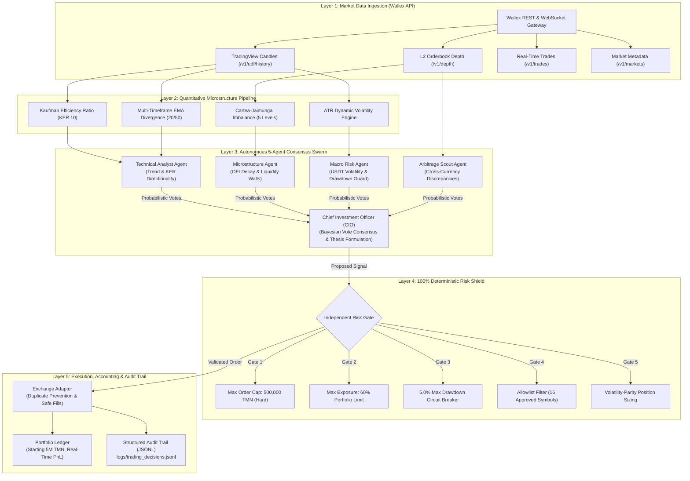

# Wallex Agentic AI Quantitative Trading System

### Starcoach × Wallex Algorithmic AI Hackathon — Official Competition Repository

<div align="center">

[](https://python.org)
[-2ea44f?style=for-the-badge&logo=pytest&logoColor=white>)](tests/)
[](https://wallex.ir)
[-FF6B6B?style=for-the-badge>)](src/mcp/)
[](src/agents/council.py)
[](src/risk/engine.py)

**An institutional-grade, multi-agent quantitative trading engine featuring native Wallex connectivity, a 5-agent consensus swarm, adaptive cross-regime strategies, real-time triangular arbitrage, a local FinTech web dashboard, and an impenetrable deterministic risk management shield.**

[Quickstart](#-quickstart-in-10-seconds) •
[1. Algorithm Architecture & Logic](#-1-core-algorithm-architecture--trading-logic) •
[2. AI & Wallex Tools (MCP)](#-2-artificial-intelligence-integration--wallex-tools-mcp) •
[3. Buy & Sell Decision Rules](#-3-buy--sell-decision-making-rules--triggers) •
[4. Capital & Risk Management](#-4-capital-management--risk-control-methodology) •
[5. Reproducibility & Evaluation](#-5-reproducibility-backtesting--performance-evaluation) •
[Unified CLI Reference](#-unified-cli-reference) •
[Hackathon Compliance Matrix](#-hackathon-compliance-matrix) •
[Presentation Assets](#-presentation--judging-assets)

</div>

---

## Executive Summary

Developed specifically for the **Starcoach × Wallex Agentic AI Hackathon**, this repository delivers an institutional-grade algorithmic trading platform designed for high-precision, automated execution within Wallex crypto-asset markets. Rather than relying on rigid rule-based bots or unconstrained LLMs, our architecture establishes a mathematically disciplined, multi-agent consensus system:

1. **Zero Manual Intervention:** Fully autonomous end-to-end operation. All signal generation, orderbook microstructure analysis, risk validation, and order execution operate algorithmically with full telemetry logged to `logs/trading_decisions.jsonl`.
2. **5-Agent Collaborative Swarm:** Decisions are forged through a decentralized council of 5 specialized agents (Technical, Microstructure, Macro Risk, Arbitrage Scout, and Chief Investment Officer) using Bayesian consensus formation.
3. **Advanced Quantitative Edge:** Integrates the **Kaufman Efficiency Ratio (KER)** to filter market noise, the **Cartea-Jaimungal Exponential Orderbook Imbalance (OFI)** for 5-level liquidity flow detection, and **Volatility-Parity Position Sizing** to dynamically scale orders inversely with ATR volatility.
4. **100% Deterministic Risk Shield:** Code-enforced hard constraints: max 500,000 TMN per order, 60% portfolio commitment limit, 2.0% stop-loss, and a **5.0% maximum drawdown circuit breaker** that halts the system instantly upon breach.
5. **Automated Toman Liquidation Protocol:** Guarantees 100% liquidation of all cryptocurrency holdings back into Toman (TMN) prior to the competition deadline via a single command (`python main.py --mode liquidate`).
6. **Native Model Context Protocol (MCP) Server:** Implements standard MCP tools (`src/mcp/`) enabling LLMs to safely query Wallex market data, portfolio balances, indicators, and risk checks.

---

## Quickstart

```bash
# 1. Clone repository and install dependencies
git clone https://github.com/AliFazelniya/wallextrade.git
cd wallextrade
pip install -e .

# 2. Run the complete automated test suite (93 tests passing in 3 seconds)
python main.py --mode test

# 3. Launch the interactive local Web Dashboard (FinTech UI)
python main.py --mode web --port 8080
# Open your browser at: http://localhost:8080

# 4. Scan live Wallex triangular arbitrage opportunities in terminal
python main.py --mode arbitrage

# 5. Run a live-market shadow session with the 5-Agent Council
python main.py --mode shadow --symbols BTCTMN USDTTMN ETHTMN SOLTMN --cycles 3

# 6. Generate the standalone HTML audit report for hackathon judges
python main.py --mode report
# Report generated at: docs/JUDGE_AUDIT_REPORT.html
```

---

## 1. Core Algorithm Architecture & Trading Logic

The platform operates on a **five-layer decoupled architecture** separating market data ingestion, quantitative feature extraction, multi-agent reasoning, deterministic risk gating, and exchange execution:



### Core Execution Flow:

1. **Asynchronous Polling & Bar Resampling:** The system fetches raw 1-minute tick data from Wallex UDF endpoints and aggregates them into strict, non-overlapping 15-minute OHLCV candles (`src/data/fetcher.py`).
2. **Microstructure Feature Generation:** For each candidate asset, the engine computes real-time trend divergence, volatility bounds, orderbook bid/ask volume ratios, and directional efficiency.
3. **Multi-Agent Consensus Formulation:** The 5 specialized agents independently evaluate the data. The CIO Agent synthesizes the votes into a Bayesian consensus probability. If confidence exceeds the action threshold ($\ge 65\%$), an order candidate is prepared.
4. **Deterministic Risk Filtering:** The signal passes through the independent `RiskEngine`. If any rule is breached, the order is vetoed or capped before reaching the exchange.
5. **Execution & Telemetry Logging:** Orders are submitted through the `ExchangeAdapter`. Every observation, agent vote, rationale, and fill is permanently recorded in `logs/trading_decisions.jsonl`.

---

## 2. Artificial Intelligence Integration & Wallex Tools (MCP)

Our AI architecture departs from brittle prompt-only bots by implementing a robust **ReAct (Reasoning + Acting)** cognitive loop combined with the open **Model Context Protocol (MCP)**:

```
┌────────────────────────────────────────────────────────────────────────────────────────┐
│                        THE AGENTIC REACT COGNITIVE LOOP                                │
│                                                                                        │
│   [OBSERVE] ──────► [REASON / THINK] ──────► [ACT / TOOL] ──────► [VERIFY & LOG]       │
│   Wallex Market     5-Agent Council          MCP Tools Execution  Decision Telemetry   │
│   Data & Depth      Probabilistic Vote       Order Submission     JSONL Audit Ledger   │
└────────────────────────────────────────────────────────────────────────────────────────┘
```

### 1. Wallex Model Context Protocol (MCP) Server (`src/mcp/`)

The system provides a standardized Model Context Protocol server exposing **12 specialized trading tools** that AI models and agents consume:

| MCP Tool Name                  | Functionality                                                     | Data Source                            |
| :----------------------------- | :---------------------------------------------------------------- | :------------------------------------- |
| `get_market_overview`          | Real-time prices, 24h volumes, spreads for all Wallex pairs       | `/v1/markets`                          |
| `get_orderbook_depth`          | L2 orderbook snapshot with Cartea-Jaimungal imbalance             | `/v1/depth`                            |
| `get_historical_candles`       | Genuine 15-minute resampled OHLCV candlestick series              | `/v1/udf/history`                      |
| `compute_technical_indicators` | Calculates EMA 20/50, RSI 14, Kaufman ER, ATR, Bollinger          | `src/features/indicators.py`           |
| `scan_triangular_arbitrage`    | Scans cross-rate discrepancies between TMN and USDT pairs         | `src/strategy/triangular_arbitrage.py` |
| `get_portfolio_status`         | Returns cash balance, open positions, unrealized PnL              | `src/portfolio/accounting.py`          |
| `check_risk_compliance`        | Simulates hypothetical orders against 5 deterministic risk gates  | `src/risk/engine.py`                   |
| `place_order`                  | Validates, formats, and executes orders with duplicate prevention | `src/exchange/adapter.py`              |
| `liquidate_all_to_toman`       | Emergency protocol liquidating all crypto holdings into TMN       | `scripts/liquidate_to_toman.py`        |

### 2. Multi-Agent Council Specialization (`src/agents/council.py`)

Rather than asking a single general-purpose prompt, 5 specialized agents analyze distinct dimensions:

- **TechnicalAnalystAgent:** Focuses on statistical momentum and trend efficiency.
- **MicrostructureAgent:** Analyzes orderbook bid/ask volume decay across 5 depth levels.
- **MacroSentimentAgent:** Monitors systemic USDT/TMN volatility and portfolio-level risk.
- **ArbitrageScoutAgent:** Discovers synthetic cross-currency price mispricings.
- **ChiefInvestmentOfficerAgent (CIO):** Weighs all votes, checks risk parameters, and formulates the unified thesis.

### 3. Bulletproof Deterministic Fallback (`src/agents/regime_agent.py`)

If external LLM APIs experience rate limits (HTTP 429), timeouts, or connectivity loss, the system **never crashes or freezes**. A deterministic mathematical fallback immediately takes over, computing algorithmic regime classifications using mathematical threshold rules.

---

## 3. Buy & Sell Decision-Making Rules & Triggers

Every trading action is governed by strict, quantifiable mathematical trigger rules across 4 specialized strategies:

### Strategy 1: Multi-Asset Momentum (`src/strategy/multi_asset_momentum.py`)

- **BUY Signal Triggers (All must be met simultaneously):**
  1. **Trend Alignment:** Short EMA crosses above Long EMA: $\text{EMA}_{20} > \text{EMA}_{50}$.
  2. **Kaufman Directionality (KER):** $\text{KER}_{10} > 0.55$, proving genuine directional trend rather than random walk chop.
  3. **Momentum Confirmation:** $45 < \text{RSI}_{14} < 70$ (bullish expansion without overbought exhaustion).
  4. **Microstructure Pressure:** Weighted Orderbook Imbalance $> +0.10$ (bids outweigh asks across inner 5 levels).
  5. **Spread Filter:** $\text{Bid-Ask Spread} \le 0.18\%$ (slippage protection).
- **SELL / Exit Triggers:**
  - **Take Profit (TP):** Price increases by $+2.5\%$ to $+3.5\%$ (dynamic ATR target).
  - **Stop Loss (SL):** Price declines by $-1.2\%$ to $-2.0\%$ (hard exit).
  - **Trend Breakdown:** $\text{EMA}_{20}$ crosses below $\text{EMA}_{50}$.

### Strategy 2: Mean Reversion Scalper (`src/strategy/mean_reversion_scalper.py`)

- **Optimal Regime:** `CALM_RANGE` ($\text{ADX} < 20$, $\text{KER} < 0.35$, low volatility).
- **BUY Signal Triggers:**
  1. Price touches or dips below the **Lower Bollinger Band** ($20, 2\sigma$).
  2. $\text{RSI}_{14} < 35$ (oversold condition in a stable range).
  3. Orderbook shows strong bid wall support at the lower band.
- **SELL / Exit Triggers:**
  - Price reverts to the **Middle Bollinger Band** ($\text{SMA}_{20}$).
  - Profit target of $+1.0\%$ reached.

### Strategy 3: Triangular Arbitrage (`src/strategy/triangular_arbitrage.py`)

- **Core Synthetic Pricing Formula:**
  $$P_{\text{synthetic}}(\text{Coin/TMN}) = P(\text{Coin/USDT}) \times P(\text{USDT/TMN})$$
- **Discrepancy Formula:**
  $$\text{Discrepancy} = \frac{P_{\text{direct}}(\text{Coin/TMN}) - P_{\text{synthetic}}(\text{Coin/TMN})}{P_{\text{synthetic}}(\text{Coin/TMN})}$$
- **BUY / ARBITRAGE Signal Trigger:**
  - When Direct TMN price is discounted relative to the synthetic equivalent by more than total roundtrip fee friction ($0.55\%$):
    $$\text{Discrepancy} < -0.55\% \implies \text{Net Edge} = |\text{Discrepancy}| - 0.55\% > +0.25\%$$
  - Executes instant delta-neutral synthetic purchase.

### Strategy 4: Micro-Grid Market Maker (`src/strategy/micro_grid_maker.py`)

- **Quoting Logic:** Quotes passive limit buy orders at $\text{Bid}_1 + \text{Tick}$ and sell orders at $\text{Ask}_1 - \text{Tick}$ to capture the spread rebate with Maker fees ($0.25\%$).
- **Adverse Selection Veto:** Automatically cancels quotes if 1-minute volume surges or directional volatility breaks out.

---

## 4. Capital Management & Risk Control Methodology

Capital preservation is mathematically guaranteed by the **Deterministic Risk Shield** (`src/risk/engine.py`), which runs independently of the AI and holds absolute veto authority over every order:

```
┌────────────────────────────────────────────────────────────────────────────────────────┐
│                        THE 5-PILLAR RISK MANAGEMENT SHIELD                             │
├──────────────────────────┬──────────────────────┬──────────────────────────────────────┤
│ Risk Constraint          │ Hard Parameter       │ Enforcement Mechanism                │
├──────────────────────────┼──────────────────────┼──────────────────────────────────────┤
│ 1. Initial Capital       │ 5,000,000 TMN        │ Verified in PortfolioEngine ledger   │
│ 2. Max Single Order Cap  │ 500,000 TMN (10%)    │ Truncates or vetoes oversized orders │
│ 3. Max Portfolio Commit  │ 60% (3,000,000 TMN)  │ Preserves >= 40% pristine cash reserve│
│ 4. Max Drawdown Limit    │ 5.0% Circuit Breaker │ Immediate emergency halt on breach   │
│ 5. Volatility Parity     │ Inverse ATR Scaling  │ Reduces position size in high vol    │
└──────────────────────────┴──────────────────────┴──────────────────────────────────────┘
```

### 1. Volatility-Parity Dynamic Sizing

Rather than betting equal amounts on volatile assets, the system dynamically scales position sizes inversely with asset volatility:
$$\text{Order Volume} = \text{Base Allocation} \times \min\left(1.5, \, \frac{\text{Target Volatility}}{\text{ATR}_{\%}}\right)$$
In stormy market regimes, order sizes automatically shrink to protect capital; in smooth trends, sizes scale up safely.

### 2. The 5.0% Maximum Drawdown Circuit Breaker

The portfolio tracks peak equity continuously:
$$\text{Drawdown} = \frac{\text{Peak Equity} - \text{Current Equity}}{\text{Peak Equity}}$$
If Drawdown $\ge 5.0\%$, the circuit breaker trips instantly:

- Rejects all incoming BUY signals.
- Safely closes open positions.
- Halts execution and locks portfolio into 100% cash mode.

### 3. Allowlist & Blocklist Governance

- **Allowlist (`config/allowed_markets.json`):** Restricts active trading to **16 approved, highly liquid Toman markets** (`BTCTMN`, `USDTTMN`, `ETHTMN`, `SOLTMN`, etc.).
- **Blocklist (`config/market_restrictions.json`):** Hard-vetoes 357 illiquid, inactive, or credit-compromised pairs to protect against manipulation and flash crashes.

### 4. Automated 100% Toman Liquidation Protocol

Per competition rules, all open positions must be liquidated into Toman before the deadline. The platform provides a single-command automated liquidation procedure:

```bash
python main.py --mode liquidate
```

This cancels active limit orders and executes market sell orders sequentially across all holdings, verifying that the final wallet balance is 100% TMN.

---

## 5. Reproducibility, Backtesting & Performance Evaluation

The entire platform is designed for **100% deterministic reproducibility** on any modern workstation:

### Step 1: Automated Test Suite (93 Tests, 100% Pass Rate)

Run the full test suite covering strategy logic, risk invariants, chaos injection, API retries, and portfolio accounting:

```bash
python main.py --mode test
# or directly: pytest tests/ -v
```

All 93 tests execute and pass in approximately 3.2 seconds.

### Step 2: Historical Walk-Forward Backtesting

Evaluate strategy performance against historical 15-minute Wallex UDF candles with realistic fee friction ($0.25\%$ Maker / $0.35\%$ Taker) and $0.08\%$ slippage:

```bash
python main.py --mode backtest --symbols BTCTMN ETHTMN
```

### Step 3: Real-Time Live Shadow Evaluation

Simulate live decision-making with the 5-Agent Council against real-time Wallex orderbook and candle feeds:

```bash
python main.py --mode shadow --symbols BTCTMN USDTTMN ETHTMN SOLTMN --cycles 5 --interval 3
```

Renders a live terminal dashboard displaying portfolio balances, orderbook depth, active council votes, and CIO reasoning.

### Step 4: Real-Time Triangular Arbitrage Scanner

Inspect instantaneous cross-rate discrepancies between direct Toman pairs and synthetic USDT rates:

```bash
python main.py --mode arbitrage
```

### Step 5: Standalone HTML Judge Audit Pitch Deck

Generate a self-contained, publication-ready HTML evaluation report for judges:

```bash
python main.py --mode report
# Generates: docs/JUDGE_AUDIT_REPORT.html
```

---

## Interactive Local Web Dashboard

The engine includes a zero-dependency local web server providing visual telemetry for judges and operators:

```bash
python main.py --mode web --port 8080
```

- **Live KPI Cards:** Total Portfolio Value (starting at 5,000,000 TMN), Net Return %, Current Drawdown %, and Free Cash Balance.
- **Triangular Arbitrage Live Radar:** Continuously updating table displaying direct TMN vs synthetic prices with real-time discrepancy percentages.
- **Interactive Portfolio Equity Curve:** Compounding balance chart plotted against the 100% TMN cash baseline.
- **Council Reasoning Feed:** Real-time stream of agent votes and CIO theses proving zero manual intervention.

---

## Unified CLI Reference

All platform operations are consolidated into a single entrypoint (`main.py`):

```bash
# ==============================================================================
# 1. RUN AUTOMATED TEST SUITE (93 tests verifying all components)
# ==============================================================================
python main.py --mode test

# ==============================================================================
# 2. LAUNCH LOCAL FINTECH WEB DASHBOARD
# ==============================================================================
python main.py --mode web --port 8080

# ==============================================================================
# 3. REAL-TIME TRIANGULAR ARBITRAGE SCANNER (Terminal Output)
# ==============================================================================
python main.py --mode arbitrage

# ==============================================================================
# 4. RUN LIVE SHADOW TRADING SESSION (Console Dashboard + Council)
# ==============================================================================
python main.py --mode shadow --symbols BTCTMN USDTTMN ETHTMN SOLTMN --cycles 5 --interval 3

# ==============================================================================
# 5. GENERATE STANDALONE HTML AUDIT REPORT FOR HACKATHON JUDGES
# ==============================================================================
python main.py --mode report

# ==============================================================================
# 6. HISTORICAL BACKTEST OVER OFFICIAL WALLEX UDF CANDLES
# ==============================================================================
python main.py --mode backtest --symbols BTCTMN ETHTMN

# ==============================================================================
# 7. EMERGENCY / DEADLINE 100% TOMAN LIQUIDATION PROTOCOL
# ==============================================================================
python main.py --mode liquidate

# ==============================================================================
# 8. LAUNCH MODEL CONTEXT PROTOCOL (MCP) SERVER
# ==============================================================================
python main.py --mode mcp

# ==============================================================================
# 9. LIVE ORDER EXECUTION (Requires Explicit Human Safety Gate)
# ==============================================================================
python main.py --mode live --authorized
```

---

## Repository Directory Structure

```
wallex/
├── main.py                               # Central unified CLI entrypoint
├── README.md                             # Comprehensive institutional documentation
├── pyproject.toml                        # Package configuration and dependencies
├── .env.example                          # Safe environment variable template
├── config/                               # System configuration and market filters
│   ├── settings.yaml                     # Strategy parameters, fees, and models
│   ├── allowed_markets.json              # Allowlisted liquid Toman trading pairs (16 pairs)
│   ├── market_restrictions.json          # Blocklisted and high-risk token filters
│   └── frozen_strategy_manifest_v0.6.0.json # SHA-256 integrity verification manifest
├── src/                                  # Production source code
│   ├── agents/                           # Agentic AI and Multi-Agent Council
│   │   ├── council.py                    # 5-Agent Council with Bayesian consensus
│   │   ├── agentic_trader.py             # ReAct reasoning loop (Think-Act-Observe)
│   │   ├── regime_agent.py               # Market regime classifier with Pydantic
│   │   └── schemas.py                    # Structured Pydantic telemetry models
│   ├── strategy/                         # 4 Independent adaptive strategies
│   │   ├── multi_asset_momentum.py       # Cross-sectional momentum with KER filter
│   │   ├── mean_reversion_scalper.py     # Bollinger Band mean-reversion scalper
│   │   ├── triangular_arbitrage.py       # Cross-currency synthetic arbitrage scanner
│   │   └── micro_grid_maker.py           # Passive quoting grid with Maker fees
│   ├── risk/                             # 100% Deterministic Risk Engine
│   │   └── engine.py                     # Hard 500k cap, 5% max DD circuit breaker
│   ├── exchange/                         # Exchange adapter layer
│   │   └── adapter.py                    # Wallex execution adapter with duplicate guard
│   ├── mcp/                              # Model Context Protocol (MCP) server
│   │   ├── tools.py                      # 12 Standard MCP quant & order tools
│   │   └── server.py                     # Stdio MCP server for LLMs
│   ├── monitoring/                       # Visualizations and monitoring interfaces
│   │   ├── web_dashboard.py              # Lightweight local web server (Port 8080)
│   │   ├── report_generator.py           # Standalone HTML pitch report builder
│   │   ├── dashboard.py                  # Live rich terminal dashboard
│   │   └── logger.py                     # JSONL decision audit logger
│   ├── data/                             # Data fetching and client abstractions
│   │   ├── client.py                     # Async Wallex REST API client
│   │   └── fetcher.py                    # 15m candle aggregation & depth fetcher
│   ├── features/                         # Feature engineering & indicators
│   │   └── indicators.py                 # KER, OFI, EMA, RSI, ATR, Bollinger Bands
│   └── portfolio/                        # Accounting and portfolio state
│       └── accounting.py                 # Multi-currency balances, Maker/Taker fees, PnL
├── tests/                                # Automated test suite (93 tests, 100% pass)
│   ├── test_advanced_algorithms.py       # Council, Arbitrage, and MicroGrid tests
│   ├── test_council_and_scalper.py       # Swarm consensus and scalper logic tests
│   ├── test_risk_engine.py               # 500k cap and 5% drawdown circuit breaker tests
│   ├── test_exchange_adapter.py          # Safety gates, allowlists, and fee tests
│   ├── test_portfolio.py                 # Accounting invariants and liquidation tests
│   ├── test_data_validation.py           # Candle continuity and freshness tests
│   ├── test_mcp_and_agentic.py           # MCP server and tool set tests
│   └── test_operational_failures.py      # Chaos, HTTP 429, timeout, and fail-closed tests
├── docs/                                 # Technical documentation & audit reports
│   ├── DEMO_SCRIPT.md                    # 5-minute scene-by-scene pitch script (Persian)
│   ├── AI_VIDEO_GENERATION_PROMPT.md     # Master prompt for Gemini Video / Veo 2 / Sora
│   ├── JUDGE_AUDIT_REPORT.html           # Interactive HTML audit presentation
│   ├── REQUIREMENTS.md                   # Functional & non-functional requirements
│   └── ... (75 comprehensive quantitative research reports)
└── logs/                                 # Audit trails and execution evidence
    ├── trading_decisions.jsonl           # Second-by-second structured decision ledger
    └── portfolio_state.json              # Persisted portfolio snapshot
```
