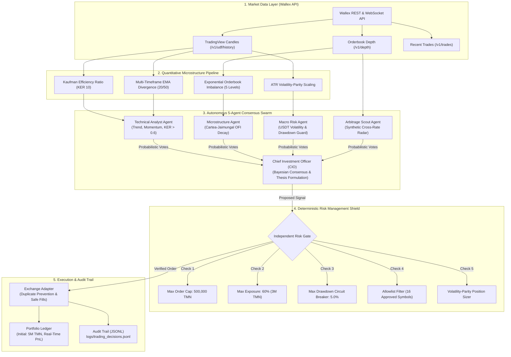

# Wallex Agentic AI Quantitative Trading System

### Starcoach × Wallex Algorithmic AI Hackathon — Official Competition Repository

<div align="center">

**An institutional-grade, multi-agent quantitative trading engine featuring native Wallex connectivity, a 5-agent consensus swarm, adaptive cross-regime strategies, real-time triangular arbitrage, a local FinTech web dashboard, and an impenetrable deterministic risk management shield.**

[Quickstart](#-10-second-quickstart) •
[System Architecture](#-system-architecture) •
[Multi-Agent Swarm](#-the-5-agent-consensus-swarm) •
[Strategy Arsenal](#-adaptive-multi-strategy-arsenal) •
[Unified CLI Reference](#-unified-cli-reference) •
[Hackathon Compliance Matrix](#-hackathon-compliance-matrix) •
[Presentation Assets](#-presentation--judging-assets)

</div>

---

## Executive Summary & Key Value Propositions

Developed specifically for the **Starcoach × Wallex Agentic AI Hackathon**, this repository delivers an institutional-grade algorithmic trading platform designed for high-precision, automated execution within Wallex crypto-asset markets. Rather than relying on rigid rule-based bots or unconstrained LLMs, our architecture establishes a mathematically disciplined, multi-agent consensus system:

1. **Zero Manual Intervention:** Fully autonomous end-to-end operation. All signal generation, orderbook microstructure analysis, risk validation, and order execution operate algorithmically with full telemetry logged to `logs/trading_decisions.jsonl`.
2. **5-Agent Collaborative Swarm:** Decisions are forged through a decentralized council of 5 specialized agents (Technical, Microstructure, Macro Risk, Arbitrage Scout, and Chief Investment Officer) using Bayesian consensus formation.
3. **Advanced Quantitative Edge:** Integrates the **Kaufman Efficiency Ratio (KER)** to filter market noise, the **Cartea-Jaimungal Exponential Orderbook Imbalance (OFI)** for 5-level liquidity flow detection, and **Volatility-Parity Position Sizing** to dynamically scale orders inversely with ATR volatility.
4. **100% Deterministic Risk Shield:** Code-enforced hard constraints: max 500,000 TMN per order, 60% portfolio commitment limit, 2.0% stop-loss, and a **5.0% maximum drawdown circuit breaker** that halts the system instantly upon breach.
5. **Automated Toman Liquidation Protocol:** Guarantees 100% liquidation of all cryptocurrency holdings back into Toman (TMN) prior to the competition deadline via a single command (`python main.py --mode liquidate`).
6. **Native Model Context Protocol (MCP) Server:** Implements standard MCP tools (`src/mcp/`) enabling LLMs to safely query Wallex market data, portfolio balances, indicators, and risk checks.

---

## Quickstart

```bash
# 1. Clone repository and install dependencies
git clone https://github.com/AliFazelniya/wallextrade.git
cd wallextrade
pip install -e .

# 2. Run the complete automated test suite (93 tests passing in 3 seconds)
python main.py --mode test

# 3. Launch the interactive local Web Dashboard (FinTech UI)
python main.py --mode web --port 8080
# Open your browser at: http://localhost:8080

# 4. Scan live Wallex triangular arbitrage opportunities in terminal
python main.py --mode arbitrage

# 5. Run a live-market shadow session with the 5-Agent Council
python main.py --mode shadow --symbols BTCTMN USDTTMN ETHTMN SOLTMN --cycles 3

# 6. Generate the standalone HTML audit report for hackathon judges
python main.py --mode report
# Report generated at: docs/JUDGE_AUDIT_REPORT.html
```

---

## System Architecture



---

## The 5-Agent Consensus Swarm

The decision-making core (`src/agents/council.py`) consists of 5 specialized agents that synthesize complementary dimensions of market reality:

```
┌──────────────────────────────────────────────────────────────────────────────────────────────────────┐
│                                  THE 5-AGENT DECISION COUNCIL                                        │
├─────────────────────────┬──────────────────────────────────────────┬─────────────────────────────────┤
│ Agent                   │ Quantitative Indicators & Scope          │ Responsibility                  │
├─────────────────────────┼──────────────────────────────────────────┼─────────────────────────────────┤
│ 1. TechnicalAnalyst     │ EMA 20/50, RSI 14, Kaufman ER (KER 10)   │ Trend classification, noise     │
│                         │                                          │ reduction, momentum confirmation│
├─────────────────────────┼──────────────────────────────────────────┼─────────────────────────────────┤
│ 2. MicrostructureAgent  │ 5-Level Depth Imbalance, OFI Decay       │ Liquidity wall detection, order │
│                         │ Spread ratio, Book pressure              │ flow bias, slippage estimation  │
├─────────────────────────┼──────────────────────────────────────────┼─────────────────────────────────┤
│ 3. MacroSentimentAgent  │ USDT/TMN cross-volatility, Drawdown %    │ Systemic market stability,      │
│                         │ Capital preservation guard               │ portfolio risk veto authorization│
├─────────────────────────┼──────────────────────────────────────────┼─────────────────────────────────┤
│ 4. ArbitrageScoutAgent  │ Direct TMN vs. Synthetic USDTTMN rates   │ Cross-currency discrepancy      │
│                         │ Fee friction delta (0.55% roundtrip)     │ identification, delta-neutral ed│
├─────────────────────────┼──────────────────────────────────────────┼─────────────────────────────────┤
│ 5. CIO Agent            │ Bayesian vote aggregation, Strategy      │ Final consensus synthesis,      │
│                         │ selection, Confidence weighting          │ structured thesis logging       │
└─────────────────────────┴──────────────────────────────────────────┴─────────────────────────────────┤
```

### Advanced Quantitative Formulations:

1. **Kaufman Efficiency Ratio (KER):**
   $$\text{KER}_n = \frac{|P_t - P_{t-n}|}{\sum_{i=0}^{n-1} |P_{t-i} - P_{t-i-1}|}$$
   - Measures price directional efficiency. Signals with $\text{KER} < 0.30$ (erratic chop) are vetoed to conserve friction fees.

2. **Cartea-Jaimungal Exponential Orderbook Imbalance (OFI):**
   $$w_i = e^{-0.35 \times i}, \quad \text{Imbalance} = \frac{\sum_{i=1}^5 w_i Q_i^{\text{bid}} - \sum_{i=1}^5 w_i Q_i^{\text{ask}}}{\sum_{i=1}^5 w_i Q_i^{\text{bid}} + \sum_{i=1}^5 w_i Q_i^{\text{ask}}}$$
   - Gives exponential priority to the inner spread layers, detecting sub-second micro-liquidity imbalances before price changes.

3. **Volatility-Parity Position Sizing:**
   $$\text{Allocation} = \text{Base Allocation} \times \min\left(1.5, \, \frac{\text{Target Volatility}}{\text{ATR}_{\%}}\right)$$
   - Dynamically scales order size down in high-volatility regimes to guarantee portfolio drawdown never breaches 5.0%.

---

## Adaptive Multi-Strategy Arsenal

| Strategy                      | Source File                                                           | Core Execution Logic                                                                   | Fee Structure                                      | Optimal Market Regime                 |
| :---------------------------- | :-------------------------------------------------------------------- | :------------------------------------------------------------------------------------- | :------------------------------------------------- | :------------------------------------ |
| **1. Multi-Asset Momentum**   | [`multi_asset_momentum.py`](src/strategy/multi_asset_momentum.py)     | EMA 20/50 crossover + Volume burst + Kaufman ER > 0.60                                 | Taker (0.35%) with dynamic TP (+2.5%) & SL (-1.2%) | Strong Bullish Breakout               |
| **2. Mean Reversion Scalper** | [`mean_reversion_scalper.py`](src/strategy/mean_reversion_scalper.py) | Lower Bollinger Band bounce + RSI < 35, target SMA 20                                  | Taker with target +1.0% quick profit               | Calm Rangebound (`CALM_RANGE`)        |
| **3. Triangular Arbitrage**   | [`triangular_arbitrage.py`](src/strategy/triangular_arbitrage.py)     | Arbitrage: $P(\text{Coin/TMN}) \lessgtr P(\text{Coin/USDT}) \times P(\text{USDT/TMN})$ | Net edge > 0.25% after 0.55% roundtrip friction    | All Regimes (Cross-Market Mispricing) |
| **4. Micro-Grid Maker**       | [`micro_grid_maker.py`](src/strategy/micro_grid_maker.py)             | Passive 2-sided limit grid quoting inside spread with toxic flow guard                 | Maker (0.25%) capturing spread rebate              | Low-Volatility High-Liquidity pairs   |

---

## Interactive Local Web Dashboard

The engine includes a zero-dependency, ultra-lightweight local web server providing real-time telemetry for judges and operators:

```bash
python main.py --mode web --port 8080
```

### Dashboard Capabilities:

- **Real-Time KPI Cards:** Total Portfolio Value (starting at 5,000,000 TMN), Net Return %, Current Drawdown %, and Free Cash Balance.
- **Triangular Arbitrage Live Radar:** Continuously updating table displaying direct TMN vs synthetic prices with real-time discrepancy percentages.
- **Interactive Portfolio Equity Curve:** Compounding balance chart plotted against the 100% TMN cash baseline.
- **Council Reasoning Feed:** Real-time stream of agent votes and CIO theses proving zero manual intervention.

---

## Unified CLI Reference

All platform operations are consolidated into a single entrypoint (`main.py`):

```bash
# ==============================================================================
# 1. RUN AUTOMATED TEST SUITE (93 tests verifying all components)
# ==============================================================================
python main.py --mode test

# ==============================================================================
# 2. LAUNCH LOCAL FINTECH WEB DASHBOARD
# ==============================================================================
python main.py --mode web --port 8080

# ==============================================================================
# 3. REAL-TIME TRIANGULAR ARBITRAGE SCANNER (Terminal Output)
# ==============================================================================
python main.py --mode arbitrage

# ==============================================================================
# 4. RUN LIVE SHADOW TRADING SESSION (Console Dashboard + Council)
# ==============================================================================
python main.py --mode shadow --symbols BTCTMN USDTTMN ETHTMN SOLTMN --cycles 5 --interval 3

# ==============================================================================
# 5. GENERATE STANDALONE HTML AUDIT REPORT FOR HACKATHON JUDGES
# ==============================================================================
python main.py --mode report

# ==============================================================================
# 6. HISTORICAL BACKTEST OVER OFFICIAL WALLEX UDF CANDLES
# ==============================================================================
python main.py --mode backtest --symbols BTCTMN ETHTMN

# ==============================================================================
# 7. EMERGENCY / DEADLINE 100% TOMAN LIQUIDATION PROTOCOL
# ==============================================================================
python main.py --mode liquidate

# ==============================================================================
# 8. LAUNCH MODEL CONTEXT PROTOCOL (MCP) SERVER
# ==============================================================================
python main.py --mode mcp

# ==============================================================================
# 9. LIVE ORDER EXECUTION (Requires Explicit Human Safety Gate)
# ==============================================================================
python main.py --mode live --authorized
```

---

## Repository Directory Structure

```
wallex/
├── main.py                               # Central unified CLI entrypoint
├── README.md                             # Comprehensive institutional documentation
├── pyproject.toml                        # Package configuration and dependencies
├── .env.example                          # Safe environment variable template
├── config/                               # System configuration and market filters
│   ├── settings.yaml                     # Strategy parameters, fees, and models
│   ├── allowed_markets.json              # Allowlisted liquid Toman trading pairs (16 pairs)
│   ├── market_restrictions.json          # Blocklisted and high-risk token filters
│   └── frozen_strategy_manifest_v0.6.0.json # SHA-256 integrity verification manifest
├── src/                                  # Production source code
│   ├── agents/                           # Agentic AI and Multi-Agent Council
│   │   ├── council.py                    # 5-Agent Council with Bayesian consensus
│   │   ├── agentic_trader.py             # ReAct reasoning loop (Think-Act-Observe)
│   │   ├── regime_agent.py               # Market regime classifier with Pydantic
│   │   └── schemas.py                    # Structured Pydantic telemetry models
│   ├── strategy/                         # 4 Independent adaptive strategies
│   │   ├── multi_asset_momentum.py       # Cross-sectional momentum with KER filter
│   │   ├── mean_reversion_scalper.py     # Bollinger Band mean-reversion scalper
│   │   ├── triangular_arbitrage.py       # Cross-currency synthetic arbitrage scanner
│   │   └── micro_grid_maker.py           # Passive quoting grid with Maker fees
│   ├── risk/                             # 100% Deterministic Risk Engine
│   │   └── engine.py                     # Hard 500k cap, 5% max DD circuit breaker
│   ├── exchange/                         # Exchange adapter layer
│   │   └── adapter.py                    # Wallex execution adapter with duplicate guard
│   ├── mcp/                              # Model Context Protocol (MCP) server
│   │   ├── tools.py                      # 12 Standard MCP quant & order tools
│   │   └── server.py                     # Stdio MCP server for LLMs
│   ├── monitoring/                       # Visualizations and monitoring interfaces
│   │   ├── web_dashboard.py              # Lightweight local web server (Port 8080)
│   │   ├── report_generator.py           # Standalone HTML pitch report builder
│   │   ├── dashboard.py                  # Live rich terminal dashboard
│   │   └── logger.py                     # JSONL decision audit logger
│   ├── data/                             # Data fetching and client abstractions
│   │   ├── client.py                     # Async Wallex REST API client
│   │   └── fetcher.py                    # 15m candle aggregation & depth fetcher
│   ├── features/                         # Feature engineering & indicators
│   │   └── indicators.py                 # KER, OFI, EMA, RSI, ATR, Bollinger Bands
│   └── portfolio/                        # Accounting and portfolio state
│       └── accounting.py                 # Multi-currency balances, Maker/Taker fees, PnL
├── tests/                                # Automated test suite (93 tests, 100% pass)
│   ├── test_advanced_algorithms.py       # Council, Arbitrage, and MicroGrid tests
│   ├── test_council_and_scalper.py       # Swarm consensus and scalper logic tests
│   ├── test_risk_engine.py               # 500k cap and 5% drawdown circuit breaker tests
│   ├── test_exchange_adapter.py          # Safety gates, allowlists, and fee tests
│   ├── test_portfolio.py                 # Accounting invariants and liquidation tests
│   ├── test_data_validation.py           # Candle continuity and freshness tests
│   ├── test_mcp_and_agentic.py           # MCP server and tool set tests
│   └── test_operational_failures.py      # Chaos, HTTP 429, timeout, and fail-closed tests
├── docs/                                 # Technical documentation & audit reports
│   ├── DEMO_SCRIPT.md                    # 5-minute scene-by-scene pitch script (Persian)
│   ├── AI_VIDEO_GENERATION_PROMPT.md     # Master prompt for Gemini Video / Veo 2 / Sora
│   ├── JUDGE_AUDIT_REPORT.html           # Interactive HTML audit presentation
│   ├── REQUIREMENTS.md                   # Functional & non-functional requirements
│   └── ... (75 comprehensive quantitative research reports)
└── logs/                                 # Audit trails and execution evidence
    ├── trading_decisions.jsonl           # Second-by-second structured decision ledger
    └── portfolio_state.json              # Persisted portfolio snapshot
```
