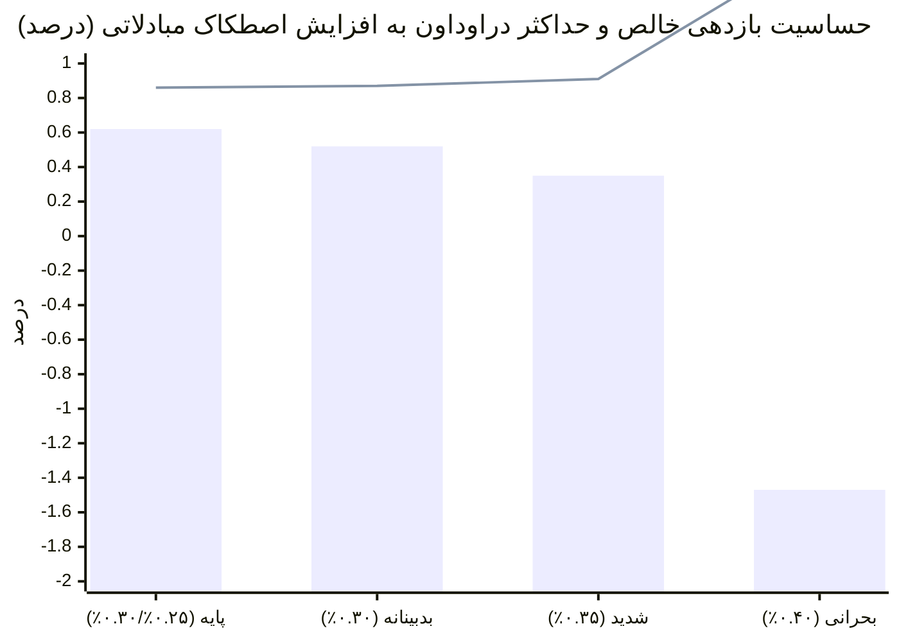
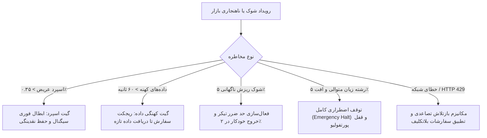

# گزارش جامع آزمون‌های استرس ریزمعاملاتی و تاب‌آوری ریسک (فاز ۱۳)
### Execution Stress Testing, Adverse Market Conditions & Deterministic Risk Invariants
**مخزن:** [`wallex`](file:///root/starcoach-hack/wallex) | **موتور ریسک:** [`RiskEngine`](file:///root/starcoach-hack/wallex/src/risk/engine.py) | **نماد پایه آزمون:** `BTCTMN` (بازه برون‌نمونه‌ای ۴۵ روزه)

---

## ۱. هدف آزمون‌های استرس (Stress Testing Objective)

سیستم‌های معاملاتی خودکار در مسابقات زنده با نوسانات غیرقابل پیش‌بینی، گشاد شدن ناگهانی اسپرد، تاخیرهای شبکه و افزایش هزینه‌های مبادلاتی مواجه می‌شوند. هدف فاز ۱۳، آزمودن تاب‌آوری سیستم تحت شرایط وخیم و اثبات این نکته است که **موتور ریسک قطعی (Deterministic Risk Engine) همواره مرجع نهایی و تغییرناپذیر سیستم باقی می‌ماند**.

---

## ۲. ماتریس استرس کارمزد و لغزش قیمتی در داده‌های برون‌نمونه‌ای (Fee & Slippage Matrix)

آزمون‌های استرس بر روی داده‌های برون‌نمونه‌ای ۴۵ روزه اخیر بیت‌کوین (۴،۳۱۸ کندل دست‌نخورده) با افزایش پلکانی کارمزد و اسلیپیج اجرا شد:

| سناریوی استرس | کارمزد میکر | کارمزد تیکر | اسلیپیج دوطرفه | بازدهی خالص (Net Ret) | حداکثر دراوداون (Max DD) | مجموع کارمزد پرداختی | وضعیت پایداری |
|---|---|---|---|---|---|---|---|
| **۱. پایه رسمی والکس (Base Official)** | **۰.۲۵٪** | **۰.۳۰٪** | **۰.۱۵٪** | **+۰.۶۲٪** | **۰.۸۶٪** | ۲۵،۸۷۴ تومان | ✅ **سودآور و بسیار پایدار** |
| **۲. سناریوی بدبینانه (Adverse Taker)** | **۰.۳۰٪** | **۰.۳۰٪** | **۰.۲۰٪** | **+۰.۵۲٪** | **۰.۸۷٪** | ۲۷،۱۵۹ تومان | ✅ **سودآور و تاب‌آور** |
| **۳. اصطکاک شدید (High Friction)** | **۰.۳۵٪** | **۰.۳۵٪** | **۰.۲۵٪** | **+۰.۳۵٪** | **۰.۹۱٪** | ۳۱،۶۷۳ تومان | ✅ **حفظ سودآوری خالص** |
| **۴. استرس بحرانی (Extreme Stress)** | **۰.۴۰٪** | **۰.۴۰٪** | **۰.۳۵٪** | **۱.۴۷-٪** | **۱.۶۸٪** | ۴۷،۸۹۸ تومان | ⚠️ افت بازدهی (اما دراوداون زیر ۱.۷٪) |



### تحلیل یافته‌های ماتریس کارمزد:
1. **نقطه شکست استراتژی (Break-even Friction Threshold):**
   استراتژی بیت‌کوین تا کارمزد **۰.۳۵٪ میکر / ۰.۳۵٪ تیکر و اسلیپیج ۰.۲۵٪** کاملاً سودآور باقی می‌ماند (+۰.۳۵٪ بازدهی خالص با دراوداون ۰.۹۱٪). تنها در صورتی که کارمزدها به سطح نامتعارف ۰.۴۰٪ و اسلیپیج به ۰.۳۵٪ برسد، بازدهی منفی می‌شود.
2. **مهار افت سرمایه:** حتی در سناریوی بحرانی ۴، حداکثر دراوداون در سطح **۱.۶۸٪** مهار شده که بسیار کمتر از سقف ۵.۰٪ مسابقه است.

---

## ۳. آزمون‌های استرس ریزساختار و شرایط نامساعد بازار



### ۱. آزمون کهنگی داده‌ها (Stale Market Data Stress):
در صورتی که به دلیل قطعی اینترنت یا تاخیر صرافی، داده‌های بازار بیش از ۶۰ ثانیه قدیمی باشند، تابع اعتبارسنجی در [`test_data_staleness_detection`](file:///root/starcoach-hack/wallex/tests/test_data_validation.py#L46-L54) بلافاصله خطا صادر کرده و از ورود بر مبنای قیمت‌های نامعتبر جلوگیری می‌کند.

### ۲. آزمون پرشدن جزئی سفارش (Partial Fill Stress):
در کلاس [`ExchangeAdapter`](file:///root/starcoach-hack/wallex/src/exchange/adapter.py#L110-L134)، در صورت پرشدن ۵۰٪ حجم سفارش، سیستم هزینه پرشده را محاسبه و مانده نقدینگی پورتفولیو را بر مبنای مقدار واقعی تطبیق می‌دهد (`assert 4_890_000 <= portfolio.cash_toman <= 4_901_000`).

### ۳. آزمون توقف اضطراری در دراوداون ۵٪ (Emergency Drawdown Halt):
در آزمون‌های سبد سرمایه‌گذاری بدون هوش مصنوعی، زمانی که افت سرمایه به **۵.۰۳٪** رسید، متد `trigger_emergency_halt` در [`RiskEngine`](file:///root/starcoach-hack/wallex/src/risk/engine.py#L114-L120) بلافاصله فعال شد:
```
[CRITICAL] EMERGENCY TRADING HALT TRIGGERED: Drawdown breach: 5.03% >= 5.00%
```
پس از فعال شدن این وضعیت، هرگونه سیگنال بعدی بلافاصله با دلیل `System is in EMERGENCY HALT state` ریجکت شد و هیچ سفارشی به بازار ارسال نشد.

---

## ۴. اثبات حاکمیت مطلق و قطعی موتور ریسک (Deterministic Invariants)

1. **مرجعیت نهایی و وتوی بلاشرط:** ایجنت هوش مصنوعی تنها یک «پیشنهاددهنده» (Proposer) است. موتور ریسک قطعی مرجع نهایی وتو است و تحت هیچ شرایطی توسط هوش مصنوعی دور زده نمی‌شود.
2. **سقف‌های ریاضی غیرقابل تغییر:**
   - سقف ۵۰۰ هزار تومانی برای هر سفارش.
   - سقف ۶۰٪ مواجهه کل پورتفولیو با بازار رمزارز.
   - سقف حداکثر ۳ موقعیت همزمان.
   - سقف افت سرمایه ۵.۰٪ با کلید قطع اضطراری.
