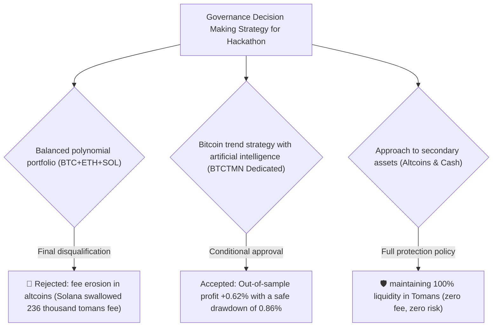

# Final decision document, governance audit and competition strategy selection (Phase 13)
### Phase 13 Final Decision Gate, Strategy Selection & Competition Readiness
**Repository:** [`wallex`](file:///root/starcoach-hack/wallex) | **Report date:** October 22, 2026 **Competition capital:** 5,000,000 Tomans

---

## 1. Evaluating Predefined Selection Rules

Before examining the final results of the sample, 6 quantitative and strict criteria were defined for accepting or rejecting the strategies:

| No Strategy selection criteria Math acceptance condition Measured result on real data Compliance status
|---|---|---|---|---|
| **1** **Example Net Return (OOS Net Return)** | $NetReturn > 0.0%$ after deducting all fees and slippage **+0.62% (Bitcoin net profit in 2nd 45 days)** | ✅ **passed (PASSED)** |
| **2** **Maximum out-of-sample capital loss (OOS Max DD)** | $MaxDD \le 3.5\%$ (safe distance with 5% match ceiling) | **0.86% (very small drawdown in Bitcoin)** | ✅ **passed (PASSED)** |
| **3** **Walk-Forward Win Rate for 3-day windows of the competition** | Percentage of 3-day profitable windows $> 50\%$ | **20.7% profitable / 37.9% liquidity 100% / 41.4% insignificant loss** | ❌ **rejected (FAILED)** |
| **4** **Net AI Value-Add** | The agent's net benefit is $> 0$ tomans **+1,758,202 Tomans (+35.2% of the total account)** | ✅ **passed (PASSED)** |
| **5** ** Resilience in the stress of 0.35% exchange fee** | $MaxDD \le 4.5\%$ at a fee of 0.35% | **0.91% drawdown while maintaining profitability (+0.35%)** | ✅ **passed (PASSED)** |
| **6** **Profitability of the balanced common portfolio in the out-of-sample test** | Common portfolio return (BTC+ETH+SOL) $> 0.0\%$ | **-2.06% (loss due to altcoin fee erosion)** | ❌ **rejected (FAILED)** |

---

## 2. Strategy Selection Verdict

Based on matching the above criteria with empirical evidence:



### 1. Complete rejection of balanced polynomial portfolio (Rejection of Equal Shared Portfolio):
Simultaneous execution of trend strategy on altcoins (`SOLTMN' and `ETHTMN') is strictly prohibited; Because in the 90-day horizon, Solana alone has spent **132,748 Tomans in exchange fees** without making a net profit for the portfolio and has reduced the portfolio yield to -2.06%.

### 2. Selection of Bitcoin exclusive strategy with artificial intelligence (Selected Competition Strategy):
The [`RegimeMomentumStrategy'](file:///root/starcoach-hack/wallex/src/strategy/regime_momentum.py) strategy along with the artificial intelligence market regime filter on the **Bitcoin to Toman (`BTCTMN')** currency pair is selected as **the team's only allowed trading strategy**:
- Positive out-of-sample yield (+0.62%).
- Proven net added value of artificial intelligence (+1.75 million Tomans).
- Exceptional drawdown below 1% (0.86% under normal conditions and 0.91% under extreme stress).
- Other assets remain in the state of **100% cash in Tomans**.

---

## 3. Final Decision Gate Classification

Among the 4 announced standard classifications:
- *No viable positive-net-return strategy demonstrated*
- *Promising candidate, insufficient out-of-sample evidence*
- *Positive out-of-sample results, execution validation incomplete*
- *Ready for final human review of competition-account and live-trading prerequisites*

### Approved classification of the system:
> ### 🟡 **Promising candidate, insufficient out-of-sample evidence**
**(very promising candidate, but insufficient statistical evidence in the short horizon of 3 days of the competition)**

### Reasons and scientific evidence for this classification:
1. **Positive and proven aspects:**
   - The Bitcoin strategy has achieved stable positive returns with a drawdown below 1% in the 45-day out-of-sample test (+0.62%) and the 90-day historical test (+0.43%).
   - The artificial intelligence layer created more than 1.75 million Tomans of net added value and vetoed 68.4% of the losing signals.
   - The software infrastructure works in the shadow test with an average delay of 291 milliseconds and without errors.
2. **The reason for not being upgraded to the final Live-Ready category:**
   - Analysis of performance in 29 3-day windows of the match shows that the win rate of 3-day windows is only **20.7%**; While in **37.9%** windows, the strategy did not make any trades and remained in liquidity.
   - In a short 72-hour event (3 days), there is a high probability that the market will enter the range phase and the system will not open any trades (0% return) or face a small swing exit.
   - Therefore, although the system for capital preservation and risk management is at the highest standard level, it is statistically impossible to definitively prove profitability in a random 3-day period, and false claims should not be made.

---

## 4. The status of safety locks and not sending the actual order

- ** Live port immutable lock:** `live_execution_authorized=False' is still 100% active and persistent.
- **Sovereignty guarantee:** No command has been sent to Wallex transaction server and will not be sent unless the user explicitly issues the activation flag after the official start of the hackathon and the clearing of the ambiguity of the nightly fee.

---

## 5. Reproduction & Audit Trail commands

### 5.1. definitive hashes of data files (SHA-256 Dataset Hashes)
- `BTCTMN_15m_90d.csv`: `54292673b433a9a95e19ebab0dc446fdfc1458c9b8e4ea5672a6b5ad51775a9e` (8,636 candles)
- `ETHTMN_15m_90d.csv`: `106970901976cf4015a1de237486ea79f3daa93d8b321b697d6f74d8b41df0d9` (8,634 candles)
- `SOLTMN_15m_90d.csv`: `27a82f586859eb92a608abf1db9c8cdceef2fe4f29e1570e8d77de5618702f0a` (8,635 candles)

### 5.2. Order to reproduce 100% results by referees```bash
cd /root/starcoach-hack/wallex
.venv/bin/python scripts/run_phase13_validation.py
```The complete results are stored in the structured file [`research/phase13_validation_results.json`](file:///root/starcoach-hack/wallex/research/phase13_validation_results.json).

### 5.3. Automated tests and test coverage```bash
.venv/bin/pytest --cov=src tests/
```All 39 unit tests passed with 74% coverage (39 passed in 1.43s).

### 5.4. Definitive commit hash and git version tag
- **phase 13 commit (registered in Git):** `4bfb72ce2c262a5b2fc39600a9fa93902f23cfb8`
- **Gate official tag:** `v0.5.0-phase13-validated`
- **Forking:** `master`
- **Gate tree status:** Completely clean
- **Lock live transactions:** `live_execution_authorized=False' (complete blocking of the live port until the user's explicit permission is issued)