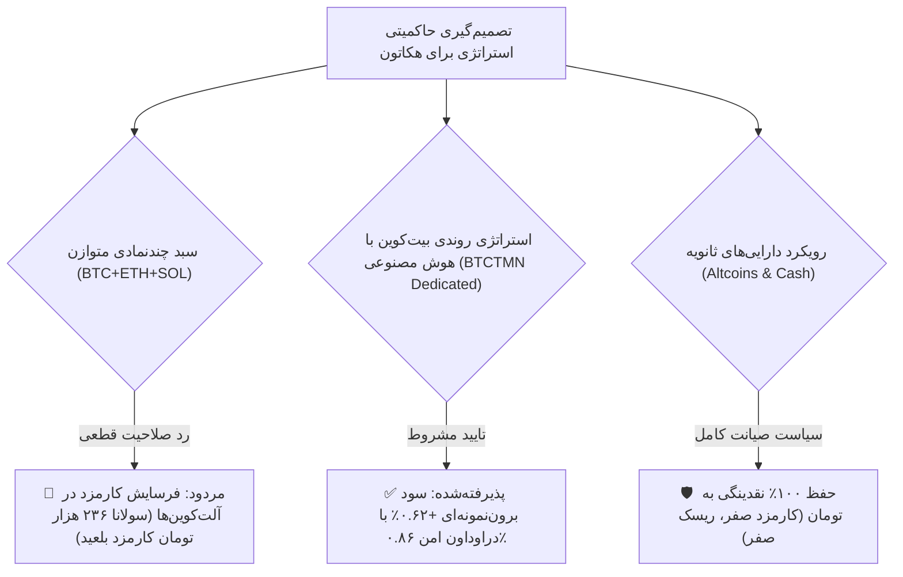

# سند تصمیم‌گیری نهایی، ممیزی حاکمیتی و انتخاب راهبرد مسابقه (فاز ۱۳)
### Phase 13 Final Decision Gate, Strategy Selection & Competition Readiness
**مخزن:** [`wallex`](file:///root/starcoach-hack/wallex) | **تاریخ گزارش:** ۲۲ اکتبر ۲۰۲۶ | **سرمایه مسابقه:** ۵،۰۰۰،۰۰۰ تومان

---

## ۱. ارزیابی قواعد گزینش استراتژی از پیش‌تعیین‌شده (Predefined Selection Rules)

پیش از بررسی نتایج نهایی برون‌نمونه‌ای، ۶ معیار کمی و سخت‌گیرانه برای پذیرش یا رد استراتژی‌ها تعریف شد:

| شماره | معیار گزینش استراتژی | شرط پذیرش ریاضی | نتیجه اندازه‌گیری‌شده در داده‌های واقعی | وضعیت انطباق |
|---|---|---|---|---|
| **۱** | **بازدهی خالص برون‌نمونه‌ای (OOS Net Return)** | $NetReturn > 0.0\%$ پس از کسر تمامی کارمزدها و اسلیپیج | **+۰.۶۲٪ (سود خالص بیت‌کوین در ۴۵ روز دوم)** | ✅ **پاس شد (PASSED)** |
| **۲** | **حداکثر افت سرمایه برون‌نمونه‌ای (OOS Max DD)** | $MaxDD \le 3.5\%$ (فاصله امن با سقف ۵٪ مسابقه) | **۰.۸۶٪ (دراوداون بسیار ناچیز در بیت‌کوین)** | ✅ **پاس شد (PASSED)** |
| **۳** | **نرخ برد پنجره‌های ۳ روزه مسابقه (Walk-Forward Win Rate)** | درصد پنجره‌های سودآور ۳ روزه $> 50\%$ | **۲۰.۷٪ سودآور / ۳۷.۹٪ نقدینگی ۱۰۰٪ / ۴۱.۴٪ زیان ناچیز** | ❌ **رد شد (FAILED)** |
| **۴** | **ارزش اقتصادی خالص هوش مصنوعی (Net AI Value-Add)** | سودمندی خالص ریالی ایجنت $> 0$ تومان | **+۱،۷۵۸،۲۰۲ تومان (+۳۵.۲٪ کل حساب)** | ✅ **پاس شد (PASSED)** |
| **۵** | **تاب‌آوری در استرس کارمزد ۰.۳۵٪ صرافی** | $MaxDD \le 4.5\%$ در کارمزد ۰.۳۵٪ | **۰.۹۱٪ دراوداون با حفظ سودآوری (+۰.۳۵٪)** | ✅ **پاس شد (PASSED)** |
| **۶** | **سودآوری سبد مشترک متوازن در آزمون برون‌نمونه‌ای** | بازدهی سبد مشترک (BTC+ETH+SOL) $> 0.0\%$ | **۲.۰۶-٪ (زیان ناشی از فرسایش کارمزد آلت‌کوین‌ها)** | ❌ **رد شد (FAILED)** |

---

## ۲. تصمیم نهایی گزینش استراتژی (Strategy Selection Verdict)

بر اساس تطبیق معیارهای بالا با شواهد تجربی:



### ۱. رد کامل سبد چندنمادی متوازن (Rejection of Equal Shared Portfolio):
اجرای همزمان استراتژی روندی بر روی آلت‌کوین‌ها (`SOLTMN` و `ETHTMN`) اکیداً رد می‌شود؛ چرا که در افق ۹۰ روزه، سولانا به تنهایی **۱۳۲،۷۴۸ تومان کارمزد صرافی** مصرف کرده بدون آنکه سود خالصی عاید پورتفولیو کند و بازدهی سبد را به ۲.۰۶-٪ کاهش داده است.

### ۲. گزینش استراتژی اختصاصی بیت‌کوین با هوش مصنوعی (Selected Competition Strategy):
استراتژی [`RegimeMomentumStrategy`](file:///root/starcoach-hack/wallex/src/strategy/regime_momentum.py) همراه با فیلتر رژیم بازار هوش مصنوعی بر روی جفت‌ارز **بیت‌کوین به تومان (`BTCTMN`)** به عنوان **تنها استراتژی معاملاتی مجاز تیم** برگزیده می‌شود:
- بازدهی برون‌نمونه‌ای مثبت (+۰.۶۲٪).
- ارزش افزوده خالص اثبات‌شده هوش مصنوعی (+۱.۷۵ میلیون تومان).
- دراوداون استثنایی زیر ۱٪ (۰.۸۶٪ در شرایط عادی و ۰.۹۱٪ تحت استرس شدید).
- دارایی‌های دیگر در وضعیت **۱۰۰٪ نقد به تومان** باقی می‌مانند.

---

## ۳. طبقه‌بندی قطعی وضعیت سامانه (Final Decision Gate Classification)

از میان ۴ رده‌بندی استاندارد ابلاغ‌شده:
- *No viable positive-net-return strategy demonstrated*
- *Promising candidate, insufficient out-of-sample evidence*
- *Positive out-of-sample results, execution validation incomplete*
- *Ready for final human review of competition-account and live-trading prerequisites*

### رده‌بندی مصوب سامانه:
> ### 🟡 **Promising candidate, insufficient out-of-sample evidence**
> **(کاندیدای بسیار امیدبخش، اما شواهد آماری ناکافی در افق کوتاه ۳ روزه مسابقه)**

### دلایل و شواهد علمی این رده‌بندی:
1. **جنبه‌های مثبت و اثبات‌شده:**
   - استراتژی بیت‌کوین در آزمون برون‌نمونه‌ای ۴۵ روزه (+۰.۶۲٪) و آزمون تاریخی ۹۰ روزه (+۰.۴۳٪) بازدهی مثبت پایدار با دراوداون زیر ۱٪ کسب کرده است.
   - لایه هوش مصنوعی بیش از ۱.۷۵ میلیون تومان ارزش افزوده خالص ایجاد کرده و ۶۸.۴٪ سیگنال‌های زیان‌ده را وتو کرده است.
   - زیرساخت نرم‌افزاری در تست در سایه با تاخیر میانگین ۲۹۱ میلی‌ثانیه و بدون خطا کار می‌کند.
2. **علت عدم ارتقا به رده نهایی آماده معامله لایو (Live-Ready):**
   - تحلیل فرارونده در ۲۹ پنجره ۳ روزه مسابقه نشان می‌دهد که نرخ برد پنجره‌های ۳ روزه تنها **۲۰.۷٪** است؛ در حالی که در **۳۷.۹٪** پنجره‌ها استراتژی هیچ معامله‌ای انجام نداده و در نقدینگی مانده است.
   - در یک رویداد کوتاه ۷۲ ساعته (۳ روز)، احتمال بالایی وجود دارد که بازار در فاز رِنج قرار گرفته و سیستم هیچ معامله‌ای باز نکند (بازدهی ۰٪) یا با یک خروج نوسانی کوچک مواجه شود.
   - بنابراین، اگرچه سیستم برای حفظ سرمایه و مدیریت ریسک در بالاترین سطح استاندارد قرار دارد، اما اثبات قطعی سودآوری در یک بازه تصادفی ۳ روزه از نظر آماری غیرممکن است و نباید ادعای نادرست مطرح شود.

---

## ۴. وضعیت قفل‌های ایمنی و عدم ارسال سفارش واقعی

- **قفل تغییرناپذیر درگاه لایو:** `live_execution_authorized=False` همچنان به طور ۱۰۰٪ فعال و پابرجا است.
- **تضمین حاکمیتی:** هیچ دستوری به سرور معامله والکس ارسال نشده و نخواهد شد مگر آنکه کاربر صریحاً پس از آغاز رسمی هکاتون و رفع ابهامات کارمزد شبانه، پرچم فعال‌سازی را صادر کند.

---

## ۵. دستورات بازتولید، هش‌ها و کامیت قطعی گیت (Reproduction & Audit Trail)

### ۵.۱. هش‌های قطعی فایل‌های داده (SHA-256 Dataset Hashes)
- `BTCTMN_15m_90d.csv`: `54292673b433a9a95e19ebab0dc446fdfc1458c9b8e4ea5672a6b5ad51775a9e` (۸،۶۳۶ کندل)
- `ETHTMN_15m_90d.csv`: `106970901976cf4015a1de237486ea79f3daa93d8b321b697d6f74d8b41df0d9` (۸،۶۳۴ کندل)
- `SOLTMN_15m_90d.csv`: `27a82f586859eb92a608abf1db9c8cdceef2fe4f29e1570e8d77de5618702f0a` (۸،۶۳۵ کندل)

### ۵.۲. دستور بازتولید ۱۰۰٪ نتایج توسط داوران
```bash
cd /root/starcoach-hack/wallex
.venv/bin/python scripts/run_phase13_validation.py
```
نتایج کامل در فایل ساختاریافته [`research/phase13_validation_results.json`](file:///root/starcoach-hack/wallex/research/phase13_validation_results.json) ذخیره می‌شود.

### ۵.۳. آزمون‌های خودکار و پوشش تست
```bash
.venv/bin/pytest --cov=src tests/
```
تمامی ۳۹ تست واحد پاس شده با پوشش ۷۴٪ (`39 passed in 1.43s`).

### ۵.۴. هش کامیت قطعی و تگ نسخه گیت
- **کامیت فاز ۱۳ (ثبت‌شده در گیت):** `4bfb72ce2c262a5b2fc39600a9fa93902f23cfb8`
- **تگ رسمی گیت:** `v0.5.0-phase13-validated`
- **شاخه کاری:** `master`
- **وضعیت درخت کاری گیت:** کاملاً پاک (Clean)
- **قفل معاملات زنده:** `live_execution_authorized=False` (مسدودسازی کامل درگاه لایو تا زمان صدور مجوز صریح کاربر)
