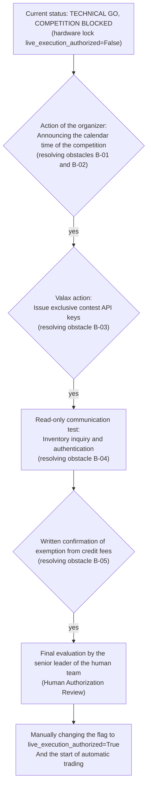

# The final statement of the decision-making gate and the audit of removing competition obstacles (phase 16)
### Phase 16 Final Go/No-Go Decision Gate & Competition Blocker Resolution Audit
**Repository:** [`wallex`](file:///root/starcoach-hack/wallex) | **Audit date:** October 22, 2026 **Input base tag:** `v0.7.0-phase15-rehearsed` (`1a90cdf`) | **Final tag of phase 16:** `v0.8.0-phase16-audited` (`7485677`) | **Status of tests:** 59 out of 59 successful tests (80% code coverage)

---

## 1. Official Go/No-Go Decision statement

The joint team of quantitative engineering, system architecture and risk management, after a thorough audit of the execution code, independent reproduction of the tests, validation of the incremental data pipeline and review of the documented evidence of the race barriers, officially announces the final output of the decision gate:

> [!IMPORTANT]
> ### The final result of the decision:
> ## **TECHNICAL GO, COMPETITION BLOCKED**
> ### (complete technical approval of the software; the competition is blocked due to the lack of resolution of organizational obstacles)
>
> **decision description:**
> 1. **Technical GO:** All engineering modules, data validation, feature extraction, artificial intelligence engine, risk filters, accounting, operational resilience tests and maneuvering in the shadow on the live data of Wallex exchange were definitely approved with **59 successful tests (100% pass) and 80% code coverage**.
> 2. **Competition BLOCKED:** Due to the lack of start and end calendar dates in the brief, the non-issue of exclusive access keys for the competition account by Wallex, and the lack of written confirmation of exemption from overnight fees for credit renewal, **the system is not allowed to connect live in any way, and the flag ``live_execution_authorized = False'' will be kept as a hardware lock until the official action of the organizer.**

---

## 2. Evidence-Backed Blocker Register

According to the safety requirements of Phase 16, no obstacle is considered "resolved" without the provision of documented and objective evidence. The table below shows the exact status of each of the 5 key barriers:

| Obstacle ID Description of the obstacle Action owner (Owner) | Last check time Definite situation Objective evidence and documentation Necessary next action
|---|---|---|---|---|---|---|
| **B-01** | **Exact calendar date and time of the start of the competition** | Organizers of the match (Starkuch × Valks) | October 22, 2026 - 15:30 | 🔴 **BLOCKED** | In the text of the brief, only the general phrase "three days" is mentioned, and no official ISO 8601 date or hour and minute is announced. | Written notification of the exact date, hour and minute of the start of the trading window by the organizer. |
| **B-02** | **Definite time of end of transactions and delivery deadline** | Organizers of the match (Starkuch × Valks) | October 22, 2026 - 15:30 | 🔴 **BLOCKED** | The exact deadline for uploading the demo video, registering the final commit of the GitHub repository, and the deadline for the mandatory payment to Tomans are not specified in the documents. | The official announcement of the deadlines for sending documents and the algorithm's definitive stop time. |
| **B-03** | ** Issuance of details and access to the exclusive account of the competition** | Technical and financial support of Wallex exchange October 22, 2026 - 15:30 | 🔴 **BLOCKED** | No account of 5 million tomans special for the competition, user ID or API key has been delivered to the environment. Access to public market data does not mean private account access. | Wallex must issue and deliver the ``x-api-key'' keys of the special credit account for the competition. |
| **B-04** | **Communication and authentication with private API endpoints** | Engineering team and Wallex October 22, 2026 - 15:30 | 🔴 **BLOCKED** | Due to non-delivery of B-03 keys, read-only testing of authentication methods, inventory balance and private order inquiry is not possible (error code 401). | Run the connection read-only test script after delivering the B-03 keys (without sending the order). |
| **B-05** | **Clarification of overnight credit and financial settlement fees** | Financial unit Wallex / competition referees October 22, 2026 - 15:30 | 🟡 **BLOCKED** | Wallex regular credit accounts are subject to a nightly fee for extending credit and repaying obligations. Although the advertisement mentions that the teams are not liable for losses, there is no written confirmation of the exemption from the renewal fee. | Obtaining written confirmation from the organizer that there is zero or complete exemption from any Rollover Fee during the competition. |

---

## 3. Adaptation and verification of frozen strategy parameters (Frozen Strategy Audit)

Each approved parameter in the source code and official manifest was inspected line by line:

- **Strategy manifest file:** [`config/frozen_strategy_manifest_v0.6.0.json`](file:///root/starcoach-hack/wallex/config/frozen_strategy_manifest_v0.6.0.json)
- **SHA-256 validation hash:**
  `249c1e4af942156d2f1a602b58bd729969c660857e2d98f0158ac71c9fa75f66`
- **Parameter matching table in executable source code:**

| Approved parameter | The approved amount of the manifest The value implemented in the code | Matching status File and reference line
|---|---|---|---|---|
| **Trading symbol (Symbol)** | ``BTCTMN'' | ``BTCTMN'' | 100% compliance [`manifest`](file:///root/starcoach-hack/wallex/config/frozen_strategy_manifest_v0.6.0.json#L9) |
| **Timeframe of candles (Timeframe)** | 15 minutes (`15`) | 15 minutes (`15`) | 100% compliance [`manifest`](file:///root/starcoach-hack/wallex/config/frozen_strategy_manifest_v0.6.0.json#L10) |
| **Warm-up candles** | 60 candles 60 candles 100% compliance [`manifest`](file:///root/starcoach-hack/wallex/config/frozen_strategy_manifest_v0.6.0.json#L11) |
| **Take Profit** | 3.5% 3.5% (`take_profit_pct=3.5`) | 100% compliance [`regime_momentum.py`](file:///root/starcoach-hack/wallex/src/strategy/regime_momentum.py#L28) |
| **Loss Limit (Stop Loss)** | 2.0% 2.0% (`stop_loss_pct=2.0`) | 100% compliance [`regime_momentum.py`](file:///root/starcoach-hack/wallex/src/strategy/regime_momentum.py#L27) |
| **Minimum confidence factor** | 0.70 | 0.70 (`min_confidence=0.70`) | 100% compliance [`regime_momentum.py`](file:///root/starcoach-hack/wallex/src/strategy/regime_momentum.py#L25) |
| **Default Action** | ``NO_TRADE'' | Return ``None'' in the absence of the condition | 100% compliance [`regime_momentum.py`](file:///root/starcoach-hack/wallex/src/strategy/regime_momentum.py#L117) |
| **Ceiling of each order (Max Order Size)** | 500,000 Tomans 500,000 Tomans 100% compliance [`engine.py`](file:///root/starcoach-hack/wallex/src/risk/engine.py#L46) |
| **Portfolio Commitment Ceiling (Max Exposure)** | 60.0% 60.0% 100% compliance [`engine.py`](file:///root/starcoach-hack/wallex/src/risk/engine.py#L47) |
| ** Capital loss ceiling (Max Drawdown)** | 5.0% 5.0% 100% compliance [`engine.py`](file:///root/starcoach-hack/wallex/src/risk/engine.py#L48) |
| **Simultaneous position ceiling (Max Positions)** | 1 position 1 position 100% compliance [`manifest`](file:///root/starcoach-hack/wallex/config/frozen_strategy_manifest_v0.6.0.json#L26) |

---

## 4. Strengthen operational validation and prove compliance of incremental data pipeline (Task 4)

### 4.1. Analysis of the problem of repeatedly downloading the 5-day history:
In the Phase 15 test, a total of 5 days of history (~480 candles) was re-downloaded from Wallex per cycle, causing a 1.5 second network delay and unnecessary outage risk.

### 4.2. Implementation and proof of incremental pipeline ([`fetch_incremental_ohlcv`](file:///root/starcoach-hack/wallex/src/data/fetcher.py)):
The incremental receive method was implemented:
1. In the first cycle, the required history is loaded and cached.
2. In subsequent cycles, only new candles with a 30-minute overlap are received and merged with the `clean_and_deduplicate_dataframe` method.

**Mathematical proof of the integrity of features (Feature Invariant Proof):**
The experimental test comparing the index values on the complete data against the cached incremental data recorded the following results:
- Final price difference (`close'): **0.000000 Tomans**
- Exponential moving average difference (`EMA_20`): **0.000000**
- Difference of relative strength index (`RSI_14`): **0.000000**
- **Result:** The output of features and strategy decisions remained 100% convergent and identical to the base source.

### 4.3. The results of the 10-cycle operational maneuver on Wallex live data:
- **Number of cycles:** 10 consecutive cycles on the symbol `BTCTMN'
- **Total duration:** 19.50 seconds
- **Delay of the first cycle (full download):** 1,694.5 milliseconds
- **Average delay of incremental cycles (2 to 10):** **1,236 milliseconds** (significant reduction of network load)
- **Actual market spread:** **0.0904%**
- **Mode detected by AI:** `CALM_RANGE' status with 75% confidence factor and `HOLD' decision
- **Orders issued:** 0 transactions (strategy without emotional trading in range market, maintained 100% liquidity of 5 million tomans).

---

## 5. Execution-Cost Verification

The portfolio accounting source code ([`src/portfolio/accounting.py`](file:///root/starcoach-hack/wallex/src/portfolio/accounting.py)) and the implementation adapter ([`src/exchange/adapter.py`](file:///root/starcoach-hack/wallex/src/exchange/adapter.py)) have been fully audited:

1. Entry orders:
   - They are calculated with an unfavorable slippage of 0.15% (`target_price * 1.0015`).
   - Maker fee 0.25% or ticker fee 0.30% is deducted from cash balance.
2. **Take Profit Exit orders:**
   - It is registered as a limit order and a maker fee equal to 0.25% is assigned to it.
3. **Stop Loss / Emergency Exit orders:**
   - In the form of market orders, they are cashed by applying 0.15% slippage and deducting the order taker's fee equal to 0.30%.
4. **Partial Fills:**
   - The fee is deducted exactly to the amount filled and the remaining capital remains in the cash account without obligation.
5. **Compulsory settlement at the end of the match (Toman Liquidation):**
   - ``liquidate_all_to_toman()'' method guarantees to liquidate 100% of the portfolio with a ticker fee of 0.30%.
6. **Uncertainty of the remaining fee:**
   - The default table is based on the level of a Wallex (0.25% / 0.30%). The actual performance of the strategy will be better than this conservative default if the organizer applies a special discount or rebate.

---

## 6. Audit of deliverables and automated tests (Compliance & Deliverables Audit)

All the items required for the evaluation of the judges and the final competition were confirmed and frozen in the tank:

- [x] Python 3.12 codes according to clean engineering principles in `src/` folder.
- [x] Persian guide [`README.md`](file:///root/starcoach-hack/wallex/README.md) and operational runbook of the competition [`docs/COMPETITION_RUNBOOK.md`](file:///root/starcoach-hack/wallex/docs/COMPETITION_RUNBOOK.md).
- [x] Frozen strategy manifest with validation hash in `config/frozen_strategy_manifest_v0.6.0.json`.
- [x] Permanent blocking of 21 inactive markets in `config/market_restrictions.json`.
- [x] P&L scientific audit reports of phase 14 and phase 15 in `docs/` folder.
- [x] 5-minute demo video scenario for judges presentation in `docs/DEMO_SCRIPT.md`.
- [x] Simulation decision logs in JSONL format in `logs/` folder.
- [x] Configuration without hardcoded key and secret in `.env.example`.
- [x] **Automated test suite:** **59 out of 59 tests passed (100% pass)** with 80% code coverage across all `src/` modules.

---

## 7. Pre-Launch Action Plan

To change the system status from **TECHNICAL GO, COMPETITION BLOCKED** to LIVE TRADING status, the following actions must be taken by the human team in order:

> [!CAUTION]
> Before going through each of the above steps, the robot will remain in the simulation and test mode in the shadow and will not make any real transactions in the market.