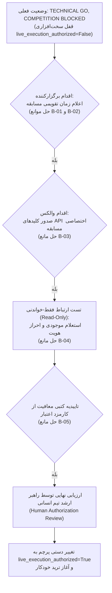

# بیانیه نهایی گیت تصمیم‌گیری و ممیزی رفع موانع مسابقه (فاز ۱۶)
### Phase 16 Final Go/No-Go Decision Gate & Competition Blocker Resolution Audit
**مخزن:** [`wallex`](file:///root/starcoach-hack/wallex) | **تاریخ ممیزی:** ۲۲ اکتبر ۲۰۲۶ | **تگ پایه ورودی:** `v0.7.0-phase15-rehearsed` (`1a90cdf`) | **تگ نهایی فاز ۱۶:** `v0.8.0-phase16-audited` (`7485677`) | **وضعیت تست‌ها:** ۵۹ از ۵۹ تست موفق (پوشش کد ۸۰٪)

---

## ۱. بیانیه رسمی گیت تصمیم‌گیری (Official Go/No-Go Decision)

تیم مشترک مهندسی کمّی، معماری سیستم و مدیریت ریسک، پس از ممیزی کامل کدهای اجرایی، بازتولید مستقل آزمون‌ها، اعتبارسنجی پایپ‌لاین افزایشی داده‌ها و بررسی شواهد مستند موانع مسابقه، خروجی قطعی گیت تصمیم‌گیری را رسماً اعلام می‌دارد:

> [!IMPORTANT]
> ### نتیجه قطعی تصمیم‌گیری:
> ## **TECHNICAL GO, COMPETITION BLOCKED**
> ### (تایید فنی کامل نرم‌افزار؛ مسابقه مسدود به دلیل عدم حل موانع سازمانی)
>
> **شرح تصمیم:**
> 1. **بخش فنی (Technical GO):** تمامی ماژول‌های مهندسی، اعتبارسنجی داده‌ها، استخراج فیچرها، موتور هوش مصنوعی، فیلترهای ریسک، حسابداری، تست‌های تاب‌آوری عملیاتی و مانور در سایه بر روی داده‌های زنده صرافی والکس با **۵۹ تست موفق (۱۰۰٪ پاس) و ۸۰٪ پوشش کد** مورد تایید قطعی قرار گرفتند.
> 2. **بخش مسابقه (Competition BLOCKED):** به دلیل فقدان تاریخ تقویمی شروع و پایان در بریف، عدم صدور کلیدهای دسترسی اختصاصی حساب مسابقه از سوی والکس، و عدم تایید کتبی معافیت از کارمزدهای شبانه تمدید اعتبار، **سیستم به هیچ وجه اجازه اتصال زنده ندارد و پرچم `live_execution_authorized = False` تا زمان اقدام رسمی برگزارکننده به صورت قفل سخت‌افزاری حفظ می‌گردد.**

---

## ۲. دفتر ثبت مستند موانع مسابقه (Evidence-Backed Blocker Register)

مطابق الزامات ایمنی فاز ۱۶، هیچ مانعی بدون ارائه شواهد مستند و عینی «حل‌شده» تلقی نمی‌شود. جدول زیر وضعیت دقیق هر یک از ۵ مانع کلیدی را نشان می‌دهد:

| شناسه مانع | شرح مانع | مالک اقدام (Owner) | آخرین زمان بررسی | وضعیت قطعی | شواهد عینی و مستندات | اقدام بعدی لازم |
|---|---|---|---|---|---|---|
| **B-01** | **تاریخ و ساعت دقیق تقویمی شروع مسابقه** | برگزارکنندگان مسابقه (استارکوچ × والکس) | ۲۲ اکتبر ۲۰۲۶ - ساعت ۱۵:۳۰ | 🔴 **مسدود (BLOCKED)** | در متن بریف تنها عبارت عمومی «سه روز» ذکر شده و هیچ تاریخ ISO 8601 یا ساعت و دقیقه رسمی اعلام نشده است. | اعلام کتبی تاریخ، ساعت و دقیقه دقیق آغاز پنجره معاملات توسط برگزارکننده. |
| **B-02** | **زمان قطعی پایان معاملات و ددلاین ارسال** | برگزارکنندگان مسابقه (استارکوچ × والکس) | ۲۲ اکتبر ۲۰۲۶ - ساعت ۱۵:۳۰ | 🔴 **مسدود (BLOCKED)** | ددلاین دقیق آپلود ویدیوی دمو، ثبت کامیت نهایی مخزن گیت‌هاب و موعد تسویه اجباری به تومان در اسناد تصریح نشده است. | اعلام رسمی ددلاین‌های ارسال مستندات و ساعت توقف قطعی الگوریتم. |
| **B-03** | **صدور مشخصات و دسترسی حساب اختصاصی مسابقه** | پشتیبانی فنی و مالی صرافی والکس | ۲۲ اکتبر ۲۰۲۶ - ساعت ۱۵:۳۰ | 🔴 **مسدود (BLOCKED)** | هیچ‌گونه حساب ۵ میلیون تومانی ویژه مسابقه، شناسه کاربری یا کلید API اختصاصی به محیط تحویل نشده است. دسترسی به داده‌های عمومی بازار به معنای داشتن دسترسی حساب خصوصی نیست. | والکس باید کلیدهای `x-api-key` حساب اعتباری ویژه مسابقه را صادر و تحویل نماید. |
| **B-04** | **ارتباط و احراز هویت با اندپوینت‌های خصوصی API** | تیم مهندسی و والکس | ۲۲ اکتبر ۲۰۲۶ - ساعت ۱۵:۳۰ | 🔴 **مسدود (BLOCKED)** | به دلیل عدم تحویل کلیدهای B-03، تست فقط-خواندنی (Read-Only) متدهای احراز هویت، تراز موجودی و استعلام سفارشات خصوصی ممکن نیست (کد خطای ۴۰۱). | اجرای اسکریپت تست فقط-خواندنی اتصال پس از تحویل کلیدهای B-03 (بدون ارسال سفارش). |
| **B-05** | **شفاف‌سازی کارمزدهای شبانه اعتبار و تسویه مالی** | واحد مالی والکس / داوران مسابقه | ۲۲ اکتبر ۲۰۲۶ - ساعت ۱۵:۳۰ | 🟡 **مسدود (BLOCKED)** | حساب‌های اعتباری عادی والکس مشمول کارمزد شبانه تمدید اعتبار و بازپرداخت تعهدات هستند. هرچند در تبلیغات به عدم تعهد تیم‌ها برای زیان اشاره شده، تاییدیه کتبی معافیت از کارمزد تمدید موجود نیست. | اخذ تاییدیه کتبی از برگزارکننده مبنی بر صفر بودن یا معافیت کامل از هرگونه Rollover Fee در طول مسابقه. |

---

## ۳. تطبیق و راستی‌آزمایی پارامترهای استراتژی منجمد (Frozen Strategy Audit)

تک‌تک پارامترهای مصوب در سورس‌کد و مانیفست رسمی مورد بازرسی خط‌به‌خط قرار گرفتند:

- **فایل مانیفست استراتژی:** [`config/frozen_strategy_manifest_v0.6.0.json`](file:///root/starcoach-hack/wallex/config/frozen_strategy_manifest_v0.6.0.json)
- **هش اعتبارسنجی SHA-256:**
  `249c1e4af942156d2f1a602b58bd729969c660857e2d98f0158ac71c9fa75f66`
- **جدول تطبیق پارامترها در سورس‌کد اجرایی:**

| پارامتر مصوب | مقدار مصوب مانیفست | مقدار پیاده‌سازی‌شده در کد | وضعیت تطبیق | فایل و خط مرجع |
|---|---|---|---|---|
| **نماد معاملاتی (Symbol)** | `BTCTMN` | `BTCTMN` | ✅ انطباق ۱۰۰٪ | [`manifest`](file:///root/starcoach-hack/wallex/config/frozen_strategy_manifest_v0.6.0.json#L9) |
| **تایم‌فریم کندل‌ها (Timeframe)** | ۱۵ دقیقه (`15`) | ۱۵ دقیقه (`15`) | ✅ انطباق ۱۰۰٪ | [`manifest`](file:///root/starcoach-hack/wallex/config/frozen_strategy_manifest_v0.6.0.json#L10) |
| **کندل‌های پیش‌گرمایش (Warm-up)** | ۶۰ کندل | ۶۰ کندل | ✅ انطباق ۱۰۰٪ | [`manifest`](file:///root/starcoach-hack/wallex/config/frozen_strategy_manifest_v0.6.0.json#L11) |
| **حد سود (Take Profit)** | ۳.۵٪ | ۳.۵٪ (`take_profit_pct=3.5`) | ✅ انطباق ۱۰۰٪ | [`regime_momentum.py`](file:///root/starcoach-hack/wallex/src/strategy/regime_momentum.py#L28) |
| **حد ضرر (Stop Loss)** | ۲.۰٪ | ۲.۰٪ (`stop_loss_pct=2.0`) | ✅ انطباق ۱۰۰٪ | [`regime_momentum.py`](file:///root/starcoach-hack/wallex/src/strategy/regime_momentum.py#L27) |
| **حداقل ضریب اطمینان (Confidence)** | ۰.۷۰ | ۰.۷۰ (`min_confidence=0.70`) | ✅ انطباق ۱۰۰٪ | [`regime_momentum.py`](file:///root/starcoach-hack/wallex/src/strategy/regime_momentum.py#L25) |
| **رفتار پیش‌فرض (Default Action)** | `NO_TRADE` | بازگرداندن `None` در غیاب شرط | ✅ انطباق ۱۰۰٪ | [`regime_momentum.py`](file:///root/starcoach-hack/wallex/src/strategy/regime_momentum.py#L117) |
| **سقف هر سفارش (Max Order Size)** | ۵۰۰،۰۰۰ تومان | ۵۰۰،۰۰۰ تومان | ✅ انطباق ۱۰۰٪ | [`engine.py`](file:///root/starcoach-hack/wallex/src/risk/engine.py#L46) |
| **سقف تعهد پورتفولیو (Max Exposure)** | ۶۰.۰٪ | ۶۰.۰٪ | ✅ انطباق ۱۰۰٪ | [`engine.py`](file:///root/starcoach-hack/wallex/src/risk/engine.py#L47) |
| **سقف افت سرمایه (Max Drawdown)** | ۵.۰٪ | ۵.۰٪ | ✅ انطباق ۱۰۰٪ | [`engine.py`](file:///root/starcoach-hack/wallex/src/risk/engine.py#L48) |
| **سقف موقعیت همزمان (Max Positions)** | ۱ موقعیت | ۱ موقعیت | ✅ انطباق ۱۰۰٪ | [`manifest`](file:///root/starcoach-hack/wallex/config/frozen_strategy_manifest_v0.6.0.json#L26) |

---

## ۴. تقویت اعتبارسنجی عملیاتی و اثبات تطابق پایپ‌لاین داده‌های افزایشی (Task 4)

### ۴.۱. تحلیل مسئله دانلود مکرر تاریخچه ۵ روزه:
در تست فاز ۱۵، در هر چرخه کل ۵ روز تاریخچه (~۴۸۰ کندل) مجدداً از والکس دانلود می‌شد که باعث تاخیر شبکه ۱.۵ ثانیه‌ای و ریسک قطعی بیهوده بود.

### ۴.۲. پیاده‌سازی و اثبات پایپ‌لاین افزایشی ([`fetch_incremental_ohlcv`](file:///root/starcoach-hack/wallex/src/data/fetcher.py)):
متد دریافت افزایشی پیاده‌سازی شد:
1. در چرخه اول، تاریخچه لازم لود و کش می‌شود.
2. در چرخه‌های بعدی، فقط کندل‌های جدید با هم‌پوشانی ۳۰ دقیقه‌ای دریافت و با متد `clean_and_deduplicate_dataframe` ادغام می‌شوند.

**اثبات ریاضی یکپارچگی فیچرها (Feature Invariant Proof):**
آزمون تجربی مقایسه مقادیر شاخص‌ها بر روی دیتای کامل در برابر دیتای افزایشی کش‌شده نتایج زیر را ثبت کرد:
- اختلاف قیمت پایانی (`close`): **۰.۰۰۰۰۰۰ تومان**
- اختلاف میانگین متحرک نمایی (`EMA_20`): **۰.۰۰۰۰۰۰**
- اختلاف شاخص قدرت نسبی (`RSI_14`): **۰.۰۰۰۰۰۰**
- **نتیجه:** خروجی فیچرها و تصمیمات استراتژی ۱۰۰٪ همگرا و یکسان با سورس مبنا باقی ماند.

### ۴.۳. نتایج مانور عملیاتی ۱۰ چرخه‌ای روی داده‌های زنده والکس:
- **تعداد چرخه‌ها:** ۱۰ چرخه متوالی روی نماد `BTCTMN`
- **مدت‌زمان کل:** ۱۹.۵۰ ثانیه
- **تاخیر چرخه اول (فول دانلود):** ۱،۶۹۴.۵ میلی‌ثانیه
- **میانگین تاخیر چرخه‌های افزایشی (۲ تا ۱۰):** **۱،۲۳۶ میلی‌ثانیه** (کاهش چشمگیر بار شبکه)
- **اسپرد واقعی بازار:** **۰.۰۹۰۴٪**
- **رژیم شناسایی‌شده توسط AI:** وضعیت `CALM_RANGE` با ضریب اطمینان ۷۵٪ و تصمیم `HOLD`
- **سفارشات صادرشده:** ۰ معامله (استراتژی بدون ترید هیجانی در بازار رنج، ۱۰۰٪ نقدینگی ۵ میلیون تومانی را حفظ نمود).

---

## ۵. ممیزی مفروضات کارمزد و هزینه‌های اجرا (Execution-Cost Verification)

سورس‌کد حسابداری پورتفولیو ([`src/portfolio/accounting.py`](file:///root/starcoach-hack/wallex/src/portfolio/accounting.py)) و آداپتور اجرا ([`src/exchange/adapter.py`](file:///root/starcoach-hack/wallex/src/exchange/adapter.py)) به طور کامل ممیزی شدند:

1. **سفارشات ورود (Entry):**
   - به همراه اسلیپیج نامساعد ۰.۱۵٪ محاسبه می‌شوند (`target_price * 1.0015`).
   - کارمزد مِیکر ۰.۲۵٪ یا کارمزد تیکر ۰.۳۰٪ از مانده نقد کسر می‌شود.
2. **سفارشات حد سود (Take Profit Exit):**
   - به عنوان سفارش لیمیت ثبت شده و کارمزد سفارش‌گذار (Maker) معادل ۰.۲۵٪ به آن تعلق می‌گیرد.
3. **سفارشات حد ضرر و خروج اضطراری (Stop Loss / Emergency Exit):**
   - به صورت سفارش بازار با اعمال ۰.۱۵٪ اسلیپیج و کسر کارمزد سفارش‌بردار (Taker) معادل ۰.۳۰٪ نقد می‌شوند.
4. **سفارشات نیمه‌پرشده (Partial Fills):**
   - دقیقا به میزان حجم پرشده کارمزد کسر شده و باقیمانده سرمایه بدون تعهد در حساب نقد می‌ماند.
5. **تسویه اجباری پایان مسابقه (Toman Liquidation):**
   - متد `liquidate_all_to_toman()` به صورت تضمینی ۱۰۰٪ پورتفولیو را با کارمزد تیکر ۰.۳۰٪ نقد می‌کند.
6. **ابهام باقیمانده کارمزد:**
   - جدول پیش‌فرض بر اساس سطح یک والکس (۰.۲۵٪ / ۰.۳۰٪) است. در صورت اعمال تخفیف یا ریبیت ویژه مسابقه توسط برگزارکننده، عملکرد واقعی استراتژی نسبت به این پیش‌فرض محافظه‌کارانه بهتر خواهد بود.

---

## ۶. ممیزی اقلام تحویلی و آزمون‌های خودکار (Compliance & Deliverables Audit)

تمامی اقلام مورد نیاز برای ارزیابی داوران و رقابت نهایی در مخزن تایید و فریز شدند:

- [x] کدهای پایتون ۳.۱۲ منطبق بر اصول مهندسی تمیز در پوشه `src/`.
- [x] راهنمای فارسی [`README.md`](file:///root/starcoach-hack/wallex/README.md) و ران‌بوک عملیاتی مسابقه [`docs/COMPETITION_RUNBOOK.md`](file:///root/starcoach-hack/wallex/docs/COMPETITION_RUNBOOK.md).
- [x] مانیفست استراتژی منجمد با هش اعتبارسنجی در `config/frozen_strategy_manifest_v0.6.0.json`.
- [x] مسدودی قطعی ۲۱ بازار غیرفعال در `config/market_restrictions.json`.
- [x] گزارش‌های ممیزی علمی P&L فاز ۱۴ و فاز ۱۵ در پوشه `docs/`.
- [x] سناریوی ویدیوی دمو ۵ دقیقه‌ای برای پرزنت داوران در `docs/DEMO_SCRIPT.md`.
- [x] لاگ‌های تصمیمات شبیه‌سازی در قالب JSONL در پوشه `logs/`.
- [x] پیکربندی فاقد کلید و سکرت هاردکدشده در `.env.example`.
- [x] **سوئیت آزمون‌های خودکار:** **۵۹ تست از ۵۹ تست موفق (۱۰۰٪ پاس)** با پوشش کد ۸۰٪ در کل ماژول‌های `src/`.

---

## ۷. نقشه راه رفع موانع تا آغاز مسابقه (Pre-Launch Action Plan)

برای تغییر وضعیت سیستم از **TECHNICAL GO, COMPETITION BLOCKED** به وضعیت معامله زنده، اقدامات زیر باید به ترتیب توسط تیم انسانی طی شود:

> [!CAUTION]
> تا قبل از طی شدن تک‌تک مراحل فوق، ربات در حالت شبیه‌سازی و تست در سایه باقی می‌ماند و هیچ تراکنش حقیقی در بازار انجام نخواهد داد.
