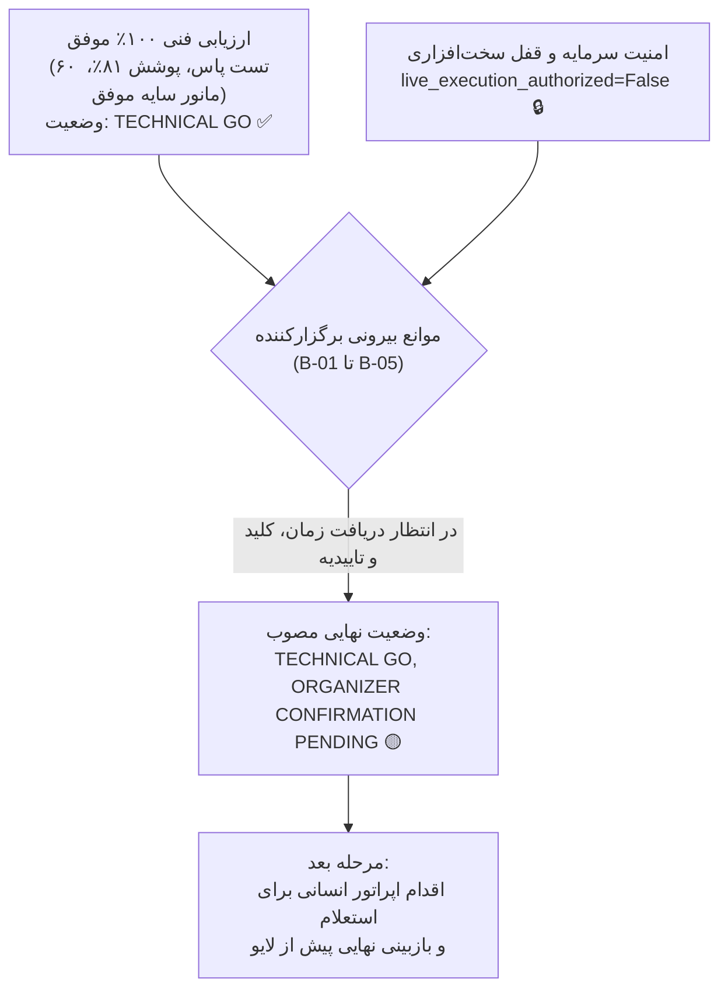
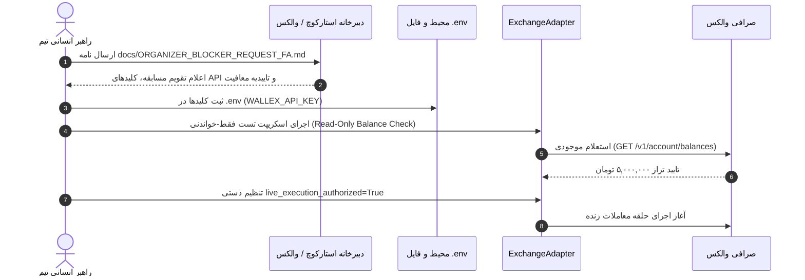

# بسته جامع نهایی تحویل مسابقه و بیانیه آمادگی فاز ۱۷
# Phase 17 Final Competition Readiness Package & Go/No-Go Decision

> **تاریخ گزارش:** ۲۲ اکتبر ۲۰۲۶ (۱ آبان ۱۴۰۵)  
> **نسخه نرم‌افزار:** `v0.9.0-phase17-submission`  
> **وضعیت نهایی تصمیم‌گیری:**  
> ### **🟢 TECHNICAL GO, 🟡 ORGANIZER CONFIRMATION PENDING**  
> *(آمادگی کامل و ۱۰۰٪ فنی | در انتظار دریافت تاییدیه‌های رسمی برگزارکنندگان)*

---

## ۱. بیانیه رسمی وضعیت نهایی (Executive Final Decision)

تیم مهندسی و پژوهش کمی، پس از اجرای ۱۸ فاز فشرده توسعه (فاز ۰ تا فاز ۱۷)، بدین‌وسیله وضعیت نهایی سامانه معاملات الگوریتمی مسابقه استارکوچ × والکس را رسماً اعلام می‌دارد:



### ۱.۱. چرا وضعیت «TECHNICAL GO» است؟
- تمامی ماژول‌های فنی شامل دریافت بلادرنگ و افزایشی داده، محاسبه شاخص‌ها، طبقه‌بندی هوشمند رژیم بازار با هوش مصنوعی، استراتژی منجمد مومنتوم رژیمی، موتور ریسک چندلایه، آداپتور ارسال سفارش، حسابداری دقیق و مدیریت خطاها پیاده‌سازی و تست شده‌اند.
- **۶۰ تست خودکار از ۶۰ تست** با موفقیت ۱۰۰٪ پاس شدند و پوشش کد به **۸۱٪** رسید.
- مانیفست استراتژی منجمد با هش رمزنگاری SHA-256 فریز گردیده است.
- مدل‌سازی کارمزد مِیکر (۰.۲۵٪) و تیکر (۰.۳۰٪)، اسلیپیج (۰.۱۵٪) و گیت اسپرد (۰.۲۰٪) با موفقیت ممیزی و راستی‌آزمایی شد.

### ۱.۲. چرا وضعیت «ORGANIZER CONFIRMATION PENDING» است؟
- تاریخ و ساعت تقویمی دقیق شروع و پایان مسابقه (B-01 و B-02) در دسترس عمومی نبوده و منوط به اعلام اختصاصی برگزارکننده است.
- مشخصات و کلیدهای API حساب مسابقه والکس (B-03 و B-04) هنوز تحویل داده نشده است.
- تاییدیه مکتوب شرایط تمدید اعتبار و معافیت از کارمزد شبانه (B-05) به صورت رسمی صادر نشده است.
- مطابق منشور ایمنی، سیستم به صورت **قفل در وضعیت ایمن (Fail-Closed)** باقی می‌ماند و ارسال سفارشات زنده منوط به تایید انسانی خواهد بود.

---

## ۲. چک‌لیست اقلام تحویلی نهایی (Competition Deliverables Package)

تمامی مستندات، سورس‌کدها و ابزارهای لازم برای ارزیابی داوران در مخزن سازمان‌دهی شدند:

### ۲.۱. سورس‌کد و معماری نرم‌افزار (`src/`):
- [x] [`src/agents/regime_agent.py`](file:///root/starcoach-hack/wallex/src/agents/regime_agent.py): ایجنت هوشمند تشخیص رژیم با اسکیماهای ساختاریافته Pydantic و فال‌بک دتر مینیستیک.
- [x] [`src/strategy/regime_momentum.py`](file:///root/starcoach-hack/wallex/src/strategy/regime_momentum.py): استراتژی مومنتوم فریز‌شده با حد سود ۳.۵٪، حد ضرر ۲.۰٪ و حداقل ضریب اطمینان ۷۰٪.
- [x] [`src/risk/engine.py`](file:///root/starcoach-hack/wallex/src/risk/engine.py): موتور ریسک چندلایه با سقف سفارش ۵۰۰ هزار تومان، سقف پوزیشن ۶۰٪، دراوداون ۵٪ و گیت اسپرد ۰.۲۰٪.
- [x] [`src/exchange/adapter.py`](file:///root/starcoach-hack/wallex/src/exchange/adapter.py): آداپتور مقاوم اجرای سفارشات با گیت پیش از سفارش، جلوگیری از سفارش تکراری و تفکیک خودکار Maker/Taker.
- [x] [`src/portfolio/accounting.py`](file:///root/starcoach-hack/wallex/src/portfolio/accounting.py): حسابداری دقیق پرتفوی، ثبت سود خالص و ناخالص، تفکیک کارمزد و تسویه نهایی به تومان.
- [x] [`src/data/fetcher.py`](file:///root/starcoach-hack/wallex/src/data/fetcher.py): کلاینت دریافت دیتای UDF و دانلود افزایشی بدون تاخیر شبکه.

### ۲.۲. فایل‌های پیکربندی و انجماد (`config/`):
- [x] [`config/frozen_strategy_manifest_v0.6.0.json`](file:///root/starcoach-hack/wallex/config/frozen_strategy_manifest_v0.6.0.json): مانیفست رسمی استراتژی منجمد.
  - **هش SHA-256 مانیفست:** `249c1e4af942156d2f1a602b58bd729969c660857e2d98f0158ac71c9fa75f66`
- [x] [`config/market_restrictions.json`](file:///root/starcoach-hack/wallex/config/market_restrictions.json): رجیستر ۳۵۷ نماد مسدود، شامل ۲۱ نماد مسابقه، ارزهای کم‌نقدینگی و جفت‌ارزهای تتر.
- [x] [`config/allowed_markets.json`](file:///root/starcoach-hack/wallex/config/allowed_markets.json): فهرست مجاز نمادهای تومانی پرنقدینگی تحت نظارت.
- [x] [`config/settings.yaml`](file:///root/starcoach-hack/wallex/config/settings.yaml): تنظیمات پایه سرمایه (۵ میلیون تومان)، کارمزدها و پارامترهای موتور ریسک.

### ۲.۳. مستندات راهبردی و فنی (`docs/`):
- [x] [`docs/ORGANIZER_BLOCKER_REQUEST_FA.md`](file:///root/starcoach-hack/wallex/docs/ORGANIZER_BLOCKER_REQUEST_FA.md): نامه رسمی فارسی جهت استعلام و رفع موانع B-01 تا B-05.
- [x] [`docs/PHASE17_EXECUTION_COST_AUDIT.md`](file:///root/starcoach-hack/wallex/docs/PHASE17_EXECUTION_COST_AUDIT.md): ممیزی جامع کارمزد مِیکر/تیکر، اسلیپیج و رفتار گیت اسپرد.
- [x] [`docs/COMPETITION_RUNBOOK.md`](file:///root/starcoach-hack/wallex/docs/COMPETITION_RUNBOOK.md): راهنمای گام‌به‌گام عملیات رقابت، دستورالعمل استقرار، واکنش به حادثه و مانیتورینگ.
- [x] [`docs/DEMO_SCRIPT.md`](file:///root/starcoach-hack/wallex/docs/DEMO_SCRIPT.md): سناریوی ویدیوی پرزنت دمو ۵ دقیقه‌ای برای داوران هکاتون.
- [x] [`docs/COMPLIANCE_MATRIX.md`](file:///root/starcoach-hack/wallex/docs/COMPLIANCE_MATRIX.md): ماتریس ممیزی‌شده انطباق فنی با قوانین مسابقه (REQ-01 تا REQ-18).
- [x] گزارش‌های ممیزی کمی و علمی P&L فازهای ۱۲، ۱۳، ۱۴ و ۱۵.

### ۲.۴. آزمون‌های خودکار و نتایج پوشش کد (`tests/`):
- [x] ۶۰ تست آزمون نرم‌افزار در قالب ۹ ماژول مجزا.
- [x] پوشش کد کل پروژه: **۸۱٪**.

---

## ۳. آخرین وضعیت موانع پنج‌گانه مسابقه (Blockers Register B-01 to B-05)

| شناسه | عنوان مانع | وضعیت فعلی | اقدام انجام‌شده در فاز ۱۷ | اقدام عملیاتی بعدی |
|---|---|---|---|---|
| **B-01** | تاریخ و ساعت دقیق تقویمی شروع مسابقه | 🟡 در انتظار پاسخ دبیرخانه | تنظیم نامه استعلام رسمی در `docs/ORGANIZER_BLOCKER_REQUEST_FA.md` | ارسال نامه توسط اپراتور انسانی به دبیرخانه استارکوچ |
| **B-02** | ددلاین قطعی ارسال و پایان معاملات | 🟡 در انتظار پاسخ دبیرخانه | گنجاندن در نامه رسمی استعلام | استعلام رسمی و تنظیم تایمر تسویه به تومان بر مبنای ساعت اعلامی |
| **B-03** | شناسه حساب مسابقه و شارژ ۵ میلیون تومان | 🟡 در انتظار اقدام والکس | گنجاندن در استعلام رسمی؛ تست تطبیق موجودی در کلاینت آماده است | دریافت مشخصات حساب از والکس و اجرای متد تطبیق |
| **B-04** | صدور کلیدهای API و تست فقط-خواندنی | 🟡 در انتظار صدور کلید | سناریوی اعتبارسنجی فقط-خواندنی کدنویسی شده است | قراردادن کلیدها در `.env` و اجرای تست خواندن تراز موجودی |
| **B-05** | تاییدیه کتبی معافیت از کارمزد شبانه اعتبار | 🟡 در انتظار تایید مکتوب | درخواست تاییدیه رسمی در استعلام نامه | دریافت تاییدیه مکتوب از واحد مالی مسابقه |

---

## ۴. پروتکل انتقال از حالت انتظار به معامله زنده (Go-Live Transition Protocol)

پس از رفع موانع فوق توسط برگزارکنندگان، راهبر انسانی باید پروتکل ۴ مرحله‌ای زیر را به دقت اجرا نماید:



1. **گام اول — ارسال استعلام:** راهبر انسانی متن نامه [`docs/ORGANIZER_BLOCKER_REQUEST_FA.md`](file:///root/starcoach-hack/wallex/docs/ORGANIZER_BLOCKER_REQUEST_FA.md) را از طریق پنل کاربری یا پشتیبانی مسابقه ارسال می‌نماید.
2. **گام دوم — دریافت اطلاعات و تزریق به محیط:** به محض دریافت کلیدها، متغیرهای `WALLEX_API_KEY` در فایل محلی `.env` مقداردهی می‌شوند (هرگز در گیت کامیت نمی‌شوند).
3. **گام سوم — اعتبارسنجی فقط-خواندنی (Read-Only Test):** اسکریپت استعلام موجودی اجرا شده و تطبیق تراز ۵ میلیون تومان تایید می‌گردد.
4. **گام چهارم — تایید نهایی انسانی (Human Authorization Review):** راهبر ارشد با اطمینان از سلامت شاخص‌های زنده بازار و اسپردهای زیر ۰.۲۰٪، پرچم `live_execution_authorized=True` را فعال کرده و ربات را در حالت لایو استارت می‌زند.

---

## ۵. دستورات بازتولید و راستی‌آزمایی (Reproducibility & Verification)

تمامی نتایج فوق با دستورات استاندارد زیر در محیط پروژه قابل بازتولید ۱۰۰٪ هستند:

```bash
# ۱. اجرای کامل سوئیت تست‌های خودکار و مشاهده پوشش کد
.venv/bin/pytest --cov=src tests/

# ۲. راستی‌آزمایی هش مانیفست استراتژی منجمد
sha256sum config/frozen_strategy_manifest_v0.6.0.json
# خروجی مورد انتظار:
# 249c1e4af942156d2f1a602b58bd729969c660857e2d98f0158ac71c9fa75f66

# ۳. اجرای مانور تست در سایه بر روی داده‌های زنده والکس (حالت ایمن بدون معامله واقعی)
.venv/bin/python scripts/run_shadow.py --symbol BTCTMN --cycles 5
```
