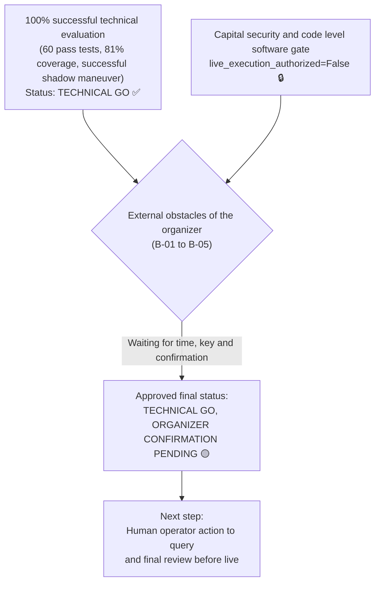
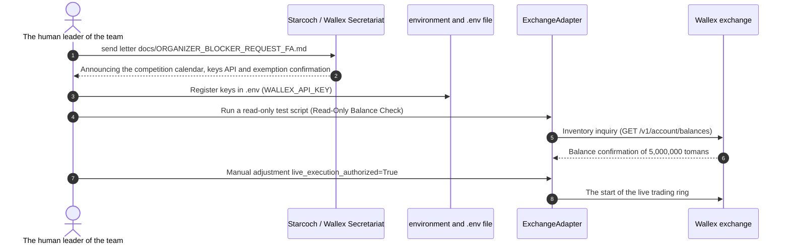

# The final comprehensive package for the delivery of the competition and the preparation statement for phase 17
# Phase 17 Final Competition Readiness Package & Go/No-Go Decision

> **Report date:** October 22, 2026 (November 1, 1405)  
> **Software version:** `v0.9.0-phase17-submission`  
> **Final state of decision making:**  
> ### ** 🟢 TECHNICAL GO, 🟡 ORGANIZER CONFIRMATION PENDING**  
> *(Full preparation and 100% technical | Waiting for the official approvals of the organizers)*

---

## 1. Official statement of the final situation (Executive Final Decision)

The quantitative research and engineering team, after implementing 18 intensive phases of development (phase 0 to phase 17), hereby officially announces the final status of the algorithmic trading system of the Starcoch x Wallex competition:



### 1.1. Why is the status "TECHNICAL GO"?
- All technical modules, including real-time and incremental data acquisition, index calculation, intelligent market regime classification with artificial intelligence, frozen regime momentum strategy, multilayer risk engine, order sending adapter, accurate accounting and error management have been implemented and tested.
- **60 automated tests out of 60** passed with 100% success and the code coverage reached **81%**.
- The frozen strategy manifest is frozen with SHA-256 cryptographic hash.
- Maker (0.25%) and taker (0.30%), slippage (0.15%) and gate spread (0.20%) modeling fees were successfully audited and verified.

### 1.2. Why is the status "ORGANIZER CONFIRMATION PENDING"?
- The exact calendar date and time of the start and end of the competition (B-01 and B-02) are not publicly available and are subject to the exclusive announcement of the organizer.
- The details and API keys of Wallex racing account (B-03 and B-04) have not yet been delivered.
- Written confirmation of credit extension conditions and exemption from overnight fee (B-05) has not been officially issued.
- According to the safety charter, the system remains **locked in a safe state (Fail-Closed)** and the sending of live orders will be subject to human approval.

---

## 2. Checklist of final deliverables (Competition Deliverables Package)

All the documentation, source codes and tools necessary for the evaluation of the judges were organized in the repository:

### 2.1. Source code and software architecture (`src/`):
- [x] [`src/agents/regime_agent.py`](../src/agents/regime_agent.py): Smart regime detection agent with structured Pydantic schemas and ministic deterrent fallback.
- [x] [`src/strategy/regime_momentum.py`](../src/strategy/regime_momentum.py): Frozen momentum strategy with 3.5% profit limit, 2.0% loss limit and 70% minimum confidence factor.
- [x] [`src/risk/engine.py`](../src/risk/engine.py): Multi-layer risk engine with order limit of 500 thousand tomans, position limit of 60%, drawdown of 5% and gate spread of 0.20%.
- [x] [`src/exchange/adapter.py`](../src/exchange/adapter.py): Robust order execution adapter with pre-order gate, duplicate order prevention and automatic Maker/Taker separation.
- [x] [`src/portfolio/accounting.py`](../src/portfolio/accounting.py): Accurate portfolio accounting, net and gross profit registration, separation of fees and final settlement in Tomans.
- [x] [`src/data/fetcher.py`](../src/data/fetcher.py): UDF data receiving client and incremental download without network delay.

### 2.2. Configuration and freezing files (`config/`):
- [x] [`config/frozen_strategy_manifest_v0.6.0.json`](../config/frozen_strategy_manifest_v0.6.0.json): The official Frozen Strategy manifest.
  - **SHA-256 hash of manifest:** `249c1e4af942156d2f1a602b58bd729969c660857e2d98f0158ac71c9fa75f66`
- [x] [`config/market_restrictions.json`](../config/market_restrictions.json): Registry of 357 blocked symbols, including 21 race symbols, cryptocurrencies and Tether currency pairs.
- [x] [`config/allowed_markets.json`](../config/allowed_markets.json): Allowed list of supervised high liquidity tokens.
- [x] [`config/settings.yaml`](../config/settings.yaml): basic capital settings (5 million Tomans), fees and risk engine parameters.

### 2.3. Strategic and technical documentation (`docs/`):
- [x] [`docs/ORGANIZER_BLOCKER_REQUEST_FA.md`](ORGANIZER_BLOCKER_REQUEST_FA.md): Official Persian letter to inquire and remove obstacles B-01 to B-05.
- [x] [`docs/PHASE17_EXECUTION_COST_AUDIT.md`](PHASE17_EXECUTION_COST_AUDIT.md): Comprehensive audit of maker/taker fees, slippage and gate spread behavior.
- [x] [`docs/COMPETITION_RUNBOOK.md`](COMPETITION_RUNBOOK.md): Step-by-step guide to competition operations, deployment instructions, incident response and monitoring.
- [x] [`docs/DEMO_SCRIPT.md`](DEMO_SCRIPT.md): 5 minute demo presentation video scenario for hackathon judges.
- [x] [`docs/COMPLIANCE_MATRIX.md`](COMPLIANCE_MATRIX.md): Audited matrix of technical compliance with competition rules (REQ-01 to REQ-18).
- [x] Quantitative and scientific audit reports of P&L phases 12, 13, 14 and 15.

### 2.4. Automated tests and code coverage results (`tests/`):
- [x] 60 software tests in the form of 9 separate modules.
- [x] Code coverage of the entire project: **81%**.

---

## 3. The last status of the five obstacles of the competition (Blockers Register B-01 to B-05)

| ID Obstacle title Current status The action taken in phase 17 Next operational action
|---|---|---|---|---|
| **B-01** | The exact date and time of the start of the competition Waiting for the response from the secretariat Setting up the official inquiry letter in `docs/ORGANIZER_BLOCKER_REQUEST_FA.md` Send a letter by a human operator to the secretariat of Starkoch
| **B-02** | Definite deadline for sending and ending transactions Waiting for the response from the secretariat Inclusion in the official letter of inquiry Official inquiry and setting the settlement timer in Tomans based on the announced time
| **B-03** | Match account ID and charge 5 million tomans 🟡 Waiting for Valax's action inclusion in the official inquiry; The balance matching test is ready in the client Receive the account details from Wallex and execute the matching method
| **B-04** | Issuance of API keys and read-only testing 🟡 Waiting for key issuance The read-only validation scenario is coded Putting the keys in `.env` and running the balance reading test
| **B-05** | Written confirmation of exemption from credit night fee Awaiting written confirmation Request for official confirmation in the inquiry letter Receive written confirmation from the financial unit of the competition

---

## 4. Go-Live Transition Protocol

After removing the above obstacles by the organizers, the human guide must carefully implement the following 4-step protocol:



1. **Step 1 — Send a request:** The human coach sends the text of the letter [`docs/ORGANIZER_BLOCKER_REQUEST_FA.md`](ORGANIZER_BLOCKER_REQUEST_FA.md) through the user panel or support of the match.
2. **Step 2 — Get information and inject into the environment:** As soon as the keys are received, the `WALLEX_API_KEY` variables are initialized in the local `.env` file (never committed in git).
3. **The third step - read-only validation (Read-Only Test):** The balance query script is executed and the adjustment of the balance of 5 million Tomans is confirmed.
4. **Step 4 - Human Authorization Review:** After making sure the health of the live market indicators and spreads below 0.20%, the senior manager activates the `live_execution_authorized=True' flag and starts the robot in live mode.

---

## 5. Reproducibility & Verification instructions

All the above results are 100% reproducible with the following standard commands in the project environment:

```bash
# 1. Full execution of automated tests suite and code coverage viewing
.venv/bin/pytest --cov=src tests/

# 2. Freeze strategy manifest hash verification
sha256sum config/frozen_strategy_manifest_v0.6.0.json
# Expected output:
# 249c1e4af942156d2f1a602b58bd729969c660857e2d98f0158ac71c9fa75f66

# 3. Running test maneuver in the shadow on Wallex live data (safe mode without real transaction)
.venv/bin/python scripts/run_shadow.py --symbol BTCTMN --cycles 5
```
