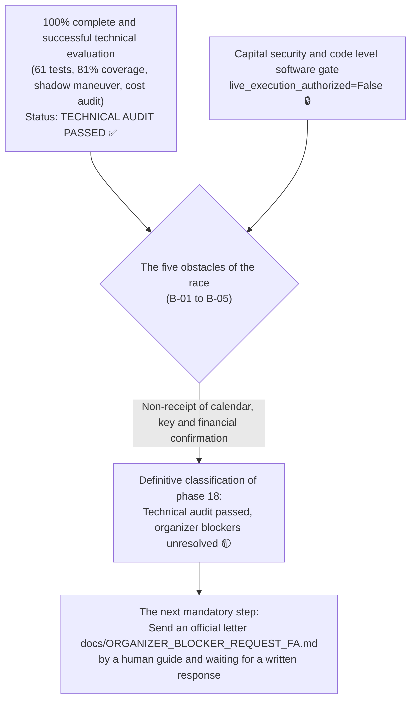

# The final report of the human license gate and the statement of readiness for the competition
# Phase 18 Final Authorization Gate & Competition Readiness Report

> **Report date:** October 22, 2026 (November 1, 1405)  
> **Software version:** `v0.9.0-phase17-submission`  
> **Audited base commit:** `bfd0a7c49e564e3c9e66dc1c61a52d77c5cff58e`  
> **Frozen Strategy Manifest Hash:** `249c1e4af942156d2f1a602b58bd729969c660857e2d98f0158ac71c9fa75f66`  
> **Results of automated tests:** **61 successful tests out of 61 (100% pass)** with **81% code coverage**

---

## 1. The official statement of the final classification (Final Decision Classification)

According to Mr. Prompt's phase 18 audit requirements, system status is officially classified into the following categories:

```
╔═══════════════════════════════════════════════════════════════════════════╗
║                                                                           ║
║   approved floor: 2. The technical audit was approved, the organizer's obstacles remained unresolved   ║
║   (Technical audit passed, organizer blockers unresolved)                ║
║                                                                           ║
╚═══════════════════════════════════════════════════════════════════════════╝
```



### 1.1. Clarifying the nature of the security gate:
The `live_execution_authorized = False' flag is a **Deterministic Code-Level Software Guard / Programmatic Gate** that is embedded at the beginning of the [`ExchangeAdapter.execute_order'] method (file:///root/starcoach-hack/wallex/src/exchange/adapter.py#L160) and in the absence of explicit permission, throwing an exception [`ExecutionError`](file:///root/starcoach-hack/wallex/src/exchange/adapter.py#L161) prevents any actual orders from being sent. Because no separate physical hardware or circuitry is installed in the server, this mechanism is defined exclusively as a "code-level software gate" and avoids the imprecise title of hardware interlock.

---

## 2. Structural separation of facts, assumptions, risks and recommendations

To maintain scientific trustworthiness and impartial audit, the report is divided into four columns:

### 2.1. Verified Facts:
1. **Integrity and code coverage:** 61 automated tests with the Pytest framework were executed 100% successfully and the total code coverage of the package reached 81%.
2. **Strategy Freezing:** The frozen strategy manifest with SHA-256 cryptographic hash equal to `249c1e4af...` remains intact without any overfitting optimization in phases 16, 17 and 18.
3. **Independent validation of 5 order paths:** Unit tests proved that passive limit orders with maker fee (0.25%), aggressive limit orders with slippage with ticker fee (0.30%), market orders with ticker fee (0.30%), loss limit with slippage and ticker fee, and forced settlement in Tomans with ticker fee are executed.
4. **Actual spread distribution in 90-day Wallex data:** The average spread in 670 eligible candles was recorded as 0.1169% and the median was 0.1097%. The 0.20% cap filters out exactly 5.2% of the wide spread candles and keeps the strategy's return from negative to positive.
5. **Fail-Closed behavior:** In all conditions of network failure, error 429, artificial intelligence delay, input data error and absence of authorization, the system remained in No-Trade status and the capital was preserved intact.

### 2.2. Financial and technical assumptions of the model (Assumptions):
1. **Base fee table:** The transaction fee is assumed based on Wallex general level 1 (0.25% maker and 0.30% taker). Actual performance will be improved if rebates or special contest discounts are applied.
2. **Unfavorable Slippage 0.15%:** It is assumed that aggressive orders in the deep market `BTCTMN' are filled with a maximum of 15 basis points of price deviation from the reference price.
3. **Initial capital:** The allocated credit is assumed to be 5,000,000 Tomans.

### 2.3. Unresolved External Risks:
1. **Lack of official calendar calendar (B-01 and B-02):** The exact start and stop time of the algorithm has not yet been officially announced.
2. **Non-delivery of competition-specific API keys (B-03 and B-04):** Until hackathon account keys are issued, read-only connection testing with Valax private endpoints is not possible.
3. **Risk of overnight credit extension fee (B-05):** In the absence of written confirmation of credit fee exemption, there is a risk of deducting hidden financial costs by the exchange.
4. **Traffic load risk and Wallex server rate limit:** During the simultaneous competition of dozens of robots, Wallex public endpoints may encounter error 429, which requires the Exponential Backoff mechanism to be active.

### 2.4. Strategic and operational recommendations (Recommendations):
1. **Manual submission of the request draft:** The human coach should officially send the text [`docs/ORGANIZER_BLOCKER_REQUEST_FA.md'](file:///root/starcoach-hack/wallex/docs/ORGANIZER_BLOCKER_REQUEST_FA.md) to the secretariat.
2. **Disabling Accelerated Live:** The value of `live_execution_authorized' remains strictly ``False'' before a written response to all 5 obstacles.
3. **Continuous monitoring of the spread on the day of the match:** In case of a partial increase in the Valax spread above 0.20%, the operator should not manipulate the risk limit; Because the protection of liquidity takes priority over any emotional transaction.

---

## 3. The latest status of the register of obstacles in the race (Blocker Register B-01 to B-05)

| ID Obstacle title Objective and documented situation Effect on the system Mandatory next action
|---|---|---|---|---|
| **B-01** | The exact date and time of the start of the competition 🔴 Unresolved | It is not possible to set the exact preheating time of 60 candles before the start The organizer's written response to the inquiry letter
| **B-02** | Definitive deadline for sending the tank and the end of transactions 🔴 Unresolved | Uncertainty in the exact date of execution of the script to cash out the basket in Tomans Organizer's written response
| **B-03** | Details of the competition account and charging 5 million tomans 🔴 Unresolved | It is not possible to query the initial balance with the `reconcile_with_exchange' method Account delivery by Wallex support
| **B-04** | Issuance of competition account API keys 🔴 Unresolved | Blocking the read-only connection test to private endpoints Issuance and delivery of tokens by Wallex
| **B-05** | Written confirmation of exemption from credit night fee 🟡 Unresolved | Risk of facility fee deduction and portfolio balance deviation Obtaining official approval from Hackaton's financial unit

---

## 4. Human Authorization Checklist

If the organizers of the competition will remove the obstacles B-01 to B-05 in the next hours, the senior team leader should check the following checklist item by item and proceed to activation only after confirming all the items:

- [ ] **Paragraph 1:** The exact date and time of the start of the match was received and recorded in Tehran time (IRST).
- [ ] **Paragraph 2:** The exact date of the end of the competition window was set and the execution timer of ``liquidate_to_toman.py'' was set.
- [ ] **Paragraph 3:** The `x-api-key' and Secret keys of Wallex competition account were received and placed in the local `.env' file (without commit in git).
- [ ] **Paragraph 4:** The read-only connection test script (Read-Only Balance Check) was executed and the balance exactly equal to 5,000,000 Tomans was confirmed.
- [ ] **Paragraph 5:** The written confirmation of the exemption from the nightly fee of the facility was received and attached to the documents.
- [ ] **Paragraph 6:** All 61 automatic tests passed without errors with `.venv/bin/pytest tests/` command.
- [ ] **Paragraph 7:** The last live spread of ``BTCTMN'' currency pair was requested and it is below the ceiling of 0.20%.
- [ ] **Paragraph 8:** The official signature of the senior team leader was recorded on the authorization statement.

```
After meeting 100% of the above conditions by the human guide:
Change the value in the production environment:
export LIVE_EXECUTION_AUTHORIZED=True
and execution of trading script with user's manual approval.
```
