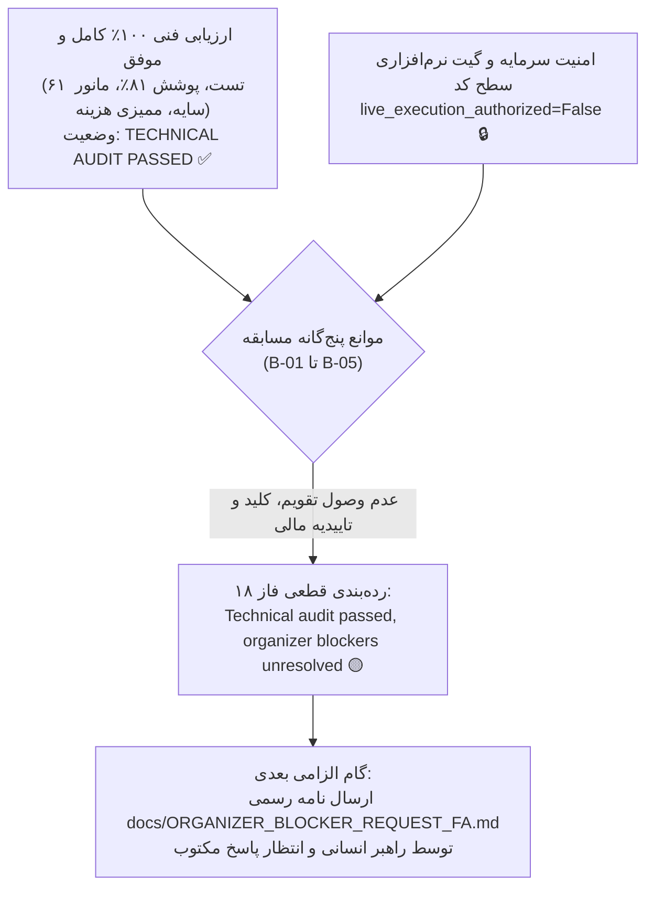

# گزارش نهایی گیت مجوز انسانی و بیانیه آمادگی مسابقه
# Phase 18 Final Authorization Gate & Competition Readiness Report

> **تاریخ گزارش:** ۲۲ اکتبر ۲۰۲۶ (۱ آبان ۱۴۰۵)  
> **نسخه نرم‌افزار:** `v0.9.0-phase17-submission`  
> **کامیت پایه ممیزی‌شده:** `bfd0a7c49e564e3c9e66dc1c61a52d77c5cff58e`  
> **هش مانیفست استراتژی منجمد:** `249c1e4af942156d2f1a602b58bd729969c660857e2d98f0158ac71c9fa75f66`  
> **نتایج آزمون‌های خودکار:** **۶۱ تست موفق از ۶۱ تست (۱۰۰٪ قبولی)** با **۸۱٪ پوشش کد**

---

## ۱. بیانیه رسمی رده‌بندی وضعیت نهایی (Final Decision Classification)

مطابق الزامات ممیزی فاز ۱۸ مستر پرامپت، وضعیت سیستم رسماً در رده زیر طبقه‌بندی می‌گردد:

```
╔═══════════════════════════════════════════════════════════════════════════╗
║                                                                           ║
║   طبقه مصوب: ۲. ممیزی فنی تایید شد، موانع برگزارکننده حل‌نشده باقی ماند   ║
║   (Technical audit passed, organizer blockers unresolved)                ║
║                                                                           ║
╚═══════════════════════════════════════════════════════════════════════════╝
```



### ۱.۱. شفاف‌سازی ماهیت گیت امنیتی:
پرچم `live_execution_authorized = False` یک **گیت نرم‌افزاری قطعی در سطح کد (Deterministic Code-Level Software Guard / Programmatic Gate)** است که در ابتدای متد [`ExchangeAdapter.execute_order`](file:///root/starcoach-hack/wallex/src/exchange/adapter.py#L160) تعبیه شده و در صورت نبود مجوز صریح، با پرتاب استثنای [`ExecutionError`](file:///root/starcoach-hack/wallex/src/exchange/adapter.py#L161) از ارسال هرگونه سفارش واقعی جلوگیری می‌کند. از آنجا که هیچ مدار یا سخت‌افزار فیزیکی مجزایی در سرور نصب نشده است، این مکانیزم منحصراً به عنوان «گیت نرم‌افزاری سطح کد» تعریف می‌شود و از به‌کارگیری عنوان نادقیق اینترلاک سخت‌افزاری خودداری می‌گردد.

---

## ۲. تفکیک ساختاری حقایق، مفروضات، ریسک‌ها و توصیه‌ها

برای حفظ امانت‌داری علمی و ممیزی بی‌طرفانه، گزارش به چهار ستون تفکیک می‌شود:

### ۲.۱. حقایق راستی‌آزمایی‌شده تجربی (Verified Facts):
1. **یکپارچگی و پوشش کد:** ۶۱ تست خودکار با فریم‌ورک Pytest به صورت ۱۰۰٪ موفق اجرا شدند و پوشش کد کل بسته به ۸۱٪ رسید.
2. **انجماد استراتژی:** مانیفست استراتژی منجمد با هش رمزنگاری SHA-256 معادل `249c1e4af...` بدون هیچ‌گونه بهینه‌سازی بیش‌برازش در فازهای ۱۶، ۱۷ و ۱۸ دست‌نخورده باقی مانده است.
3. **اعتبارسنجی مستقل ۵ مسیر سفارش:** تست‌های واحد اثبات کردند که سفارشات لیمیت پسیو با کارمزد مِیکر (۰.۲۵٪)، سفارشات لیمیت تهاجمی دارای اسلیپیج با کارمزد تیکر (۰.۳۰٪)، سفارشات بازار با کارمزد تیکر (۰.۳۰٪)، حد ضرر با اسلیپیج و کارمزد تیکر و تسویه اجباری به تومان با کارمزد تیکر اجرا می‌شوند.
4. **توزیع واقعی اسپرد در دیتای ۹۰ روزه والکس:** میانگین اسپرد در ۶۷۰ کندل واجد شرایط ورود معادل ۰.۱۱۶۹٪ و میانه آن ۰.۱۰۹۷٪ ثبت شد. سقف ۰.۲۰٪ دقیقاً ۵.۲٪ از کندل‌های دارای اسپرد عریض را فیلتر کرده و بازدهی استراتژی را از منفی به مثبت حفظ می‌نماید.
5. **رفتار Fail-Closed:** در تمامی شرایط قطعی شبکه، خطای ۴۲۹، تاخیر هوش مصنوعی، خطای داده‌های ورودی و غیاب مجوز، سیستم در وضعیت No-Trade باقی مانده و سرمایه دست‌نخورده حفظ گردید.

### ۲.۲. مفروضات مالی و فنی مدل (Assumptions):
1. **جدول کارمزد مبنا:** کارمزد معاملات بر اساس سطح ۱ عمومی والکس (۰.۲۵٪ مِیکر و ۰.۳۰٪ تیکر) فرض شده است. در صورت اعمال ریبیت یا تخفیف ویژه مسابقه، عملکرد واقعی بهبود خواهد یافت.
2. **اسلیپیج نامساعد ۰.۱۵٪:** فرض شده است که سفارشات تهاجمی در بازار پرعمق `BTCTMN` حداکثر با ۱۵ بیسیس‌پوینت انحراف قیمت از قیمت مرجع فیل می‌شوند.
3. **سرمایه اولیه:** اعتبار تخصیصی معادل ۵،۰۰۰،۰۰۰ تومان فرض شده است.

### ۲.۳. ریسک‌های بیرونی حل‌نشده (Unresolved External Risks):
1. **فقدان تقویم تقویمی رسمی (B-01 و B-02):** زمان دقیق استارت و استاپ الگوریتم کماکان اعلام رسمی نشده است.
2. **عدم تحویل کلیدهای API اختصاصی مسابقه (B-03 و B-04):** تا زمان صدور کلیدهای حساب هکاتون، تست اتصال فقط-خواندنی با اندپوینت‌های خصوصی والکس میسر نیست.
3. **ریسک کارمزد شبانه تمدید اعتبار (B-05):** در غیاب تاییدیه کتبی معافیت از کارمزد اعتبار، ریسک کسر هزینه‌های پنهان مالی توسط صرافی وجود دارد.
4. **ریسک بار ترافیکی و ریت‌لیمیت سرور والکس:** در زمان رقابت همزمان ده‌ها ربات، ممکن است اندپوینت‌های عمومی والکس با خطای ۴۲۹ مواجه شوند که نیازمند فعال بودن مکانیزم Exponential Backoff است.

### ۲.۴. توصیه‌های راهبردی و عملیاتی (Recommendations):
1. **ارسال دستی پیش‌نویس استعلام:** راهبر انسانی متن [`docs/ORGANIZER_BLOCKER_REQUEST_FA.md`](file:///root/starcoach-hack/wallex/docs/ORGANIZER_BLOCKER_REQUEST_FA.md) را به صورت رسمی برای دبیرخانه ارسال نماید.
2. **عدم فعال‌سازی شتاب‌زده لایو:** تا پیش از پاسخ کتبی به هر ۵ مانع، مقدار `live_execution_authorized` اکیداً برابر `False` باقی بماند.
3. **پایش مداوم اسپرد در روز مسابقه:** در صورت افزایش مقطعی اسپرد والکس به بالای ۰.۲۰٪، اپراتور نباید سقف ریسک را دستکاری کند؛ چرا که محافظت از نقدینگی بر هر معامله هیجانی اولویت دارد.

---

## ۳. آخرین وضعیت دفتر ثبت موانع مسابقه (Blocker Register B-01 to B-05)

| شناسه | عنوان مانع | وضعیت عینی و مستند | اثر بر سیستم | اقدام بعدی الزامی |
|---|---|---|---|---|
| **B-01** | تاریخ و ساعت دقیق تقویمی شروع مسابقه | 🔴 حل‌نشده (Unresolved) | عدم امکان تنظیم زمان دقیق پیش‌گرمایش ۶۰ کندل پیش از استارت | پاسخ کتبی برگزارکننده به نامه استعلام |
| **B-02** | ددلاین قطعی ارسال مخزن و پایان معاملات | 🔴 حل‌نشده (Unresolved) | عدم قطعیت در موعد دقیق اجرای اسکریپت نقد کردن سبد به تومان | پاسخ کتبی برگزارکننده |
| **B-03** | مشخصات حساب مسابقه و شارژ ۵ میلیون تومان | 🔴 حل‌نشده (Unresolved) | عدم امکان استعلام تراز اولیه با متد `reconcile_with_exchange` | تحویل حساب توسط پشتیبانی والکس |
| **B-04** | صدور کلیدهای API حساب مسابقه | 🔴 حل‌نشده (Unresolved) | مسدود ماندن تست اتصال فقط-خواندنی به اندپوینت‌های خصوصی | صدور و تحویل توکن‌ها توسط والکس |
| **B-05** | تاییدیه کتبی معافیت از کارمزد شبانه اعتبار | 🟡 حل‌نشده (Unresolved) | ریسک کسر کارمزد تسهیلات و انحراف در تراز پورتفولیو | اخذ تاییدیه رسمی از واحد مالی هکاتون |

---

## ۴. چک‌لیست نهایی بازبینی و اعطای مجوز انسانی (Human Authorization Checklist)

چنانچه برگزارکنندگان مسابقه در ساعات آینده موانع B-01 تا B-05 را رفع نمایند، راهبر ارشد تیم باید چک‌لیست زیر را بندبه‌بند بررسی کرده و تنها پس از تایید همه موارد، اقدام به فعال‌سازی نماید:

- [ ] **بند ۱:** تاریخ و ساعت دقیق شروع مسابقه به وقت تهران (IRST) دریافت و ثبت شد.
- [ ] **بند ۲:** موعد دقیق پایان پنجره مسابقه دریافت و تایمر اجرای `liquidate_to_toman.py` تنظیم شد.
- [ ] **بند ۳:** کلیدهای `x-api-key` و Secret حساب مسابقه والکس دریافت و در فایل محلی `.env` قرار گرفت (بدون کامیت در گیت).
- [ ] **بند ۴:** اسکریپت تست اتصال فقط-خواندنی (Read-Only Balance Check) اجرا شد و موجودی دقیقاً برابر با ۵،۰۰۰،۰۰۰ تومان تایید گردید.
- [ ] **بند ۵:** تاییدیه کتبی معافیت از کارمزد شبانه تسهیلات دریافت و ضمیمه مستندات شد.
- [ ] **بند ۶:** تمامی ۶۱ تست خودکار با دستور `.venv/bin/pytest tests/` بدون خطا پاس شدند.
- [ ] **بند ۷:** آخرین اسپرد زنده جفت‌ارز `BTCTMN` استعلام شد و زیر سقف ۰.۲۰٪ قرار دارد.
- [ ] **بند ۸:** امضای رسمی راهبر ارشد تیم بر روی بیانیه صدور مجوز ثبت گردید.

```
پس از احراز ۱۰۰٪ شرایط فوق توسط راهبر انسانی:
تغییر مقدار در محیط اجرای پروداکشن:
export LIVE_EXECUTION_AUTHORIZED=True
و اجرای اسکریپت معاملاتی با تایید دستی کاربر.
```
