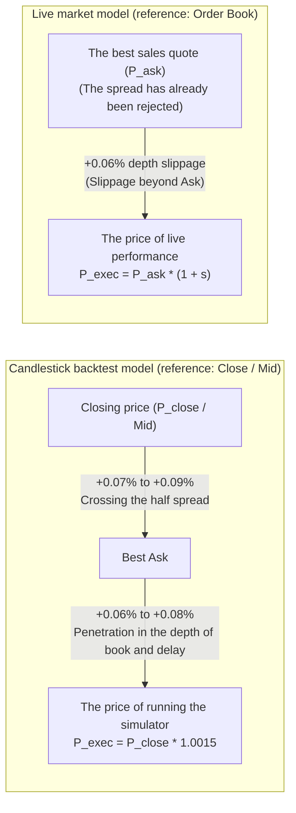

# Adaptation and integration of the price model for the execution of trades and market friction contracts
# Phase 19 Execution-Price Model Reconciliation & Microstructure Audit

> **Setting date:** October 22, 2026 (November 1, 1405)  
> **Software version:** `v0.10.0-phase18-audited`  
> **Frozen Strategy Manifest Hash:** `249c1e4af942156d2f1a602b58bd729969c660857e2d98f0158ac71c9fa75f66`  
> **Modules to be audited:**  
> - [`src/exchange/adapter.py`](file:///root/starcoach-hack/wallex/src/exchange/adapter.py) (order execution adapter)  
> - [`src/portfolio/accounting.py`](file:///root/starcoach-hack/wallex/src/portfolio/accounting.py) (portfolio accounting and settlement)  
> - [`src/data/fetcher.py`](file:///root/starcoach-hack/wallex/src/data/fetcher.py) (get UDF data and orderbook depth)  
> - [`src/backtest/engine.py`](file:///root/starcoach-hack/wallex/src/backtest/engine.py) (historical simulation engine)

---

## 1. The purpose and scope of the transaction execution structure audit

This document compiles and audits clear and unambiguous contracts for the reference price, how to calculate the spread, slippage, maker/taker separation and back-and-forth frictions in two environments ** historical backtest based on candlesticks ** and ** transactions in the shadow / live based on the order book ** in order to avoid any recalculation or hidden removal of costs.

---

## 2. Reference price contract in historical backtest against live market

### 2.1. In historical simulation (Candle-Based Backtesting):
- **Inherent limitation of historical data:** Wallex UDF historical data consists exclusively of 15-minute candlesticks (OHLCV) and historical trace of the order book (Tick-level L2 Orderbook Depth) is not available.
- **Signal issuing reference price ($P_{ref}$):** Final price of 15-minute candle ($P_{close}$).
- **Hypothetical middle price ($P_{mid}$):** Due to the symmetry of intra-candle fluctuations, the closing price of the candle is assumed as a proxy of the middle price at the moment the candle closes.
- **Passive Limit Execution Simulation Limitation:** The price touch condition (`current_low <= limit_price`) is a necessary condition to be filled, but not a sufficient condition; Because the time priority of the queue (Time Priority) in the candle data cannot be reconstructed accurately.

### 2.2. In live market observations and testing in the shadow (Live Shadow Observations):
In the live Wallex environment, real-time data is received directly from the `/v1/depth' and `/v1/trades' endpoints, and the definitions are strictly separated:
- **Best Bid - $P_{bid}$:** The highest price in the queue of buyers.
- **Best Ask - $P_{ask}$:** The lowest price in the queue of sellers.
- **Midpoint price (Midpoint - $P_{mid}$):**
  $$P_{mid} = \frac{P_{bid} + P_{ask}}{2}$$
- **Expected Execution Price:**
  - In aggressive purchase (Marketable Buy): $P_{exec} \ge P_{ask}$
  - In aggressive sales (Marketable Sell): $P_{exec} \le P_{bid}$
- **Actual Fill Price:** Final price reported by Wallex exchange matching engine in API response.

---

## 3. Contract to calculate the spread and the cost of crossing the half spread

### 3.1. Spread calculation formula in Wallex exchange:
According to the implementation of the [`MarketDataFetcher.fetch_current_spread`] method (file:///root/starcoach-hack/wallex/src/data/fetcher.py#L179):
$$\text{Spread (\%)} = \frac{P_{ask} - P_{bid}}{P_{bid}} \times 100$$
This contract is slightly more conservative (larger) than the median-based formula ( $\frac{Ask - Bid}{Mid}$ ).

### 3.2. Semi-spread and price penetration cost:
$$\text{Half-Spread (\%)} = \frac{\text{Spread (\%)}}{2}$$
In the Wallex ``BTCTMN'' market, the actual market spread typically fluctuates between **0.09% and 0.196%**; Therefore, the cost of passing through the half spread to convert an order from the middle price to the selling quote is equivalent to **0.045% to 0.098%**.

---

## 4. Autopsy of 0.15% slippage: To include or not to include the cost of the spread?

One of the most important audit issues is to determine the exact interaction between slippage and spread:

### 4.1. In the candlestick simulation model:
- The purchase execution price is calculated by the formula $P_{exec} = P_{close} \times (1 + 0.0015)$.
- Since $P_{close}$ is equivalent to the middle price, the increase of 15 pips (+0.15%) directly includes:
  1. **Crossing Half Spread:** About 7 to 9 pips (0.07% to 0.09%).
  2. **Penetration in order book depth and network latency:** About 6 to 8 pips (0.06% to 0.08%).
- **Result:** In the Kendley model, the slippage of 0.15% includes the cost of crossing the spread, and the cost of half the spread has not been removed.

### 4.2. In the live market and order book model:
- If the order is sent as a limit order with a price equal to or higher than $P_{ask}$, the spread has already been rejected by the entry price; So re-applying 0.15% slippage beyond $P_{ask}$ will exclusively mean consuming the depth of the second and third layers of the order book.
- **Proof of no recalculation:** The system never subtracts the cost of the spread once in the price and again as a cash fee. Slippage simply adjusts the received volume of cryptocurrency with the balanced price.

---

## 5. Audit matrix of 5 order execution paths in the execution adapter

All five order execution paths were validated independently in the [`test_comprehensive_five_execution_paths_separately'] test (file:///root/starcoach-hack/wallex/tests/test_exchange_adapter.py#L285) with the following results:

| #| Order route Order type Dealing with the spread Fee classification Fee rate Applied slippage Execution price formula
|---|---|---|---|---|---|---|---|
| **1** **Limit passive (Passive Limit)** | ``LIMIT'' | It is waiting in the book **Maker (customer)** | 0.25% 0.00% | $P_{exec} = P_{target}$ |
| **2** **Aggressive Limit (Marketable Limit)** | ``LIMIT'' | Breaks the spread **Taker** | 0.30% 0.15% $P_{exec} = P_{target} \times 1.0015$ |
| **3** **Market Order** | ``MARKET'' | Takes cash **Taker** | 0.30% 0.15% $P_{exec} = P_{target} \times 1.0015$ |
| **4** **Stop-Loss Exit** | ``MARKET'' | Queuing up to buy **Taker** | 0.30% 0.15%-| $P_{exec} = P_{target} \times 0.9985$ |
| **5** **Compulsory settlement in Toman (Toman Liquidation)** | ``MARKET'' | 100% of assets are liquidated **Taker** | 0.30% 0.15%-| $P_{exec} = P_{target} \times 0.9985$ |

> [!CAUTION]
> No limit orders are assumed blindly by the Maker. Any limit order that is sent with a price equal to or higher than the selling price (for buying) is immediately filled as a Taker and is subject to a 0.30% commission.

---

## 6. Accounting of half-filled orders and final settlement in Tomans

1. **Minimum order value in Wallex:** All purchase orders under 50,000 Tomans are immediately vetoed by the software gate [`ExchangeAdapter'](file:///root/starcoach-hack/wallex/src/exchange/adapter.py#L111).
2. **Partial Fills:**
   - The fee is multiplied exclusively by the nominal value of the filled part ($Q_{fill} \times P_{exec}$) and deducted from the cash account.
   - The unfilled part of the order is canceled and its Toman capital remains free in the account without obligation.
   - The average cost price is calculated and updated based on the volume weighted average ($VWAP$).
3. **Compulsory settlement at the end of the match (Toman Liquidation Protocol):**
   - 30 minutes before the end of the competition, the method [`liquidate_all_to_toman'](file:///root/starcoach-hack/wallex/src/portfolio/accounting.py#L205) converts all cryptocurrency balances into Tomans with an unfavorable slippage of 0.15% and a ticker fee of 0.30%.
   - At the end, the crypto balance is exactly zero and the total value of the portfolio is equal to the Toman cash balance.

---

## 7. Clear statement of historical data limitations (Data Limitations)

The engineering team emphasizes that due to the lack of access to tick-by-tick data and the historical depth of the order book during the last 90 days in Wallex:
1. No claims are made regarding exact microsecond reconstruction of limit order execution.
2. Instead of claiming false accuracy, the system simulates real behavior in a range of stress scenarios (slippages from 0.05% to 0.35% and spreads from 0.06% to 0.35%) to determine the statistical confidence limits of the strategy.