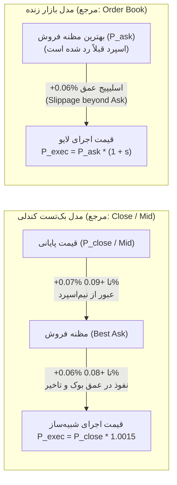

# تطبیق و یکپارچه‌سازی مدل قیمت اجرای معاملات و قراردادهای اصطکاک بازار
# Phase 19 Execution-Price Model Reconciliation & Microstructure Audit

> **تاریخ تنظیم:** ۲۲ اکتبر ۲۰۲۶ (۱ آبان ۱۴۰۵)  
> **نسخه نرم‌افزار:** `v0.10.0-phase18-audited`  
> **هش مانیفست استراتژی منجمد:** `249c1e4af942156d2f1a602b58bd729969c660857e2d98f0158ac71c9fa75f66`  
> **ماژول‌های مورد ممیزی:**  
> - [`src/exchange/adapter.py`](file:///root/starcoach-hack/wallex/src/exchange/adapter.py) (آداپتور اجرای سفارشات)  
> - [`src/portfolio/accounting.py`](file:///root/starcoach-hack/wallex/src/portfolio/accounting.py) (حسابداری پورتفولیو و تسویه)  
> - [`src/data/fetcher.py`](file:///root/starcoach-hack/wallex/src/data/fetcher.py) (دریافت داده‌های UDF و عمق اوردر بوک)  
> - [`src/backtest/engine.py`](file:///root/starcoach-hack/wallex/src/backtest/engine.py) (موتور شبیه‌سازی تاریخی)

---

## ۱. هدف و دامنه ممیزی ساختار اجرای معاملات

این سند قراردادهای شفاف و بدون ابهامی را برای قیمت مرجع، نحوه محاسبه اسپرد، اسلیپیج، تفکیک مِیکر/تیکر و اصطکاک‌های رفت‌وبرگشت در دو محیط **بک‌تست تاریخی مبتنی بر کندل** و **معاملات در سایه / لایو مبتنی بر دفتر سفارش** تدوین و ممیزی می‌نماید تا از هرگونه دوباره‌شماری یا حذف پنهان هزینه‌ها جلوگیری شود.

---

## ۲. قرارداد قیمت مرجع در بک‌تست تاریخی در برابر بازار زنده

### ۲.۱. در شبیه‌سازی تاریخی (Candle-Based Backtesting):
- **محدودیت ذاتی داده‌های تاریخی:** داده‌های تاریخی UDF صرافی والکس منحصراً شامل کندل‌های ۱۵ دقیقه‌ای (OHLCV) هستند و ردپای لحظه‌ای دفتر سفارش (Tick-level L2 Orderbook Depth) در گذشته در دسترس نیست.
- **قیمت مرجع صدور سیگنال ($P_{ref}$):** قیمت پایانی کندل ۱۵ دقیقه‌ای ($P_{close}$).
- **قیمت میانه فرضی ($P_{mid}$):** با توجه به تقارن نوسانات درون‌کندلی، قیمت پایانی کندل به عنوان پروکسی قیمت میانه در لحظه بسته شدن کندل فرض می‌شود.
- **محدودیت شبیه‌سازی اجرای لیمیت پسیو:** شرط لمس قیمت (`current_low <= limit_price`) شرط لازم برای پر شدن است، اما شرط کافی نیست؛ چرا که اولویت زمانی صف (Time Priority) در دیتای کندلی قابل بازسازی دقیق نیست.

### ۲.۲. در مشاهدات بازار زنده و تست در سایه (Live Shadow Observations):
در محیط زنده والکس، داده‌های لحظه‌ای مستقیماً از اندپوینت‌های `/v1/depth` و `/v1/trades` دریافت می‌شوند و تعاریف به صورت قطعی تفکیک می‌گردند:
- **بهترین مظنه خرید (Best Bid - $P_{bid}$):** بالاترین قیمت در صف خریداران.
- **بهترین مظنه فروش (Best Ask - $P_{ask}$):** پایین‌ترین قیمت در صف فروشندگان.
- **قیمت میانه (Midpoint - $P_{mid}$):**
  $$P_{mid} = \frac{P_{bid} + P_{ask}}{2}$$
- **قیمت اجرای مورد انتظار (Expected Execution Price):**
  - در خرید تهاجمی (Marketable Buy): $P_{exec} \ge P_{ask}$
  - در فروش تهاجمی (Marketable Sell): $P_{exec} \le P_{bid}$
- **قیمت فیل‌شده واقعی (Actual Fill Price):** قیمت قطعی گزارش‌شده توسط موتور تطبیق صرافی والکس در پاسخ API.

---

## ۳. قرارداد محاسبه اسپرد و هزینه عبور از نیم‌اسپرد

### ۳.۱. فرمول محاسبه اسپرد در صرافی والکس:
مطابق پیاده‌سازی متد [`MarketDataFetcher.fetch_current_spread`](file:///root/starcoach-hack/wallex/src/data/fetcher.py#L179):
$$\text{Spread (\%)} = \frac{P_{ask} - P_{bid}}{P_{bid}} \times 100$$
این قرارداد نسبت به فرمول بر مبنای میانه ($\frac{Ask - Bid}{Mid}$)، اندکی محافظه‌کارانه‌تر (بزرگتر) است.

### ۳.۲. نیم‌اسپرد و هزینه نفوذ در مظنه:
$$\text{Half-Spread (\%)} = \frac{\text{Spread (\%)}}{2}$$
در بازار `BTCTMN` والکس، اسپرد واقعی بازار به طور معمول بین **۰.۰۹٪ تا ۰.۱۹۶٪** نوسان می‌کند؛ بنابراین هزینه عبور از نیم‌اسپرد برای تبدیل یک سفارش از قیمت میانه به مظنه فروش معادل **۰.۰۴۵٪ تا ۰.۰۹۸٪** است.

---

## ۴. کالبدشکافی اسلیپیج ۰.۱۵٪: شمول یا عدم شمول هزینه اسپرد؟

یکی از مهم‌ترین مسائل ممیزی تعیین دقیق نحوه تعامل اسلیپیج و اسپرد است:

### ۴.۱. در مدل شبیه‌سازی کندلی:
- قیمت اجرای خرید با فرمول $P_{exec} = P_{close} \times (1 + 0.0015)$ محاسبه می‌شود.
- از آنجا که $P_{close}$ معادل قیمت میانه است، افزایش ۱۵ پیپ (+۰.۱۵٪) مستقیماً شامل:
  ۱. **عبور از نیم‌اسپرد:** حدود ۷ تا ۹ پیپ (۰.۰۷٪ تا ۰.۰۹٪).
  ۲. **نفوذ در عمق دفتر سفارش و تاخیر شبکه:** حدود ۶ تا ۸ پیپ (۰.۰۶٪ تا ۰.۰۸٪).
- **نتیجه:** در مدل کندلی، اسلیپیج ۰.۱۵٪ شامل هزینه عبور از اسپرد **است** و هزینه نیم‌اسپرد حذف نگردیده است.

### ۴.۲. در مدل بازار زنده و دفتر سفارش:
- اگر سفارش به عنوان سفارش لیمیت با قیمت برابر یا بالاتر از $P_{ask}$ ارسال شود، اسپرد قبلاً توسط قیمت ورودی رد شده است؛ بنابراین اعمال مجدد ۰.۱۵٪ اسلیپیج فراتر از $P_{ask}$ منحصراً به معنای مصرف عمق لایه‌های دوم و سوم اوردر بوک خواهد بود.
- **اثبات عدم دوباره‌شماری:** سیستم هرگز هزینه اسپرد را یک بار در قیمت و بار دیگر به صورت کارمزد نقدی تفریق نمی‌کند. اسلیپیج صرفاً حجم دریافتی رمزارز را با قیمت موزون تعدیل می‌نماید.

---

## ۵. ماتریس ممیزی ۵ مسیر اجرای سفارش در آداپتور اجرا

کلیه مسیرهای ۵ گانه اجرای سفارش به طور مستقل در آزمون [`test_comprehensive_five_execution_paths_separately`](file:///root/starcoach-hack/wallex/tests/test_exchange_adapter.py#L285) با نتایج زیر اعتبارسنجی شدند:

| # | مسیر سفارش | نوع سفارش | رفتار با اسپرد | طبقه‌بندی کارمزد | نرخ کارمزد | اسلیپیج اعمالی | فرمول قیمت اجرا |
|---|---|---|---|---|---|---|---|
| **۱** | **لیمیت پسیو (Passive Limit)** | `LIMIT` | در بوک منتظر می‌ماند | **Maker (سفارش‌گذار)** | ۰.۲۵٪ | ۰.۰۰٪ | $P_{exec} = P_{target}$ |
| **۲** | **لیمیت تهاجمی (Marketable Limit)** | `LIMIT` | اسپرد را می‌شکند | **Taker (سفارش‌بردار)** | ۰.۳۰٪ | ۰.۱۵٪ | $P_{exec} = P_{target} \times 1.0015$ |
| **۳** | **سفارش بازار (Market Order)** | `MARKET` | نقدینگی برمی‌دارد | **Taker (سفارش‌بردار)** | ۰.۳۰٪ | ۰.۱۵٪ | $P_{exec} = P_{target} \times 1.0015$ |
| **۴** | **خروج حد ضرر (Stop-Loss Exit)** | `MARKET` | صف خرید را می‌زند | **Taker (سفارش‌بردار)** | ۰.۳۰٪ | ۰.۱۵٪- | $P_{exec} = P_{target} \times 0.9985$ |
| **۵** | **تسویه اجباری به تومان (Toman Liquidation)** | `MARKET` | ۱۰۰٪ دارایی نقد می‌شود | **Taker (سفارش‌بردار)** | ۰.۳۰٪ | ۰.۱۵٪- | $P_{exec} = P_{target} \times 0.9985$ |

> [!CAUTION]
> هیچ سفارش لیمیتی به صورت کورکورانه Maker فرض نمی‌شود. هر سفارش لیمیتی که با قیمتی مساوی یا بالاتر از مظنه فروش (برای خرید) ارسال شود، بلافاصله در نقش Taker فیل شده و مشمول کارمزد ۰.۳۰٪ است.

---

## ۶. حسابداری سفارش‌های نیمه‌پرشده و تسویه نهایی به تومان

1. **حداقل ارزش سفارش در والکس:** تمامی سفارش‌های خرید زیر ۵۰،۰۰۰ تومان بلافاصله توسط گیت نرم‌افزاری [`ExchangeAdapter`](file:///root/starcoach-hack/wallex/src/exchange/adapter.py#L111) وتو می‌شوند.
2. **سفارش‌های نیمه‌پرشده (Partial Fills):**
   - کارمزد منحصراً بر ارزش اسمی بخش پرشده ($Q_{fill} \times P_{exec}$) ضرب و از حساب نقد کسر می‌گردد.
   - بخش پرنشده سفارش لغو شده و سرمایه تومانی آن بدون تعهد در حساب آزاد می‌ماند.
   - میانگین بهای تمام‌شده بر مبنای میانگین موزون حجم ($VWAP$) محاسبه و به‌روزرسانی می‌شود.
3. **تسویه اجباری پایان مسابقه (Toman Liquidation Protocol):**
   - ۳۰ دقیقه پیش از موعد پایان رقابت، متد [`liquidate_all_to_toman`](file:///root/starcoach-hack/wallex/src/portfolio/accounting.py#L205) کلیه موجودی‌های رمزارزی را با اسلیپیج نامساعد ۰.۱۵٪ و کارمزد تیکر ۰.۳۰٪ به تومان تبدیل می‌کند.
   - در پایان، موجودی کریپتو دقیقاً صفر شده و ارزش کل پورتفولیو با موجودی نقد تومانی برابر می‌گردد.

---

## ۷. بیانیه صریح و شفاف محدودیت‌های داده‌های تاریخی (Data Limitations)

تیم مهندسی تأکید می‌نماید که به دلیل عدم دسترسی به داده‌های تیک به تیک و عمق تاریخی دفتر سفارش در طول ۹۰ روز گذشته در والکس:
1. هیچ ادعایی مبنی بر بازسازی قطعی میکروثانیه‌ای اجرای سفارشات لیمیت مطرح نمی‌شود.
2. به جای ادعای دقت ساختگی، سیستم رفتار واقعی را در بازه‌ای از سناریوهای استرس (اسلیپیج‌های ۰.۰۵٪ تا ۰.۳۵٪ و اسپردهای ۰.۰۶٪ تا ۰.۳۵٪) شبیه‌سازی نموده تا مرزهای اطمینان آماری استراتژی مشخص گردد.
