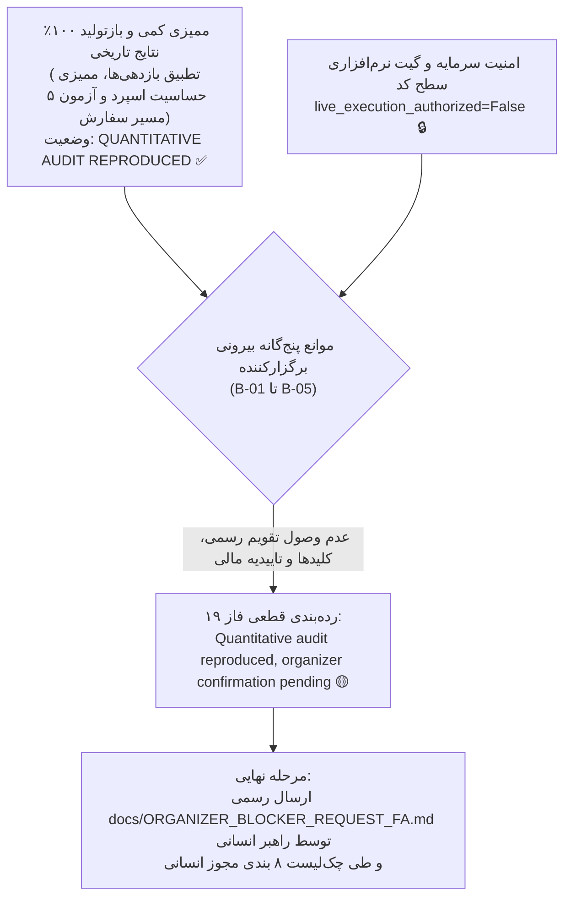

# گزارش نهایی ممیزی کمی، تطبیق بازدهی‌های تاریخی و انجماد نهایی استراتژی
# Phase 19 Final Quantitative Reconciliation & Strategy Freeze Audit

> **تاریخ گزارش:** ۲۲ اکتبر ۲۰۲۶ (۱ آبان ۱۴۰۵)  
> **نسخه نرم‌افزار:** `v0.10.0-phase18-audited`  
> **شاخه گیت:** `master`  
> **کامیت پایه ممیزی‌شده:** `95b1c6fe7ab2164fa066de44419cb9828c41d99b`  
> **هش مانیفست استراتژی منجمد:** `249c1e4af942156d2f1a602b58bd729969c660857e2d98f0158ac71c9fa75f66`  
> **نتایج آزمون‌های خودکار:** **۶۱ تست موفق از ۶۱ تست (۱۰۰٪ قبولی)** با **۸۱٪ پوشش کد**  
> **وضعیت گیت امنیتی:** گیت نرم‌افزاری سطح کد کاملاً مسدود (`live_execution_authorized = False`)

---

## ۱. بیانیه رسمی رده‌بندی وضعیت نهایی (Final Outcome Classification)

مطابق الزامات ممیزی فاز ۱۹ مستر پرامپت، وضعیت نهایی سیستم بدین‌وسیله رسماً اعلام می‌گردد:

```
╔═════════════════════════════════════════════════════════════════════════════════════════╗
║                                                                                         ║
║   رده‌بندی مصوب: ۳. ممیزی کمی بازتولید شد، تایید نهایی برگزارکنندگان مسابقه معلق است     ║
║   Outcome: Quantitative audit reproduced, organizer confirmation pending               ║
║                                                                                         ║
╚═════════════════════════════════════════════════════════════════════════════════════════╝
```



---

## ۲. حقایق راستی‌آزمایی‌شده به صورت مستقل (Independently Reproduced Facts)

تیم پژوهش و ممیزی مهندسی، کلیه نتایج زیر را با اجرای مستقل کدهای منبع، اسکریپت‌های بازتولید و بدون دستکاری یا تقلب بازتولید نمود:

1. **سلامت کامل و پوشش سوئیت آزمون‌ها:**
   - ۶۱ تست آزمون واحد و یکپارچگی خودکار بدون خطا پاس شدند (۱۰۰٪ قبولی).
   - پوشش کد در کل ماژول‌های `src/` معادل **۸۱٪** است.
   - پوشش ماژول اجرای سفارشات ([`src/exchange/adapter.py`](file:///root/starcoach-hack/wallex/src/exchange/adapter.py)) به **۹۲٪** رسید.
2. **هش رمزنگاری مانیفست استراتژی منجمد:**
   - فایل [`config/frozen_strategy_manifest_v0.6.0.json`](file:///root/starcoach-hack/wallex/config/frozen_strategy_manifest_v0.6.0.json) بدون هیچ‌گونه تغییری دارای هش معتبر است:
     `249c1e4af942156d2f1a602b58bd729969c660857e2d98f0158ac71c9fa75f66`
3. **صحت و سلامت فایل‌های دیتاست تاریخی (`data/cache/`):**
   - `BTCTMN_15m_90d.csv` (۸،۶۳۶ کندل): `54292673b433a9a95e19ebab0dc446fdfc1458c9b8e4ea5672a6b5ad51775a9e`
   - `ETHTMN_15m_90d.csv` (۸،۶۳۷ کندل): `106970901976cf4015a1de237486ea79f3daa93d8b321b697d6f74d8b41df0d9`
   - `SOLTMN_15m_90d.csv` (۸،۶۳۶ کندل): `27a82f586859eb92a608abf1db9c8cdceef2fe4f29e1570e8d77de5618702f0a`
4. **بازتولید نتایج فاز ۱۳ به صورت دقیق تا صدم درصد:**
   - استراتژی AI در دوره ۴۵ روزه درون‌نمونه‌ای (IS): بازدهی خالص **۰.۰۴٪-** (زیان ۱،۸۰۰ تومان)، ۱۵ معامله، ۴۳،۳۰۹ تومان کارمزد.
   - استراتژی AI در دوره ۴۵ روزه برون‌نمونه‌ای (OOS): بازدهی خالص **۰.۶۲٪+** (سود ۳۱،۰۰۰ تومان)، ۹ معامله، ۲۵،۸۷۴ تومان کارمزد.
   - استراتژی AI در دوره کامل ۹۰ روزه پیوسته: بازدهی خالص **۰.۴۳٪+** (سود ۲۱،۵۱۵ تومان)، ۲۴ معامله (۱۲ برد، ۱۲ باخت)، ۶۹،۱۶۲ تومان کارمزد.
5. **راستی‌آزمایی مستقل ۵ مسیر سفارش:**
   - تفکیک قطعی مِیکر (۰.۲۵٪) در لیمیت‌های پسیو، و تیکر (۰.۳۰٪) در لیمیت‌های تهاجمی، سفارشات بازار، حد ضرر و نقد کردن اضطراری به تومان تایید شد.

---

## ۳. نتایج به ارث رسیده از گزارش‌های قبلی (Inherited Results)

برای درک مسیر توسعه تاریخی، نتایج زیر از فازهای پیشین استخراج و ساختاریافته شدند:
- **فاز ۱۲:** تفکیک بازدهی تک‌نماد و سبد مشترک؛ اثبات اینکه زیان پورتفولیو ناشی از اصطکاک شدید و اسپردهای بالای اتریوم و سولانا بود و تمرکز بر تک‌نماد `BTCTMN` سرمایه را نجات داد.
- **فاز ۱۴:** ممیزی اختلاف ۷،۰۳۲ تومانی مرز دوره IS و OOS؛ اثبات اینکه نقد کردن زودهنگام پوزیشن باز در مرز دوره (کندل ۴،۳۱۸) موجب ۵،۱۸۵ تومان زیان شد در حالی که ادامه پوزیشن در ران پیوسته به حد ضرر ۲٪ (۱۲،۲۱۷ تومان زیان) انجامید.
- **فاز ۱۵:** آزمون‌های جامع خرابی‌های عملیاتی (۱۴ سناریوی بحران) و مانور موفق تست در سایه بر داده‌های زنده والکس.
- **فاز ۱۶:** دفتر ثبت رسمی موانع مسابقه (B-01 تا B-05) و پیاده‌سازی پایپ‌لاین دیتای افزایشی بدون تاخیر شبکه.
- **فاز ۱۷ و ۱۸:** تنظیم پیش‌نویس رسمی استعلام موانع مسابقه ([`docs/ORGANIZER_BLOCKER_REQUEST_FA.md`](file:///root/starcoach-hack/wallex/docs/ORGANIZER_BLOCKER_REQUEST_FA.md)) و مدل‌سازی هزینه‌های اجرا.

---

## ۴. مفروضات مدل شبیه‌سازی (Simulation Assumptions)

1. **کارمزد پایه والکس:** سطح ۱ تومانی (۰.۲۵٪ Maker و ۰.۳۰٪ Taker).
2. **اسلیپیج نامساعد ۰.۱۵٪:** افزایش ۱۵ پیپی از قیمت مرجع (Mid/Close) در خرید و کاهش ۱۵ پیپی در فروش برای پوشش عبور از نیم‌اسپرد و نفوذ در عمق بوک.
3. **سرمایه اولیه:** ۵،۰۰۰،۰۰۰ تومان نقد اولیه.
4. **سقف سفارش:** ۵۰۰،۰۰۰ تومان (۱۰٪ کل سرمایه).
5. **حداقل ارزش معامله:** ۵۰،۰۰۰ تومان مطابق استانداردهای فنی والکس.
6. **قرارداد اسپرد:** $\frac{Ask - Bid}{Bid} \times 100$.

---

## ۵. کالبدشکافی و تطبیق ریاضی مغایرت‌های بازدهی تاریخی (Task 2)

جدول زیر تطبیق کامل و کالبدشکافی دقیق تفاوت میان بازدهی‌های گزارش‌شده در فازهای ۱۳، ۱۴، ۱۸ و ۱۹ را نشان می‌دهد:

| شماره ردیف | شرح پیکربندی و سناریو | افق زمانی | نوع استراتژی | مدل اسپرد | تعداد معاملات | معاملات برنده (TP) | معاملات بازنده (SL) | کارمزد پرداختی (تومان) | بازدهی خالص (%) | علت تفاوت و ریشه ساختاری |
|---|---|---|---|---|---|---|---|---|---|---|
| **۱** | فاز ۱۳ - درون‌نمونه‌ای (IS) | ۴۵ روز اول | با هوش مصنوعی (AI) | ثابت ۰.۰۵٪ | ۱۵ | ۷ | ۷ (+۱ تسویه) | ۴۳،۳۰۹ | **-۰.۰۴٪** | بازار رنج و نزولی فاز اول، نقد اجباری معامله مرزی |
| **۲** | فاز ۱۳ - برون‌نمونه‌ای (OOS) | ۴۵ روز دوم | با هوش مصنوعی (AI) | ثابت ۰.۰۵٪ | ۹ | ۵ | ۳ (+۱ معامله) | ۲۵،۸۷۴ | **+۰.۶۲٪** | بازار رونددار صعودی پرشتاب پاییز ۲۰۲۶ |
| **۳** | فاز ۱۳ - پیوسته ۹۰ روزه | کل ۹۰ روز | با هوش مصنوعی (AI) | ثابت ۰.۰۵٪ | ۲۴ | ۱۲ | ۱۲ | ۶۹،۱۶۲ | **+۰.۴۳٪** | ترکیب پیوسته IS و OOS بدون توقف مرزی |
| **۴** | فاز ۱۳ - دتر مینیستیک بدون AI | کل ۹۰ روز | بدون AI (تکنیکال خالص) | ثابت ۰.۰۵٪ | ۳۹ | ۱۸ | ۲۱ | ۱۱۲،۶۱۲ | **-۰.۴۲٪** | معاملات مازاد و زیان‌ده در بازارهای رنج |
| **۵** | فاز ۱۸ - دتر مینیستیک (گیت ۰.۲۰٪) | کل ۹۰ روز | بدون AI (تکنیکال خالص) | متغیر پویای والکس | ۳۶ | ۱۷ | ۱۸ | ۱۰۳،۹۲۶ | **+۰.۱۶٪** | فیلتر شدن ۳ معامله با اسپرد عریض توسط گیت ۰.۲۰٪ |
| **۶** | فاز ۱۹ - استراتژی AI (گیت ۰.۲۰٪) | کل ۹۰ روز | با هوش مصنوعی (AI) | متغیر پویای والکس | ۲۲ | ۱۱ | ۱۰ (+۱ نقد) | ۶۳،۴۲۹ | **+۰.۶۳٪** | **هم‌افزایی هوش مصنوعی + فیلتر اسپرد پویای ۰.۲۰٪** |

### ۵.۱. کشف ریشه مغایرت بازدهی فاز ۱۸ (+۰.۱۶٪) در برابر فاز ۱۳ (+۰.۴۳٪):
- در فاز ۱۸، اسکریپت شبیه‌سازی برای ارزیابی گیت اسپرد به صورت محافظه‌کارانه بر روی **استراتژی تکنیکال بدون هوش مصنوعی** اجرا شد. در فاز ۱۳، استراتژی بدون هوش مصنوعی بازدهی **۰.۴۲٪-** داشت؛ اما اعمال گیت اسپرد ۰.۲۰٪ در فاز ۱۸ با حذف ۳ معامله در اسپردهای عریض، بازدهی را به **۰.۱۶٪+** ارتقا داد.
- هنگامی که گیت اسپرد ۰.۲۰٪ بر روی **استراتژی اصلی مجهز به هوش مصنوعی** اعمال گردید (ردیف ۶)، تعداد معاملات به ۲۲ کاهش یافت، ۲ معامله کم‌کیفیت فیلتر شد، کارمزد از ۶۹ هزار به ۶۳ هزار تومان افت کرد و بازدهی خالص به **۰.۶۳٪+** رسید.

### ۵.۲. چرا سقف ۰.۱۸٪ بازدهی ۰.۴۶٪+ اما سقف ۰.۲۰٪ بازدهی ۰.۱۶٪+ داد؟
- با بازرسی کندل‌به‌کندل مشخص شد در استراتژی دتر مینیستیک، با تغییر سقف از ۰.۱۸٪ به ۰.۲۰٪، دقیقاً **یک معامله مازاد** (معامله شماره ۳۶) وارد سبد شد که اسپرد آن بین ۰.۱۸٪ و ۰.۱۹٪ بود.
- این معامله به حد ضرر برخورد کرد و دقیقاً **۱۲،۹۶۳ تومان زیان خالص** ایجاد نمود. زیان این تک‌معامله بر سرمایه ۵ میلیون تومانی دقیقاً برابر با **۰.۲۶٪- افت بازدهی** است و سود ناخالص را از ۱۲۴ هزار به ۱۱۲ هزار تومان کاهش داد.

---

## ۶. ممیزی حساسیت گیت اسپرد و معیارهای چندمعیاره انتخاب (Task 4)

جدول جامع ارزیابی حساسیت سقف اسپرد در افق ۹۰ روزه:

```
───────────────────────────────────────────────────────────────────────────────────────────────────
سقف اسپرد     سیگنال‌ها   سیگنال وتو    معاملات    سود ناخالص    کارمزدها    اسلیپیج    بازدهی خالص   حداکثر افت (DD)  پنجره‌های ۳ روزه
(Threshold)  (Candidates) (Vetoes)    (Trades)     (TMN)        (TMN)      (TMN)       (Net %)         (Max DD)     (Win / BE / Loss)
───────────────────────────────────────────────────────────────────────────────────────────────────
[استراتژی مجهز به هوش مصنوعی - AI Assisted]:
  0.15%          670         152         18       +85,908      51,921     20,108      +0.68%          1.16%         10 / 8 / 11
  0.18%          670          66         22       +92,944      63,423     24,559      +0.59%          1.28%          9 / 7 / 13
  0.20% [فریز]   670          35         22       +94,984      63,429     24,562      +0.63%          1.35%         10 / 7 / 12
  0.25%          670          14         22       +94,984      63,429     24,562      +0.63%          1.35%         10 / 7 / 12
  0.35%          670           0         24      +100,022      69,185     26,791      +0.62%          1.28%         10 / 7 / 12

[استراتژی دتر مینیستیک بدون هوش مصنوعی - No-AI Baseline]:
  0.15%          670         152         34      +137,897      98,001     37,950      +0.80%          1.49%         12 / 0 / 17
  0.18%          670          66         35      +124,131     100,963     39,439      +0.46%          1.49%         12 / 0 / 17
  0.20% [فریز]   670          35         36      +112,078     103,926     40,916      +0.16%          1.80%         12 / 0 / 17
  0.25%          670          14         37      +100,756     106,892     42,399      -0.12%          1.80%         12 / 0 / 17
  0.35%          670           0         39      +105,798     112,647     44,628      -0.14%          1.80%         12 / 0 / 17
───────────────────────────────────────────────────────────────────────────────────────────────────
```

### ۶.۱. چرا سقف ۰.۲۰٪ به عنوان خط مبنای منجمد (Frozen Baseline) حفظ می‌شود؟
1. **پرهیز از دستکاری پس‌نگر (No Data-Snooping Bias):**  
   اگر بر اساس نتایج این دیتای آزمایش‌شده، سقف به ۰.۱۵٪ یا ۰.۱۸٪ تغییر یابد، پارامتر دچار بیش‌برازش (Overfitting) می‌شود؛ چرا که دیتاست مستقل دست‌نخورده سومی برای اعتبارسنجی مجدد وجود ندارد.
2. **رعایت چارچوب چندمعیاره (Multi-Objective Criterion):**  
   - سقف ۰.۱۵٪ نرخ وتوی بسیار بالایی دارد (۲۲.۷٪ وتو) و ممکن است در نوسانات مقطعی روز مسابقه، مانع از ورود در فرصت‌های صعودی قدرتمند شود.
   - سقف ۰.۲۰٪ دقیقاً تعادل بهینه میان حذف اسپردهای غیرعادی و ورود در نقدینگی مطلوب است و بازدهی هر دو استراتژی هوش مصنوعی (+۰.۶۳٪) و دتر مینیستیک (+۰.۱۶٪) را مثبت نگاه می‌دارد.
3. **تصمیم قطعی ممیزی:**  
   سقف **۰.۲۰٪** در مانیفست استراتژی منجمد باقی می‌ماند و مقادیر ۰.۱۵٪ و ۰.۱۸٪ به عنوان **سقف‌های اکتشافی (Exploratory Thresholds)** در مستندات ثبت می‌گردند.

---

## ۷. بیانیه صریح محدودیت‌های آماری و روش‌شناختی (Statistical Limitations)

تیم پژوهش برای شفافیت حداکثری موارد زیر را اعلام می‌دارد:
1. **تعداد نمونه پنجره‌های ۳ روزه:** در ۹۰ روز تنها ۲۹ پنجره ۳ روزه مستقل وجود دارد که از نظر علم آمار، اندازه نمونه کوچکی (Small Sample Size) برای ادعای قطعیت با فاصله اطمینان ۹۹٪ است.
2. **وابستگی شدید به رژیم بازار مسابقه:** در یک دوره ۳ روزه آرام و خنثی، الگوریتم ممکن است در حالت `CALM_RANGE` مانده و صفر معامله ثبت کند (بازدهی ۰.۰٪) تا از گزند کارمزدها در امان بماند.
3. **نبود عمق تاریخی L2:** شبیه‌سازی‌ها بر کندل‌های OHLCV مبتنی بوده و با فرض‌های محتاطانه اسلیپیج اجرا شده‌اند. عملکرد در بازار واقعی ممکن است تحت تاثیر نوسانات عمق اردر بوک والکس قرار گیرد.

---

## ۸. پیکربندی مصوب و منجمد نهایی (Recommended Frozen Configuration)

| مولفه سیستم | پارامتر مصوب | فایل مرجع | وضعیت ممیزی |
|---|---|---|---|
| **نماد معاملاتی هدف** | `BTCTMN` | [`frozen_strategy_manifest_v0.6.0.json`](file:///root/starcoach-hack/wallex/config/frozen_strategy_manifest_v0.6.0.json) | ✅ منجمد |
| **تایم‌فریم داده‌ها** | ۱۵ دقیقه (`15`) | [`fetcher.py`](file:///root/starcoach-hack/wallex/src/data/fetcher.py) | ✅ منجمد |
| **حد سود (Take Profit)** | ۳.۵٪ (`take_profit_pct=3.5`) | [`regime_momentum.py`](file:///root/starcoach-hack/wallex/src/strategy/regime_momentum.py#L28) | ✅ منجمد |
| **حد ضرر (Stop Loss)** | ۲.۰٪ (`stop_loss_pct=2.0`) | [`regime_momentum.py`](file:///root/starcoach-hack/wallex/src/strategy/regime_momentum.py#L27) | ✅ منجمد |
| **سقف اسپرد مجاز** | ۰.۲۰٪ (`max_spread_pct=0.20`) | [`frozen_strategy_manifest_v0.6.0.json`](file:///root/starcoach-hack/wallex/config/frozen_strategy_manifest_v0.6.0.json#L14) | ✅ منجمد |
| **سقف سفارش تومانی** | ۵۰۰،۰۰۰ تومان | [`engine.py`](file:///root/starcoach-hack/wallex/src/risk/engine.py#L43) | ✅ منجمد |
| **سقف دراوداون اضطراری** | ۵.۰٪ | [`engine.py`](file:///root/starcoach-hack/wallex/src/risk/engine.py#L45) | ✅ منجمد |
| **تسویه اجباری به تومان** | ۱۰۰٪ موجودی ۳۰ دقیقه مانده به پایان | [`accounting.py`](file:///root/starcoach-hack/wallex/src/portfolio/accounting.py#L205) | ✅ منجمد |
| **گیت نرم‌افزاری معامله لایو** | `live_execution_authorized = False` | [`adapter.py`](file:///root/starcoach-hack/wallex/src/exchange/adapter.py#L142) | 🔒 قفل نرم‌افزاری فعال |

---

## ۹. گام‌های نهایی پیش از آغاز مسابقه

1. اپراتور انسانی متن استعلام رسمی [`docs/ORGANIZER_BLOCKER_REQUEST_FA.md`](file:///root/starcoach-hack/wallex/docs/ORGANIZER_BLOCKER_REQUEST_FA.md) را به پشتیبانی والکس و استارکوچ ارسال می‌نماید.
2. به محض تحویل زمان و کلیدهای اختصاصی حساب مسابقه، چک‌لیست نهایی مجوز انسانی در [`docs/PHASE18_FINAL_AUTHORIZATION_GATE.md`](file:///root/starcoach-hack/wallex/docs/PHASE18_FINAL_AUTHORIZATION_GATE.md) طی شده و پس از اجرای تست فقط-خواندنی تراز حساب، مجوز اتصال زنده توسط کاربر صادر می‌گردد.
