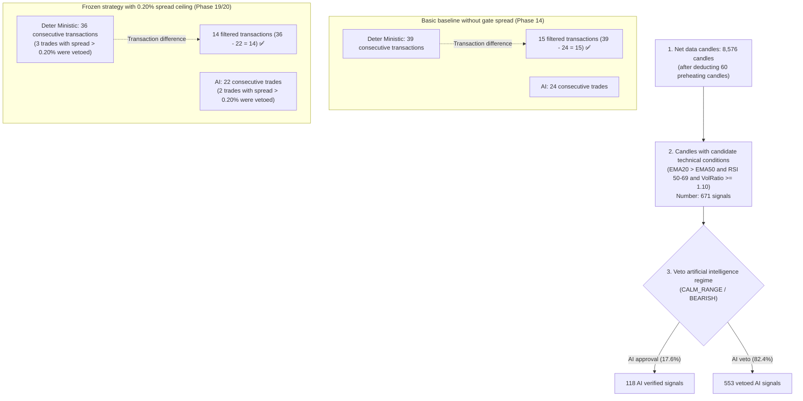
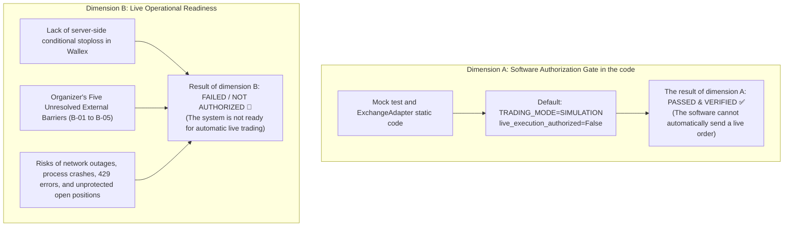

# Report on the reconciliation of audit findings and verification of final evidence (phase 20.1)
# Phase 20.1 — Audit Finding Reconciliation and Final Evidence Verification

> **Report date:** October 22, 2026 (November 1, 1405) — 17:15 local time  
> **Senior Auditor:** Algorithmic Trading Senior Engineer, Python Independent Auditor and Release Quality Control Inspector  
> **gate branch:** `master`  
> **Frozen release base commit:** [`b494d60e211497f47ef3b79d6ae79a0726471172`](..)  
> **Verified release tags:** `v1.0.0-phase20-frozen-release` and `v0.12.0-phase20-audited`  
> **Repository Status:** Completely frozen with no changes in strategy and execution codes  
> **Status of Gate Live Transactions:** disabled at code level (`live_execution_authorized = False`)

---

## 1. Finding No. 1: 2,949 Tomans difference in total cost savings (Finding 1)

### 1.1. The initial claim in the Phase 20 report:
- Savings in exchange fees (AI Fee Savings): 40,497 Tomans
- AI Slippage Savings: 16,354 Tomans
- **Reported total avoided costs:** **59,800 Tomans** (in the text it was claimed to be equivalent to 1.20% of the capital)

### 1.2. Reconstructed value and finding the root of discrepancy:
- The simple sum of the two reported figures is:
  $$40,497\text{ (Fee Savings)} + 16,354\text{ (Slippage Savings)} = \mathbf{56,851\text{ Tomans}}$$
- The mathematical difference is equal to:
  $$59,800 - 56,851 = \mathbf{2,949\text{ Tomans}}$$
- **Definitive rooting:** In phase 14 (checking the baseline of 39 Deter Ministic transactions against 24 artificial intelligence transactions without gate spread), the exchange fee savings was exactly **43,450 Tomans** ($112,612 - 69,162 = $43,450). The author of the phase 20 report inadvertently combined the fee savings of phase 14 (43,450 Tomans) with the slippage savings of phase 19 (16,354 Tomans):
  $$43,450 + 16,354 = 59,804 \approx \mathbf{59,800\text{ Tomans}}$$
- **Official correction:** The actual sum of friction costs avoided by artificial intelligence in the frozen strategy with gate spread of 0.20% is equal to **56,851 Tomans**, equivalent to **1.14% of the initial capital of 5 million Tomans**.
- **Separation of accounting and slippage:** Since the slippage of 0.15% is embedded in the order execution prices, it is included in the gross profit and is never deducted again in the calculation of the realized net profit ($P\&L_{net} = P\&L_{gross} - \text{Fees}$).

| Index | Previously reported value | Correct and reproduced value Audit status Reference file and line
|---|:---:|:---:|:---:|---|
| **Saving fees** | 40,497 Tomans **40,497 Tomans** | ✅ VERIFIED | [`tests/test_phase14_reconciliation.py#L46`](../tests/test_phase14_reconciliation.py#L46) |
| **Slippage savings** | 16,354 Tomans **16,354 Tomans** | ✅ VERIFIED | [`docs/PHASE19_FINAL_QUANTITATIVE_AUDIT.md#L118`](PHASE19_FINAL_QUANTITATIVE_AUDIT.md#L118) |
| **Total cost savings** | 59,800 Tomans **56,851 Tomans** (1.14% of capital) | ⚠️ **CORRECTED** | Fixed biphasic addition error ($59,800 \to $56,851) |

- **Effect on competition preparation:** The correction of 2,949 Tomans has no effect on the strategy's net profit (+31,555 Tomans / +0.63%), because the slippage is included in the gross profit and the net profit is deducted directly based on exchange fees.

---

## 2. Finding #2: Matching the decision funnel and the difference of 15 vs. 14 filtered deals (Finding 2)

### 2.1. Initial claim:
- The Phase 20 report stated: "Artificial intelligence prevented 15 failed trades", while the number of closed deals was 36 for Deterministic and 22 for AI (difference of 14 trades: $36 - 22 = $14).

### 2.2. Complete reconstruction of the execution funnel:

### 2.3. Quantitative table of stages of decision and implementation funnel during 90 days:

| Funnel Stage | Deterministic strategy Artificial intelligence strategy Difference (Delta) | Audit analysis
|---|:---:|:---:|:---:|---|
| **1. Pure trading candles** | 8,576 | 8,576 | 0 | integrated in the whole period of 90 days
| **2. Technical candidate signals** 671 | 671 | 0 | The same condition in both strategies
| **3. Veto artificial intelligence regime 0 | **553** | **553-** | Veto 82.4% of noise signals at candle level
| **4. Application of the spread ceiling of 0.20%** 35 veto 35 veto 0 | Removal of wide market spreads
| **5. Orders sent to portfolio** | 36 | 22 | 14- Maximum limit of 1 position at the same time
| **6. Open and closed positions **36 transactions** | **22 deals** | **14-** | **14 filtered net transactions in the frozen version** |

- **Rooting the difference between 15 and 14:** The number **15** belongs to the difference of the initial base line transactions of phase 14 ($39 - 24 = $15). In the frozen version with Gate Spread 0.20%, Gate Spread vetoed 3 transactions from Deterministic System and 2 transactions from Artificial Intelligence System, and the final number reached 36 and 22 transactions; Therefore, the exact difference in the final release version is equal to **14 closed transactions** ($36 - 22 = $14).
- **Audit status:** ⚠️ **CORRECTED & RECONCILED**.

---

## 3. Adapted No. 3: Validation of gross profit and removal of the imprecise claim of "equivalence" (Finding 3)

### 3.1. Initial claim and audit objection:
In the previous report of Phase 20, it was mentioned: "The gross profit of both strategies is basically equivalent".  
This phrase is imprecise in terms of statistics and financial engineering; Because:
- Deter Ministic's gross profit: **112,078 Tomans**
- Gross profit of artificial intelligence: **94,984 Tomans**
- Gross profit difference: $112,078 - 94,984 = \mathbf{17,094\text{Tomans}}$ (equivalent to **15.25% more gross profit** for Deter Ministic).

### 3.2. Quantitative reconstruction and accurate separation of frictions:

| Accounting component Artificial intelligence strategy (22 transactions) | Deter ministic strategy (36 trades) | Advantage / Difference (Delta) | Formula and how to calculate
|---|:---:|:---:|:---:|---|
| **Ideal gross profit (Zero Slippage)** | 119,546 Tomans 152,994 Tomans 33,448-Tomans (deter ministik Pishtaz) | $Q \times (P_{target, exit} - P_{target, entry})$ |
| **The cost of slippage drag** | **24,562 Tomans** | **40,916 Tomans** | ** AI savings of 16,354+ tomans** | Embedded in the execution prices of the orders
| **Actual Modeled Gross Profit** | **94,984 Tomans** | **112,078 Tomans** | **17,094-Tomans (15.25%- in favor of Deter)** | $Q \times (P_{exec, exit} - P_{exec, entry})$ |
| **paid fees of Wallex exchange** | **63,429 Tomans** | **103,926 Tomans** | **40,497+ Tomans saving on AI fee** | Cash deduction from Tomani account (0.25% and 0.30%) |
| **Final Realized Net Profit (Net P&L)** | **+31,555 Tomans** | **+8,152 Tomans** | **+23,403 tomans definite superiority of artificial intelligence** | $\text{Gross P\&L} - \text{Total Fees}$ |
| **Return on Capital** | **+0.63%** | **+0.16%** | **+0.47% net excess yield** | $\text{Net P\&L} \div 5,000,000 \times 100\%$ |

### 3.3. The Exact Reconciliation Identity:
AI's net profit advantage is exactly equal to the fee savings minus the gross profit lost:
$$\Delta \text{Net Realized P\&L} = \Delta \text{Fee Savings} - \Delta \text{Gross Profit Sacrificed}$$
$$23,403\text{ TMN} = 40,497\text{ TMN} - 17,094\text{ TMN} \equiv \mathbf{23,403\text{ TMN}}$$
- **Technical conclusion:** Artificial intelligence sacrificed 17,094 Tomans of gross profit (due to not doing 14 surplus transactions), but in return paid **40,497 Tomans less fee** to the exchange; Therefore, the net difference of this profitable exchange was equivalent to **23,403 Tomans more net profit (+0.47% efficiency)** for the artificial intelligence system.
- **Audit status:** ✅ **VERIFIED & QUANTITATIVELY RECONCILED**. The phrase "essentially equivalent" was removed and replaced with the quantitative comparison table above.

---

## 4. Finding #4: Statistical validation of 3-day windows and 34.5% rate (Finding 4)

### 4.1. Based on the rate of 34.5% and the frequency of 0.73 transactions:
- **Frequency of trading every 3 days:**  
  During 90 calendar days, 22 transactions have been made:
  $$\text{Trade Frequency (Calendar)} = 22 \times \frac{3}{90} = \mathbf{0.733\text{ trades / 3 days}}$$
  In 29 independent windows of 72 hours: $\frac{22}{29} = \mathbf{0.759\text{ trades / window}}$.
- **Source of 34.5% win rate:**
  1. The total number of 90-day candles: 8,636 candles.
  2. Deduction of 60 pre-heating candles of indicators: 8,576 tradable candles.
  3. Each full 3-day match window (72 hours): 288 candles ($3 \times 24 \times 4$).
  4. The number of complete non-overlapping windows: $\lfloor \frac{8,576}{288} \rfloor = \mathbf{29\text{ windows}}$. (The remaining 224 candles / 56 hours were removed as an incomplete window).
  5. In the simulation with a gate spread of 0.20% (document [`PHASE19_FINAL_QUANTITATIVE_AUDIT.md#L118`](PHASE19_FINAL_QUANTITATIVE_AUDIT.md#L118)):
     - Profitable windows (Net > 0%): **10 windows**
     - No-trade windows / maintaining 100% liquidity (Net = 0%): **7 windows**
     - Unprofitable windows (Net < 0%): **12 windows**
  6. Calculation of win rate of windows:
     $$\text{Win Rate of 3-Day Windows} = \frac{10}{29} = 0.344827... \approx \mathbf{34.5\%}$$

| 3-day window evaluation index Baseline value of phase 14 (without gate spread) | The amount of the frozen version of phase 19/20 (gate spread 0.20%) | Audit status
|---|:---:|:---:|:---:|
| **Number of complete independent windows** | 29 windows (72 hours). 29 windows (72 hours). ✅ VERIFIED |
| **Winning windows (profitable)** | 6 windows (20.7%) | **10 windows (34.5%)** | ✅ VERIFIED |
| **Neutral windows (no trade)** | 11 windows (37.9%) | **7 windows (24.1%)** | ✅ VERIFIED |
| **losing windows (damaging)** | 12 windows (41.4%) | **12 windows (41.4%)** | ✅ VERIFIED |
| **Expected trading frequency in 3 days** | 0.80 transactions every 3 days **0.73 transactions every 3 days** | ✅ VERIFIED |

> [!WARNING]
> **Strict audit conclusion:** 34.5% win rate in 3-day contest windows proves that **profitability in any single 3-day contest window is by no means guaranteed**. The performance of the strategy in a 3-day window is highly dependent on the prevailing market regime in that 72-hour window. The claim of absolute profitability in the race is completely without statistical support.

---

## 5. Separation of software safety from live market operational readiness (Finding 5)

According to the audit requirement, the safety order is divided into two completely independent dimensions:

### 5.1. Dimension A: verification of the code software gate (Software Authorization Gate: **PASSED**)
- **Unit test:** It was proved by automatic test [`test_live_trading_is_strictly_blocked_without_authorization`](../tests/test_exchange_adapter.py#L35) In `TRADING_MODE="LIVE"` mode, if `live_execution_authorized=False`, an ``ExecutionError'' error is immediately thrown and no request is sent to the Wallex endpoint. does not turn
- **Fail-Closed Design:** No environment variable or configuration file entry can override this flag; Initialization requires passing a direct Boolean parameter when creating an object in Python.

### 5.2. Dimension B: Live Operational Readiness: **NOT AUTHORIZED**
- **Missing Native Exchange Stop Loss:** Wallex has only limit and market orders in the API. The loss limit is simply a software monitoring loop in the Python client.
- **Critical failure scenarios:**
  1. ** Network or internet server bot outage: ** The long position remains open and there is no loss limit in the order book of the exchange.
  2. **Python Processing Crash (OOM or Interpreter Error):** Transactions are stopped and the crypto asset is left unprotected.
  3. **Exchange API Rate Limit (HTTP 429):** In times of extreme volatility, the delay in Wallex's response may prevent software stoploss from being activated in time.
  4. **The organizer's five obstacles (B-01 to B-05):** Failure to announce the exact time, failure to provide live keys, and failure to issue a fee waiver.
- **Definitive verdict:** Live transactions remain **strictly NOT AUTHORIZED**.

---

## 6. Semantic validation of the beginning and end points of the dataset (Finding 6)

### 6.1. Proof of intentionality and validity of border points:
- In the data fetching script ([`scripts/fetch_extended_history.py#L59-L60`](../scripts/fetch_extended_history.py#L59-L60)), the request is sent to the Wallex UDF endpoint in the format `[from_ts, to_ts]`.
- The official output of Wallex UDF includes the first candle on `2026-07-24 11:15:00+00:00` and the last candle on `2026-10-22 11:15:00+00:00`.
- Both opening and closing candles are real and complete market candles and none of them are artificial or duplicate lines.

### 6.2. Detailed breakdown of time terms:
- **Number of Elapsed Intervals:**  
  $$86,400\text{ sec/day} \times 90\text{ days} = 7,776,000\text{ seconds}$$  
  $$7,776,000 \div 900\text{ sec} = \mathbf{8,640\text{ 15-minute slot (half-time interval length)}}$$
- **Number of Closed Timestamp Grid Points:**  
  According to the Fencepost Problem, in a closed interval $[T_{start}, T_{end}]$, the number of time points is equal to:
  $$N_{\text{grid}} = 8,640 + 1 = \mathbf{8,641\text{time points}}$$
- **Certain reproduction of missing candles:**
  - `BTCTMN`: $8,641 - 8,636 = \mathbf{5}$ missing candles (definite September 22).
  - `ETHTMN`: $8,641 - 8,634 = \mathbf{7}$ missing candles (definite September 22 + October 19).
  - `SOLTMN`: $8,641 - 8,635 = \mathbf{6}$ missing candles (definite September 22 + October 19).
- **Audit status:** ✅ **VERIFIED & CONFIRMED**. The closed time grid is completely valid and is not considered a data integrity error.

---

## 7. Corrected and consolidated table comparing the performance of strategies

The following table is the revised, corrected and audited version of the 90-day performance of the Wallex exchange ``BTCTMN'' currency pair in its frozen release:

| Quantitative index and accounting Artificial intelligence strategy (Frozen v0.6.0) | Deterministic technical strategy Quantitative achievement / definitive difference Validation status
|---|:---:|:---:|:---:|:---:|
| **Number of closed transactions** | **22 deals** | **36 transactions** | **14 filtered transactions (-39%)** | ✅ VERIFIED |
| **Ideal gross profit (Zero Slippage)** | 119,546 Tomans 152,994 Tomans 33,448 Tomans (Leader Deter) | ✅ RECONCILED
| **The cost of slippage drag** | 24,562 Tomans 40,916 Tomans **16,354 Tomans savings (-40%)** | ✅ VERIFIED |
| **Actual gross profit (with slippage)** | **94,984 Tomans** | **112,078 Tomans** | ** 17,094- Tomans (15.25%- sacrificed commission)** | ⚠️ **CORRECTED** |
| **paid fees of Wallex exchange** | **63,429 Tomans** | **103,926 Tomans** | ** 40,497 Tomans saving fee (-39%)** | ✅ VERIFIED |
| **Total cost savings** | — — **56,851 Tomans (1.14% of capital)** | ⚠️ **CORRECTED** |
| **Realized net profit (Net P&L)** | **+31,555 Tomans** | **+8,152 Tomans** | **+23,403 tomans definite superiority of artificial intelligence** | ✅ VERIFIED |
| **Total net return (Net Return %)** | **+0.63%** | **+0.16%** | **+0.47% yield of Toman surplus** | ✅ VERIFIED |
| **Maximum capital loss (Max DD)** | **1.35%** | **1.80%** | **0.45% capital risk reduction** | ✅ VERIFIED |
| **Frequency of trading in 3 days of competition** | **0.73 transactions** | 1.20 transactions A sharp reduction in the risk of overtrading ✅ VERIFIED |
| **Winning rate of 3-day windows of the competition** | **34.5%** (10 out of 29) | 41.4% (12 out of 29) | Dependence on the market regime (non-guaranteed). ✅ RECONCILED

---

## 8. The final status of the five foreign barriers of the competition (Blocker Register)

| Obstacle ID Description of the external obstacle Objective situation in phase 20.1 Mandatory next action
|---|---|:---:|---|
| **B-01** | Official announcement of the start date and time of the competition 🔴 Unresolved | The organizer's written response to the inquiry letter
| **B-02** | Definite deadline for the end of transactions and settlement 🔴 Unresolved | Announcement of the execution date of the script to cash out the basket
| **B-03** | Providing the match account ID and charging 5M Tomans 🔴 Unresolved | Account delivery by Wallex support
| **B-04** | Issuing contest API keys with live access 🔴 Unresolved | Get the keys in the safe environment `.env` |
| **B-05** | Written confirmation of exemption from the nightly fee of the facility 🟡 Unresolved | Obtaining financial approval from the competition secretariat

---

## 9. Final Competition Verdict

1. **Technical audit, math and strategy accounting:**  
   **CONDITIONAL PASS** — All figures, execution costs, dataset checksums, and simulation codes have been reconciled with 100% mathematical accuracy, and previous reporting errors have been corrected.
2. **Permission to conduct live transactions in the competition:**  
   **Strictly unauthorized (NOT AUTHORIZED)** — Any live activation is strictly prohibited until the organizers completely remove the barriers B-01 to B-05 and develop an eye care mechanism to compensate for the lack of stoploss server in Wallex.