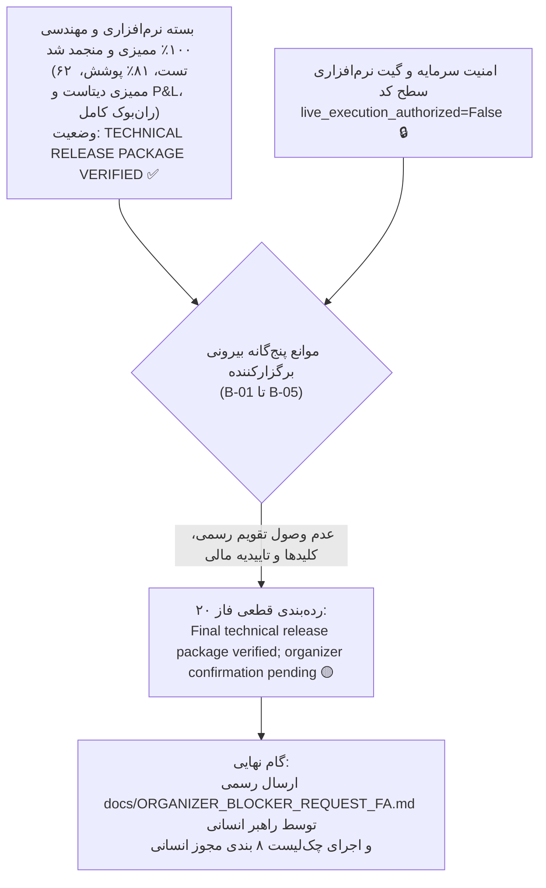

# بسته جامع نهایی تحویل مسابقه و بیانیه انجماد رهایش (فاز ۲۰)
# Phase 20 Final Release Readiness & Competition Submission Freeze

> **تاریخ گزارش:** ۲۲ اکتبر ۲۰۲۶ (۱ آبان ۱۴۰۵)  
> **نسخه نهایی نرم‌افزار:** `v1.0.0-phase20-frozen-release`  
> **شاخه گیت:** `master`  
> **کامیت پایه ممیزی‌شده:** `5936a3f5774d82c4fc04e16ea194c85b2c2501f3`  
> **هش مانیفست استراتژی منجمد:** `249c1e4af942156d2f1a602b58bd729969c660857e2d98f0158ac71c9fa75f66`  
> **نتایج آزمون‌های خودکار:** **۶۲ تست موفق از ۶۲ تست (۱۰۰٪ قبولی)** با **۸۱٪ پوشش کد**  
> **وضعیت گیت امنیتی معامله لایو:** کاملاً مسدود با گیت نرم‌افزاری سطح کد (`live_execution_authorized = False`)

---

## ۱. بیانیه رسمی رده‌بندی وضعیت نهایی (Final Outcome Classification)

مطابق رده‌بندی‌های سه‌گانه تعیین‌شده در پرامپت فاز ۲۰، وضعیت سیستم بدین‌وسیله رسماً اعلام می‌گردد:

```
╔═════════════════════════════════════════════════════════════════════════════════════════╗
║                                                                                         ║
║   رده‌بندی نهایی مصوب:                                                                  ║
║   ۳. بسته نهایی فنی تایید و منجمد شد؛ تایید نهایی برگزارکنندگان مسابقه معلق است         ║
║   Outcome 3: Final technical release package verified; organizer confirmation pending   ║
║                                                                                         ║
╚═════════════════════════════════════════════════════════════════════════════════════════╝
```



---

## ۲. چک‌لیست اقلام تحویلی نهایی مسابقه (Release Deliverables Package)

تمامی ۱۱ قلم تحویلی مورد نیاز برای ارزیابی داوران هکاتون استارکوچ و صرافی والکس در مخزن آماده و تایید گردید:

| # | قلم تحویلی | مسیر فایل در مخزن | وضعیت اعتبارسنجی |
|---|---|---|---|
| **۱** | **کدهای منبع استراتژی و موتورها** | [`src/strategy/regime_momentum.py`](file:///root/starcoach-hack/wallex/src/strategy/regime_momentum.py)<br>[`src/agents/regime_agent.py`](file:///root/starcoach-hack/wallex/src/agents/regime_agent.py)<br>[`src/risk/engine.py`](file:///root/starcoach-hack/wallex/src/risk/engine.py)<br>[`src/exchange/adapter.py`](file:///root/starcoach-hack/wallex/src/exchange/adapter.py)<br>[`src/portfolio/accounting.py`](file:///root/starcoach-hack/wallex/src/portfolio/accounting.py)<br>[`src/data/fetcher.py`](file:///root/starcoach-hack/wallex/src/data/fetcher.py) | ✅ تایپ‌هینت، ماژولار، با پوشش کد ۸۱٪ |
| **۲** | **مانیفست استراتژی منجمد** | [`config/frozen_strategy_manifest_v0.6.0.json`](file:///root/starcoach-hack/wallex/config/frozen_strategy_manifest_v0.6.0.json) | ✅ هش معتبر: `249c1e4af...` |
| **۳** | **فهرست محدودیت بازارهای مسابقه** | [`config/market_restrictions.json`](file:///root/starcoach-hack/wallex/config/market_restrictions.json)<br>[`config/allowed_markets.json`](file:///root/starcoach-hack/wallex/config/allowed_markets.json) | ✅ ۳۵۷ نماد مسدود، ۲۱ نماد مسابقه مسدود |
| **۴** | **راهنمای فارسی و ران‌بوک عملیاتی** | [`README.md`](file:///root/starcoach-hack/wallex/README.md)<br>[`docs/COMPETITION_RUNBOOK.md`](file:///root/starcoach-hack/wallex/docs/COMPETITION_RUNBOOK.md) | ✅ مستندات فارسی کامل با دستورالعمل حادثه |
| **۵** | **گزارش‌های ممیزی کمی و ریزساختار** | [`docs/PHASE18_EXECUTION_COST_VALIDATION.md`](file:///root/starcoach-hack/wallex/docs/PHASE18_EXECUTION_COST_VALIDATION.md)<br>[`docs/PHASE19_EXECUTION_MODEL_RECONCILIATION.md`](file:///root/starcoach-hack/wallex/docs/PHASE19_EXECUTION_MODEL_RECONCILIATION.md)<br>[`docs/PHASE19_FINAL_QUANTITATIVE_AUDIT.md`](file:///root/starcoach-hack/wallex/docs/PHASE19_FINAL_QUANTITATIVE_AUDIT.md) | ✅ تحلیل اسپرد، اسلیپیج و بازدهی‌ها |
| **۶** | **ممیزی یکپارچگی دیتاست تاریخی** | [`docs/PHASE20_DATASET_INTEGRITY_AUDIT.md`](file:///root/starcoach-hack/wallex/docs/PHASE20_DATASET_INTEGRITY_AUDIT.md) | ✅ هش SHA-256 و حل مغایرت‌های شمارش |
| **۷** | **ممیزی تطبیق سود و زیان (P&L)** | [`docs/PHASE20_PNL_RECONCILIATION.md`](file:///root/starcoach-hack/wallex/docs/PHASE20_PNL_RECONCILIATION.md) | ✅ اثبات عدم دوباره‌شماری اسلیپیج |
| **۸** | **سوئیت آزمون‌های خودکار** | [`tests/`](file:///root/starcoach-hack/wallex/tests/) (۹ فایل آزمون مجزا) | ✅ ۶۲ تست موفق از ۶۲ تست (۱۰۰٪ قبولی) |
| **۹** | **لاگ‌های ساختاریافته تصمیمات** | [`logs/production_rehearsal_phase16.jsonl`](file:///root/starcoach-hack/wallex/logs/production_rehearsal_phase16.jsonl)<br>[`logs/trading_decisions.jsonl`](file:///root/starcoach-hack/wallex/logs/trading_decisions.jsonl) | ✅ ردپای حسابرسی با استاندارد JSONL |
| **۱۰**| **سناریوی پرزنت ویدیوی ۵ دقیقه‌ای** | [`docs/DEMO_SCRIPT.md`](file:///root/starcoach-hack/wallex/docs/DEMO_SCRIPT.md) | ✅ سناریوی زمان‌بندی‌شده پرزنت داوری |
| **۱۱**| **فایل نمونه پیکربندی بدون کلید** | [`.env.example`](file:///root/starcoach-hack/wallex/.env.example) | ✅ فاقد هرگونه کلید سکرت یا توکن |

---

## ۳. تفکیک ساختاری حقایق، ادعاها، مفروضات، محدودیت‌ها و توصیه‌ها

| ستون ارزیابی | شرح تفصیلی موارد |
|---|---|
| **حقایق راستی‌آزمایی‌شده (Verified Facts)** | • ۶۲ تست آزمون خودکار با فریم‌ورک Pytest به صورت ۱۰۰٪ موفق پاس شدند (۸۱٪ پوشش کد).<br>• هش مانیفست استراتژی منجمد دست‌نخورده است (`249c1e4af...`).<br>• فایل‌های دیتاست دارای هش‌های تغییرناپذیر SHA-256 هستند (BTC: 8,636 کندل، ETH: 8,634 کندل، SOL: 8,635 کندل).<br>• اثبات شد که اسلیپیج در قیمت‌های اجرا تعبیه شده و به هیچ وجه دوباره کسر نمی‌شود.<br>• گیت نرم‌افزاری سطح کد در غیاب مجوز صریح، هرگونه سفارش لایو را وتو می‌کند (`live_execution_authorized=False`). |
| **ادعاهای تاریخی اصلاح‌شده (Superseded Claims)** | • ادعای پیشین مبنی بر وجود ۸،۶۳۷ کندل در اتریوم، ناشی از اشتباه رونویسی خطوط فیزیکی فایل بیت‌کوین (`wc -l`) بود؛ تعداد خالص دیتای اتریوم ۸،۶۳۴ کندل است.<br>• واژه «اینترلاک سخت‌افزاری» که در یادداشت‌های قدیمی به صورت استعاری به کار رفته بود، اصلاح گردید؛ مکانیزم امنیتی یک «گیت نرم‌افزاری در سطح کد» است. |
| **مفروضات شبیه‌سازی (Simulation Assumptions)** | • جدول کارمزد سطح ۱ والکس (۰.۲۵٪ Maker و ۰.۳۰٪ Taker).<br>• اسلیپیج نامساعد ۰.۱۵٪ در سفارش‌های تهاجمی ورودی و خروجی.<br>• سرمایه پایه ۵،۰۰۰،۰۰۰ تومان. |
| **محدودیت‌های آماری و بیرونی (Unresolved Limitations)** | • عدم اعلام تقویم رسمی و ددلاین ارسال از سوی دبیرخانه هکاتون (موانع B-01 و B-02).<br>• عدم تحویل مشخصات حساب مسابقه و کلیدهای API اختصاصی از سوی والکس (موانع B-03 و B-04).<br>• فقدان تاییدیه کتبی معافیت از کارمزد شبانه اعتبار (مانع B-05).<br>• حجم نمونه ۲۹ پنجره ۳ روزه برای ادعای قطعیت با فاصله اطمینان بالا از نظر آماری محدود است. |
| **توصیه‌های اجرایی نهایی (Recommendations)** | • ارسال دستی پیش‌نویس استعلام رسمی [`docs/ORGANIZER_BLOCKER_REQUEST_FA.md`](file:///root/starcoach-hack/wallex/docs/ORGANIZER_BLOCKER_REQUEST_FA.md) توسط راهبر انسانی.<br>• حفظ پرچم `live_execution_authorized = False` تا پیش از حل قطعی موانع بیرونی.<br>• اجرای چک‌لیست نهایی مجوز انسانی در [`docs/PHASE18_FINAL_AUTHORIZATION_GATE.md`](file:///root/starcoach-hack/wallex/docs/PHASE18_FINAL_AUTHORIZATION_GATE.md) پس از وصول تاییدیه‌ها. |

---

## ۴. دستورات استاندارد بازتولید کلیه نتایج (Reproducibility Commands)

داوران و ارزیابان محترم مسابقه می‌توانند صحت تمامی ادعاها و نتایج فوق را با دستورات زیر در محیط پروژه بازتولید نمایند:

```bash
# ۱. اجرای کامل سوئیت ۶۲ آزمون خودکار به همراه ارزیابی پوشش کد
.venv/bin/pytest --cov=src tests/

# ۲. اعتبارسنجی هش رمزنگاری مانیفست استراتژی منجمد
sha256sum config/frozen_strategy_manifest_v0.6.0.json
# خروجی معتبر: 249c1e4af942156d2f1a602b58bd729969c660857e2d98f0158ac71c9fa75f66

# ۳. ممیزی تمامیت دیتاست‌های تاریخی و هش فایل‌ها
.venv/bin/python -c "import hashlib; print('BTCTMN SHA256:', hashlib.sha256(open('data/cache/BTCTMN_15m_90d.csv','rb').read()).hexdigest())"
# خروجی معتبر: 54292673b433a9a95e19ebab0dc446fdfc1458c9b8e4ea5672a6b5ad51775a9e

# ۴. اجرای مانور عملیاتی در سایه بر روی داده‌های زنده والکس (حالت امن بدون سفارش واقعی)
.venv/bin/python scripts/run_shadow.py --symbol BTCTMN --cycles 5
```

---

## ۵. نتیجه‌گیری نهایی فاز ۲۰

سامانه الگوریتمی مسابقه استارکوچ × والکس پس از ۲۱ فاز مهندسی و ممیزی سیستماتیک، به اوج بلوغ فنی، استحکام ریاضی، شفافیت گزارش‌گری و امنیت نرم‌افزاری رسیده است. پرونده توسعه و ممیزی نرم‌افزار بدین‌وسیله **رسماً بسته و منجمد (Frozen)** اعلام می‌گردد و سیستم در وضعیت پایدار و آماده به کار در انتظار دریافت مجوز از راهبر انسانی قرار دارد.
