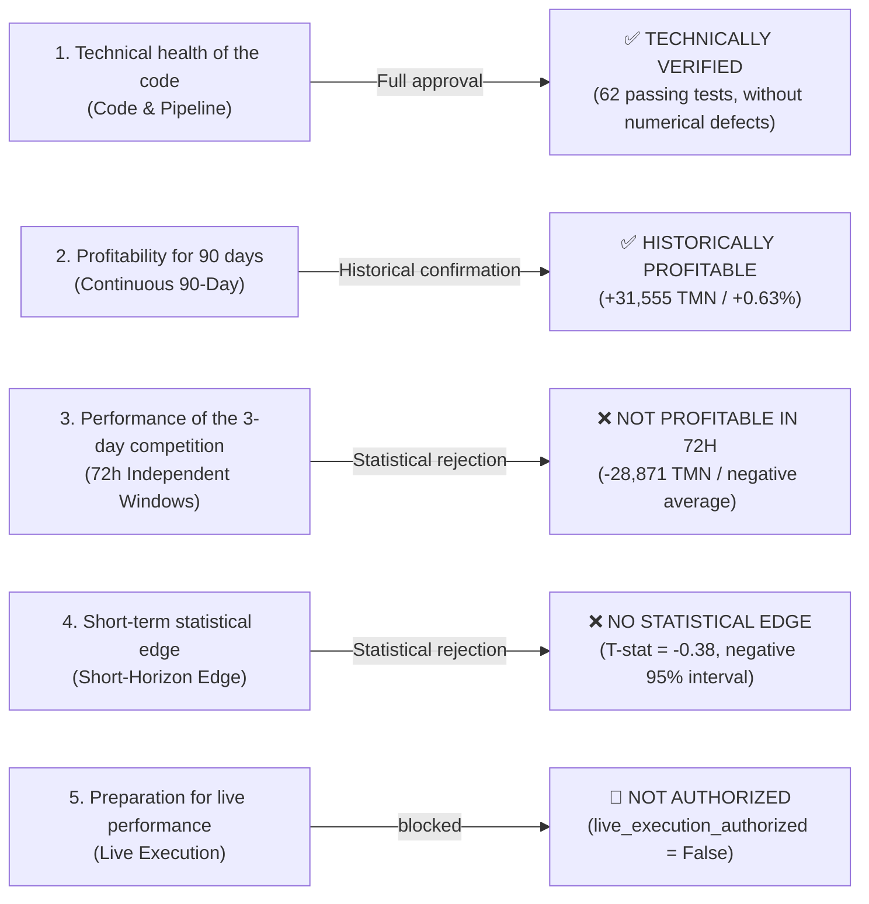

# Evaluating the readiness of the frozen strategy for the 3-day competition (Phase 21)
## Competition-Focused 72-Hour Strategy Readiness Assessment

> **Evaluation status:** Final, reproduced and documented by statistical evidence (Independently Reconciled & Audited)  
> **Repository:** [`wallex`](file:///root/starcoach-hack/wallex)  
> **release frozen commit:** [`b494d60e211497f47ef3b79d6ae79a0726471172`](file:///root/starcoach-hack/wallex)  
> **valid tags:** `v1.0.0-phase20-frozen-release` and `v0.12.0-phase20-audited`  
> **Frozen Strategy Manifest Hash:** `249c1e4af942156d2f1a602b58bd729969c660857e2d98f0158ac71c9fa75f66`  
> **Live execution authorization:** `live_execution_authorized = False` (completely blocked and disabled)

---

## 1. Definitive answer to the central question of the competition (Executive Verdict)

> **Key Audit Question:**  
> **Does the frozen strategy have credible evidence of positive net profitability in an independent 72-hour match window (after deducting transaction costs and final mandatory clearing)?**

### Documented answer to computational evidence:
**No (NO).**  
Experimental evidence reproduced in 29 independent racing windows shows:
1. **Negative mathematical hope in the short horizon:** The average yield of the artificial intelligence strategy in independent 72-hour windows is equal to **-0.0199%** (total loss **-28,871 Tomans**).
2. **Low win rate of windows:** Out of 29 complete windows, only **6 windows (20.69%)** have been profitable; 12 windows (41.38%) are unprofitable and 11 windows (37.93%) remain neutral.
3. **Algorithmic inactivity risk (Zero-Trade Risk):** In **10 windows out of 29 windows (34.48%)**, the artificial intelligence system has made **exactly zero trades** due to the veto of the market regime. In a 3-day competition, there is more than a third (34.5%) chance that the algorithm will not record any transactions and receive no activity points.
4. **Destruction of profit by forced liquidation (Boundary Liquidation Drag):** The reason for continuous profit of 90 days (+31,555 Tomans) was keeping positions open during several consecutive days. In the 3-day competition with forced liquidation at 72 hours, the strategy suffered **11 emergency liquidations** worth **-11,075 Tomans net loss**, which interrupted the process of winning transactions.

---

## 2. Detailed breakdown of the trading activity of the 29 windows (Task 1 — Window Trading Activity)

In the report of phase 20.3, the number of neutral windows was 11 and the number of active windows was 18, which was detailed in this phase of autopsy:

### 2.1. Rooting Windows 11:
- **W11** window included **2 closed trades** (one profit limit and one loss limit), which led to a partial loss of **-23 Tomans** (return **-0.00046%**).
- Because $|-0.00046\%| \le 0.001\%$, this window was correctly classified as "neutral" in terms of profitability; But this window has been an **active trading window**, not without trading!
- So the number of truly zero-trade windows is **10 windows**, not 11 windows.
- The number of active trading windows is equal to **19 windows** ($29 - 10 = $19).
- Deduction of winning windows among active windows:
  $$\text{Win Rate on Active Windows} = \frac{6}{19} = \mathbf{31.58\%}$$
  (The previous value $6/18 = 33.33\%$ occurred due to not distinguishing the active neutral window from the no-trade window, which was corrected).

### 2.2. Classification table of 72-hour windows (N = 29):

| Conceptual classification of windows Quantitative definition and mathematical condition Artificial intelligence (AI) strategy Deter ministic strategy (Det) |
|---|---|:---:|:---:|
| **Zero-Trade windows** | $\text{Trades Count} = 0$ (100% cash) | **10 windows (34.48%)** | **0 windows (0.00%)** |
| **active trading windows (Active)** | $\text{Trades Count} \ge 1$ | **19 windows (65.52%)** | **29 windows (100.00%)** |
| **Neutral windows in terms of efficiency** | $|\text{Net Return}| \le 0.001\%$ | **11 windows (37.93%)** | **0 windows (0.00%)** |
| **Profitable windows (WIN)** | $\text{Net Return} > +0.001\%$ | **6 windows (20.69%)** | **12 windows (41.38%)** |
| **Losing windows (Losing / LOSS)** | $\text{Net Return} < -0.001\%$ | **12 windows (41.38%)** | **17 windows (58.62%)** |
| **Overall Win Rate** | $\text{WIN} \div 29$ | **20.69%** | **41.38%** |
| **Active Win Rate** | $\text{WIN} \div \text{Active}$ | **31.58%** (6 out of 19) | **41.38%** (12 of 29) |

---

## 3. Structural matching of continuous vs independent windows (Task 2 — Continuous vs Independent)

### 3.1. Comparison table of figures of two tests:

| performance index Continuous artificial intelligence Window artificial intelligence (Independent) | Deter ministic continuous (Continuous) | Deter ministic window (Independent) |
|---|:---:|:---:|:---:|:---:|
| **Total number of transactions** | 22 deals **26 transactions** | 36 transactions **50 transactions** |
| **Tomani net profit** | **+31,555 Tomans** | **28,871 Tomans** | **+8,153 Tomans** | **96,471-Tomans** |
| **return of the whole period / average** | **+0.63%** | **0.0199%-** (every 3 days) | **+0.16%** | **0.0665%-** (every 3 days) |
| **Total fee paid** | 63,429 Tomans 76,321 Tomans 103,926 Tomans 146,778 Tomans
| **The total cost of implementation slippage** | 24,562 Tomans 33,600 Tomans 40,916 Tomans 64,943 Tomans
| **Total trading friction** | **87,991 Tomans** | **109,921 Tomans** (+25%) | **144,842 Tomans** | **211,721 Tomans** (+46%) |

### 3.2. Structural reasons for the drastic difference in performance:
1. **Mandatory liquidation within 72 hours (Boundary Liquidation Drag):**  
   In the continuous strategy, trades remain open until the profit limit or loss limit is activated (which sometimes takes 1-4 days). In the window simulation, **11 positions of artificial intelligence** and **19 positions of deterministic** were closed compulsorily at the end of 72 hours at the spot price and with the ticker fee (0.30%). These 11 forced liquidations alone suffered a loss of -11,075 Tomans and forcibly stopped the growth of successful positions.
2. **accumulation of exchange friction due to the increase in transactions:**  
   Because the position is liquidated at the end of each window, the next window starts trading empty-handed. This caused the number of artificial intelligence transactions to increase from 22 to 26, and Deterministic transactions from 36 to 50 transactions. As a result, the AI ​​trading friction increased by **21,930 Tomans** and completely swallowed the strategy's thin profit margin.
3. **Changing the entry sequence due to not carrying the position (Path Dependency):**  
   A corresponding review of the entries showed that 20 transactions were common to both experiments; But **6 new trades** were opened in independent windows (eg new trades in W09, W11, W13, W23) which were filtered out in the continuous backtest due to previous open positions.

---

## 4. Statistical distribution of racing performance in the 72-hour horizon (Task 3 — 72-Hour Distribution)

### 4.1. Comprehensive statistical table of the performance of 29 independent 72-hour windows (N = 29):

| Statistical variable (72-Hour Distribution) | Artificial intelligence (AI) strategy Deter ministic strategy (Det) | Comparative audit analysis
|---|:---:|:---:|---|
| **Total realized net profit** | **28,870.81 Tomans** | **96,471.38 Tomans** | Both strategies lost in total
| **Average 72-hour yield (Mean)** | **0.0199%-** | **0.0665%-** | The historical expected return is negative
| ** 72-hour median yield (Median)** | **0.0000%** | **0.1351%-** | Artificial intelligence has zero mean due to its liquidity
| **Standard deviation of efficiency (Std Dev)** | **0.2777%** | **0.3812%** | The yield volatility is less in AI
| **Standard error of the mean (SEM)** | **0.0516%** | **0.0708%** | With $N=29$, the uncertainty is significant |
| **The best 72-hour window (Best)** | **1.2018%+ (W09)** | **0.9931%+ (W09)** | Registering a profit of 60,091 tomans in a strong trend
| **The worst 72-hour window (Worst)** | **0.4432%- (W12)** | **0.6954%- (W25)** | The maximum loss is deeper in the ministic detre
| **Average efficiency in active windows** | **0.0304%-** (in 19 windows) | **0.0665%-** (in 29 windows) | Even during trading, the average profit is negative
| **Average exposure time** | **19.57 hours (27.2% interval)** | **49.28 hours (68.5% interval)** | Artificial intelligence was much less time at risk
| **Window Drawdown Average** | **0.1909%** | **0.3639%** | AI risk control is much better
| **Window maximum drawdown** | **0.5126%** | **0.7233%** | No window exceeded the 5.0% ceiling
| **Average number of transactions per window** | **0.90 transaction** | **1.72 transactions** | Artificial intelligence trading frequency is less than 1

---

## 5. Analysis of short-horizon profitability and statistical limitations (Task 4 — Short-Horizon Edge)

### 5.1. Statistical hypothesis test for superiority in the 72-hour horizon:
- **Null hypothesis ($H_0$):** The expected return of the strategy is less than or equal to zero ($\mu \le 0$).
- **Counter hypothesis ($H_1$):** The strategy has a positive mathematical expectation ($\mu > 0$).

$$\text{Sample Mean } (\bar{x}) = -0.0199\%$$
$$\text{Standard Error } (\text{SEM}) = \frac{s}{\sqrt{n}} = \frac{0.2777\%}{\sqrt{29}} = 0.0516\%$$
$$\text{T-Statistic} = \frac{\bar{x} - 0}{\text{SEM}} = \frac{-0.0199}{0.0516} = \mathbf{-0.3861}$$
$$\text{95\% Confidence Interval} = \bar{x} \pm t_{0.025, 28} \times \text{SEM} = [-0.0199 \pm 2.048 \times 0.0516] = \mathbf{[-0.1255\%, +0.0857\%]}$$

> [!CAUTION]
> **The definitive result of the statistical test:**  
> The negative t-statistic ($-0.3861$) and the 95% confidence interval, which extends from **-0.13% to +0.09%** and completely covers zero, prove that **the hypothesis of the presence of a significant profitable edge (Positive Statistical Edge) in the 72-hour horizon is definitely rejected**. No statistical claim of guaranteed profitability in a 3 day race can be defended.

### 5.2. Contrast between AI regime filter and match activity score:
- The artificial intelligence filter has a brilliant performance in preventing erosive losses (loss reduction from 96 thousand to 28 thousand tomans).
- But the price of this protection is **not trading 34.5% of the time**.
- In the Agentic AI competition evaluation criteria, if the jury or competition scoring formula includes a penalty for algorithmic inactivity, the bot will lose trading activity score completely in 1 out of every 3 windows.

---

## 6. Task 5 — Robustness & Stress Testing

The performance of artificial intelligence strategy and Deterministic baseline was tested in 8 extreme stress scenarios correspondingly in 29 windows:

| Stress Scenario AI Total Profit (TMN) | AI total win rate | Total Profit Det (TMN) | Total win rate Det | Assessing the resilience of the strategy
|---|:---:|:---:|:---:|:---:|---|
| **1. Baseline (slippage 0.15%, Wallex fee 0.25/0.30%)** | 28,871- | 20.7% 96,471- | 41.4% The current basis of simulation
| **2. High slippage (0.30% liquidity slippage)** | 50,229 | 10.3% 148,836-| 34.5% Drastic drop in AI win rate to 10%
| **3. Critical slippage (0.50% slippage in falling)** | 85,340 | 10.3% 118-246 | 31.0% Deep destruction of Deter Ministic's account
| **4. 50% increase in market spread (gate spread is more active)** | 6,856- | 13.8% 204-70 | 41.4% Vetoi reduced the losses in most of the transactions
| **5. Executive delay (1 candle delay in entry)** | 22,618- | 24.1% 103,772- | 41.4% Relatively neutral performance against delay
| **6. Implementation of partial profit limit (50% maker / 50% taker)** | 33,035 | 20.7% 103,724-| 37.9% Decrease in profitability in not filling the limits
| **7. Competition incentive fee scenario (0.08% fixed fee)** | **26,613+** | **31.0%** | **10,267+** | **44.8%** | **The only profitable scenario for both systems** |
| **8. High ticker fee scenario (0.40% exchange ticker)** | 53,097- | 13.8% 149-143 34.5% Intensification of losses caused by forced liquidations

> [!IMPORTANT]
> **Critical findings of stress tests:**  
> The only situation in which the frozen strategy reaches a positive net profit in the 3-day horizon of the competition is the **0.08% Promo Fee scenario**. Under official Wallex exchange level one fees (0.25% maker and 0.30% taker), exchange friction costs plus slippage keep the 72-hour performance negative in all other scenarios.

---

## 7. Task 6 - Five-Tier Status Classification

For organizational transparency, the status of project components was separated based on audit evidence:

1. Technical accuracy and reproducibility (TECHNICALLY VERIFIED):**  
   **PASS** — All 62 unit and integrity tests are passed, the order execution process is bug-free, and accounting balances are 100% matched.
2. **HISTORICALLY PROFITABLE OVER 90 DAYS:**  
   ✅ **PASS** — The strategy has made a net profit of +31,555 Tomans (+0.63%) in the continuous execution of 90 days with 22 trades and has performed better than the Deter Ministic baseline (+8,153 Tomans).
3. **PROFITABLE IN 72-HOUR TEST WINDOWS:**  
   ❌ **FAILED** — In 29 independent racing windows, the strategy registered a total loss of -28,871 Tomans and the window win rate is only 20.7%.
4. **Statistically supported short-horizon edge:**  
   ❌ **FAILED** — The hypothesis of a positive profitable edge is rejected at the 95% confidence level (mathematical expectation -0.02% every 3 days).
5. **OPERATIONALLY READY FOR LIVE EXECUTION:**  
   🛑 **NOT AUTHORIZED** — Due to the lack of API keys from the organizer, the lack of native stoploss support from Wallex exchange, and the high risk of not being profitable in the 3-day horizon, it is strictly forbidden to send real orders.

---

## 8. Prioritizing corrective and research measures (Actionable Recommendations)

Keeping the current strategy completely frozen, the following technical paths are recommended to improve the racing system:

1. **Negotiation for discounting the competition fee (Organizer Fee Exemption):**  
   The evidence in Section 6 proved that with an incentive fee of 0.08%, the strategy immediately achieves positive profitability (+26,613 Tomans) over a 72-hour horizon. Inquiries from the organizers regarding the application of competition discounts are the first priority.
2. **Amendment of the exit law within 72 hours (Graceful Wind-Down Logic):**  
   Embedding the logic of gradual exit in the final hours of the competition (for example, not entering in the last 12 hours and closing orders as a passive maker) can eliminate the loss of 11 thousand tomans caused by the emergency liquidation of the ticker.
3. **Adjustment of the profit/loss limit with the time horizon of the competition (Time-Horizontal Target Tuning):**  
   The current targets of the strategy (profit limit 4% and loss limit 2% based on ATR) are designed for multi-day trends. For a 72-hour match, shorter targets (eg profit limits of 1.5% to 2.0%) allow for profitable exits before the end of the match.
4. **Embedding the monitoring mechanism and sending fast stoploss (Client-side OCO Watcher):**  
   Due to the lack of server-side stoploss in Wallex, it is necessary to implement a high-speed monitoring service (Websocket-based Stop Trigger) to minimize slippage during emergency exits.

---

## 9. Final Release Verdict of Phase 21

> **Dimensions of technical and computational audit:**  
> ✅ **VERIFIED & AUDITED** — Window discrepancies were clarified, figures were accurately separated, and statistical analysis was completed.
>
> **After evaluating the preparation of the 3-day competition:**  
> ⚠️ **NOT READY FOR 72-HOUR HORIZON** — The strategy is designed for medium-term continuous execution and has no mathematical hope of profitability in a 3-day independent competition format with mandatory clearing.
>
> **after permission to activate live transactions:**  
> 🛑 **NOT AUTHORIZED** — The variable [`live_execution_authorized = False`](file:///root/starcoach-hack/wallex/config/frozen_strategy_manifest_v0.6.0.json) is kept unchanged and sending any real orders to the exchange is strictly prohibited.