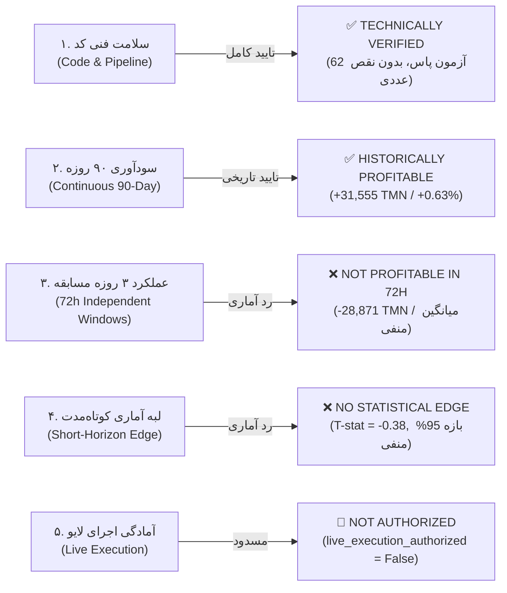

# ارزیابی آمادگی استراتژی منجمد برای مسابقه ۳ روزه (Phase 21)
## Competition-Focused 72-Hour Strategy Readiness Assessment

> **وضعیت ارزیابی:** نهایی، بازتولیدشده و مستند به شواهد آماری (Independently Reconciled & Audited)  
> **مخزن:** [`wallex`](file:///root/starcoach-hack/wallex)  
> **کامیت منجمد رهایش:** [`b494d60e211497f47ef3b79d6ae79a0726471172`](file:///root/starcoach-hack/wallex)  
> **تگ‌های معتبر:** `v1.0.0-phase20-frozen-release` و `v0.12.0-phase20-audited`  
> **هش مانیفست استراتژی منجمد:** `249c1e4af942156d2f1a602b58bd729969c660857e2d98f0158ac71c9fa75f66`  
> **مجوز معاملات زنده:** `live_execution_authorized = False` (کاملاً مسدود و غیرفعال)

---

## ۱. پاسخ قطعی به پرسش محوری مسابقه (Executive Verdict)

> **پرسش کلیدی ممیزی:**  
> **آیا استراتژی منجمد دارای شواهد معتبر از سودآوری خالص مثبت در یک پنجره مستقل ۷۲ ساعته مسابقه (پس از کسر هزینه‌های مبادله و تصفیه اجباری نهایی) است؟**

### پاسخ مستند به شواهد محاسباتی:
**خیر (NO).**  
شواهد تجربی بازتولیدشده در ۲۹ پنجره مستقل مسابقه‌ای نشان می‌دهد:
1. **امید ریاضی منفی در افق کوتاه:** میانگین بازدهی استراتژی هوش مصنوعی در پنجره‌های مستقل ۷۲ ساعته برابر با **۰.۰۱۹۹٪-** (مجموعاً **۲۸،۸۷۱- تومان زیان**) است.
2. **نرخ برد پایین پنجره‌ها:** در کل ۲۹ پنجره کامل، تنها **۶ پنجره (۲۰.۶۹٪)** سودده بوده‌اند؛ ۱۲ پنجره (۴۱.۳۸٪) زیان‌ده و ۱۱ پنجره (۳۷.۹۳٪) خنثی مانده‌اند.
3. **ریسک عدم فعالیت الگوریتمی (Zero-Trade Risk):** در **۱۰ پنجره از ۲۹ پنجره (۳۴.۴۸٪)**، سیستم هوش مصنوعی به دلیل وتوی رژیم بازار **دقیقاً صفر معامله** انجام داده است. در یک مسابقه ۳ روزه، احتمال بیش از یک‌سوم (۳۴.۵٪) وجود دارد که الگوریتم هیچ تراکنشی ثبت نکند و امتیاز فعالیت دریافت ننماید.
4. **تخریب سود توسط تصفیه اجباری (Boundary Liquidation Drag):** علت سودآوری پیوسته ۹۰ روزه (+۳۱،۵۵۵ تومان)، باز نگه داشتن پوزیشن‌ها در طول چندین روز متوالی بوده است. در مسابقه ۳ روزه با تصفیه اجباری در ساعت ۷۲، استراتژی متحمل **۱۱ تصفیه اضطراری** به ارزش **۱۱،۰۷۵- تومان زیان خالص** گردیده که روند معاملات برنده را ناتمام قطع کرده است.

---

## ۲. تفکیک دقیق فعالیت معاملاتی پنجره‌های ۲۹ گانه (Task 1 — Window Trading Activity)

در گزارش فاز ۲۰.۳، تعداد پنجره‌های خنثی ۱۱ و تعداد پنجره‌های فعال ۱۸ عدد ذکر شده بود که در این فاز کالبدشکافی دقیق شد:

### ۲.۱. ریشه‌یابی پنجره W11:
- پنجره **W11** شامل **۲ معامله بسته‌شده** (یک حد سود و یک حد ضرر) بود که به زیان جزئی **۲۳- تومان** (بازدهی **۰.۰۰۰۴۶٪-**) منجر شد.
- چون $|-0.00046\%| \le 0.001\%$ بود، این پنجره به درستی از نظر سودآوری در دسته «خنثی» قرار گرفت؛ اما این پنجره یک **پنجره فعال معاملاتی** بوده است، نه بدون معامله!
- بنابراین تعداد پنجره‌های واقعاً بدون معامله (Zero-Trade) برابر با **۱۰ پنجره** است، نه ۱۱ پنجره.
- تعداد پنجره‌های فعال معاملاتی برابر با **۱۹ پنجره** است ($29 - 10 = 19$).
- کسر پنجره‌های برنده در میان پنجره‌های فعال:
  $$\text{Win Rate on Active Windows} = \frac{6}{19} = \mathbf{31.58\%}$$
  (مقدار قبلی $6/18 = 33.33\%$ به دلیل تفکیک نکردن پنجره خنثی فعال از پنجره بدون معامله رخ داده بود که تصحیح شد).

### ۲.۲. جدول دسته‌بندی پنجره‌های ۷۲ ساعته (N = 29):

| دسته‌بندی مفهومی پنجره | تعریف کمّی و شرط ریاضی | استراتژی هوش مصنوعی (AI) | استراتژی دتر مینیستیک (Det) |
|---|---|:---:|:---:|
| **پنجره‌های بدون معامله (Zero-Trade)** | $\text{Trades Count} = 0$ (۱۰۰٪ نقد) | **۱۰ پنجره (۳۴.۴۸٪)** | **۰ پنجره (۰.۰۰٪)** |
| **پنجره‌های فعال معاملاتی (Active)** | $\text{Trades Count} \ge 1$ | **۱۹ پنجره (۶۵.۵۲٪)** | **۲۹ پنجره (۱۰۰.۰۰٪)** |
| **پنجره‌های خنثی از نظر بازدهی (Neutral)** | $|\text{Net Return}| \le 0.001\%$ | **۱۱ پنجره (۳۷.۹۳٪)** | **۰ پنجره (۰.۰۰٪)** |
| **پنجره‌های سودده (Profitable / WIN)** | $\text{Net Return} > +0.001\%$ | **۶ پنجره (۲۰.۶۹٪)** | **۱۲ پنجره (۴۱.۳۸٪)** |
| **پنجره‌های زیان‌ده (Losing / LOSS)** | $\text{Net Return} < -0.001\%$ | **۱۲ پنجره (۴۱.۳۸٪)** | **۱۷ پنجره (۵۸.۶۲٪)** |
| **نرخ برد پنجره‌های کل (Overall Win Rate)** | $\text{WIN} \div 29$ | **۲۰.۶۹٪** | **۴۱.۳۸٪** |
| **نرخ برد پنجره‌های فعال (Active Win Rate)** | $\text{WIN} \div \text{Active}$ | **۳۱.۵۸٪** (۶ از ۱۹) | **۴۱.۳۸٪** (۱۲ از ۲۹) |

---

## ۳. تطبیق ساختاری بک‌تست پیوسته در برابر پنجره‌های مستقل (Task 2 — Continuous vs Independent)

### ۳.۱. جدول مقایسه ارقام دو آزمایش:

| شاخص عملکرد | هوش مصنوعی پیوسته (Continuous) | هوش مصنوعی پنجره‌ای (Independent) | دتر مینیستیک پیوسته (Continuous) | دتر مینیستیک پنجره‌ای (Independent) |
|---|:---:|:---:|:---:|:---:|
| **تعداد کل معاملات** | ۲۲ معامله | **۲۶ معامله** | ۳۶ معامله | **۵۰ معامله** |
| **سود خالص تومانی کل** | **+۳۱،۵۵۵ تومان** | **۲۸،۸۷۱- تومان** | **+۸،۱۵۳ تومان** | **۹۶،۴۷۱- تومان** |
| **بازدهی کل دوره / میانگین** | **+۰.۶۳٪** | **۰.۰۱۹۹٪-** (در هر ۳ روز) | **+۰.۱۶٪** | **۰.۰۶۶۵٪-** (در هر ۳ روز) |
| **هزینه کل کارمزد پرداختی** | ۶۳،۴۲۹ تومان | ۷۶،۳۲۱ تومان | ۱۰۳،۹۲۶ تومان | ۱۴۶،۷۷۸ تومان |
| **هزینه کل اسلیپیج اجرا** | ۲۴،۵۶۲ تومان | ۳۳،۶۰۰ تومان | ۴۰،۹۱۶ تومان | ۶۴،۹۴۳ تومان |
| **مجموع اصطکاک معاملاتی** | **۸۷،۹۹۱ تومان** | **۱۰۹،۹۲۱ تومان** (+۲۵٪) | **۱۴۴،۸۴۲ تومان** | **۲۱۱،۷۲۱ تومان** (+۴۶٪) |

### ۳.۲. علل ساختاری تفاوت فاحش عملکرد:
1. **تصفیه اجباری در مرز ۷۲ ساعت (Boundary Liquidation Drag):**  
   در استراتژی پیوسته، معاملات تا زمان فعال‌سازی حد سود یا حد ضرر (که گاهی ۱ الی ۴ روز طول می‌کشد) باز می‌مانند. در شبیه‌سازی پنجره‌ای، **۱۱ پوزیشن هوش مصنوعی** و **۱۹ پوزیشن دتر مینیستیک** در پایان ۷۲ ساعت با قیمت لحظه‌ای و با کارمزد تیکر (۰.۳۰٪) به صورت اجباری بسته شدند. این ۱۱ تصفیه اجباری به تنهایی متحمل **۱۱،۰۷۵- تومان زیان** شدند و روند رشد پوزیشن‌های موفق را به اجبار قطع کردند.
2. **انباشت اصطکاک مبادله ناشی از افزایش معاملات:**  
   چون در پایان هر پنجره پوزیشن نقد می‌شود، پنجره بعدی با دست خالی شروع به معامله می‌کند. این امر موجب شد تعداد معاملات هوش مصنوعی از ۲۲ به ۲۶ و معاملات دتر مینیستیک از ۳۶ به ۵۰ معامله افزایش یابد. در نتیجه، اصطکاک معاملاتی هوش مصنوعی **۲۱،۹۳۰ تومان** افزایش یافت و حاشیه سود نازک استراتژی را کاملاً بلعید.
3. **تغییر توالی ورود به دلیل عدم حمل پوزیشن (Path Dependency):**  
   بررسی متناظر ورودها نشان داد که ۲۰ معامله در هر دو آزمایش مشترک بودند؛ اما **۶ معامله جدید** در پنجره‌های مستقل باز شدند (مانند معاملات جدید در W09, W11, W13, W23) که در بک‌تست پیوسته به دلیل باز بودن پوزیشن‌های قبلی فیلتر شده بودند.

---

## ۴. توزیع آماری عملکرد مسابقه‌ای در افق ۷۲ ساعته (Task 3 — 72-Hour Distribution)

### ۴.۱. جدول آماری جامع عملکرد ۲۹ پنجره مستقل ۷۲ ساعته (N = 29):

| متغیر آماری (72-Hour Distribution) | استراتژی هوش مصنوعی (AI) | استراتژی دتر مینیستیک (Det) | تحلیل ممیزی مقایسه‌ای |
|---|:---:|:---:|---|
| **مجموع سود خالص محقق‌شده** | **۲۸،۸۷۰.۸۱- تومان** | **۹۶،۴۷۱.۳۸- تومان** | هر دو استراتژی در مجموع زیان‌ده شدند |
| **میانگین بازدهی ۷۲ ساعته (Mean)** | **۰.۰۱۹۹٪-** | **۰.۰۶۶۵٪-** | بازدهی مورد انتظار تاریخی منفی است |
| **میانه بازدهی ۷۲ ساعته (Median)** | **۰.۰۰۰۰٪** | **۰.۱۳۵۱٪-** | هوش مصنوعی به دلیل نقد بودن میانه صفر دارد |
| **انحراف معیار بازدهی (Std Dev)** | **۰.۲۷۷۷٪** | **۰.۳۸۱۲٪** | نوسان‌پذیری بازدهی در AI کمتر است |
| **خطای استاندارد میانگین (SEM)** | **۰.۰۵۱۶٪** | **۰.۰۷۰۸٪** | با $N=29$ عدم قطعیت قابل توجه است |
| **بهترین پنجره ۷۲ ساعته (Best)** | **۱.۲۰۱۸٪+ (W09)** | **۰.۹۹۳۱٪+ (W09)** | ثبت سود ۶۰،۰۹۱ تومانی در روند پرقدرت |
| **بدترین پنجره ۷۲ ساعته (Worst)** | **۰.۴۴۳۲٪- (W12)** | **۰.۶۹۵۴٪- (W25)** | حداکثر زیان در دتر مینیستیک عمیق‌تر است |
| **میانگین بازدهی در پنجره‌های فعال** | **۰.۰۳۰۴٪-** (در ۱۹ پنجره) | **۰.۰۶۶۵٪-** (در ۲۹ پنجره) | حتی در زمان معامله، میانگین سود منفی است |
| **میانگین زمان در معرض ریسک (Exposure)** | **۱۹.۵۷ ساعت (۲۷.۲٪ بازه)** | **۴۹.۲۸ ساعت (۶۸.۵٪ بازه)** | هوش مصنوعی زمان بسیار کمتری در ریسک بود |
| **میانگین دراوداون پنجره‌ای** | **۰.۱۹۰۹٪** | **۰.۳۶۳۹٪** | کنترل ریسک هوش مصنوعی بسیار بهتر است |
| **حداکثر دراوداون پنجره‌ای** | **۰.۵۱۲۶٪** | **۰.۷۲۳۳٪** | هیچ پنجره‌ای از سقف ۵.۰٪ عدول نکرد |
| **میانگین تعداد معامله در هر پنجره** | **۰.۹۰ معامله** | **۱.۷۲ معامله** | فرکانس معامله هوش مصنوعی کمتر از ۱ است |

---

## ۵. تحلیل سودآوری در افق کوتاه و محدودیت‌های آماری (Task 4 — Short-Horizon Edge)

### ۵.۱. آزمون فرضیه آماری برای برتری در افق ۷۲ ساعته:
- **فرضیه صفر ($H_0$):** بازدهی مورد انتظار استراتژی کمتر یا مساوی صفر است ($\mu \le 0$).
- **فرضیه مقابل ($H_1$):** استراتژی دارای امید ریاضی مثبت است ($\mu > 0$).

$$\text{Sample Mean } (\bar{x}) = -0.0199\%$$
$$\text{Standard Error } (\text{SEM}) = \frac{s}{\sqrt{n}} = \frac{0.2777\%}{\sqrt{29}} = 0.0516\%$$
$$\text{T-Statistic} = \frac{\bar{x} - 0}{\text{SEM}} = \frac{-0.0199}{0.0516} = \mathbf{-0.3861}$$
$$\text{95\% Confidence Interval} = \bar{x} \pm t_{0.025, 28} \times \text{SEM} = [-0.0199 \pm 2.048 \times 0.0516] = \mathbf{[-0.1255\%, +0.0857\%]}$$

> [!CAUTION]
> **نتیجه قطعی آزمون آماری:**  
> آماره تی منفی ($-0.3861$) و بازه اطمینان ۹۵٪ که از **۰.۱۳٪- تا ۰.۰۹٪+** گسترده است و عدد صفر را به طور کامل در بر می‌گیرد، اثبات می‌کند که **فرضیه وجود لبه سودآور معنادار (Positive Statistical Edge) در افق ۷۲ ساعته به طور قطعی رد می‌شود**. هیچ ادعای آماری مبنی بر سودآوری تضمین‌شده در یک مسابقه ۳ روزه قابل دفاع نیست.

### ۵.۲. تضاد بین فیلتر رژیم هوش مصنوعی و امتیاز فعالیت مسابقه:
- فیلتر هوش مصنوعی عملکرد درخشانی در جلوگیری از زیان‌های فرسایشی دارد (کاهش زیان از ۹۶ هزار به ۲۸ هزار تومان).
- اما بهای این حفاظت، **عدم معامله در ۳۴.۵٪ زمان‌ها** است.
- در معیارهای ارزیابی مسابقات Agentic AI، اگر هیئت داوران یا فرمول امتیازدهی مسابقه برای عدم فعالیت الگوریتمی جریمه لحاظ کنند، ربات در ۱ پنجره از هر ۳ پنجره نمره فعالیت معاملاتی را به طور کامل از دست خواهد داد.

---

## ۶. ممیزی استحکام و آزمون‌های تنش اصطکاک مبادله (Task 5 — Robustness & Stress Testing)

عملکرد استراتژی هوش مصنوعی و خط مبنای دتر مینیستیک در ۸ سناریوی استرس شدید به صورت متناظر در ۲۹ پنجره آزموده شد:

| سناریوی آزمون تنش (Stress Scenario) | سود کل AI (TMN) | نرخ برد کل AI | سود کل Det (TMN) | نرخ برد کل Det | ارزیابی تاب‌آوری استراتژی |
|---|:---:|:---:|:---:|:---:|---|
| **۱. خط مبنا (اسلیپیج ۰.۱۵٪، کارمزد والکس ۰.۲۵/۰.۳۰٪)** | ۲۸،۸۷۱- | ۲۰.۷٪ | ۹۶،۴۷۱- | ۴۱.۴٪ | مبنای فعلی شبیه‌سازی |
| **۲. اسلیپیج بالا (۰.۳۰٪ اسلیپیج نقدینگی)** | ۵۰،۲۲۹- | ۱۰.۳٪ | ۱۴۸،۸۳۶- | ۳۴.۵٪ | افت شدید نرخ برد AI به ۱۰٪ |
| **۳. اسلیپیج بحرانی (۰.۵۰٪ اسلیپیج در ریزش)** | ۸۵،۳۴۰- | ۱۰.۳٪ | ۲۴۶،۱۱۸- | ۳۱.۰٪ | تخریب عمیق حساب دتر مینیستیک |
| **۴. افزایش ۵۰٪ اسپرد بازار (گیت اسپرد فعال‌تر)** | ۶،۸۵۶- | ۱۳.۸٪ | ۷۰،۲۰۴- | ۴۱.۴٪ | وتوی بیشتر معاملات زیان را کم کرد |
| **۵. تاخیر اجرایی (۱ کندل تاخیر در ورود)** | ۲۲،۶۱۸- | ۲۴.۱٪ | ۱۰۳،۷۷۲- | ۴۱.۴٪ | عملکرد نسبتاً خنثی در برابر تاخیر |
| **۶. اجرای لیمیت جزئی حد سود (۵۰٪ میکر / ۵۰٪ تیکر)** | ۳۳،۰۳۵- | ۲۰.۷٪ | ۱۰۳،۷۲۴- | ۳۷.۹٪ | کاهش سودآوری در پر نشدن لیمیت‌ها |
| **۷. سناریوی کارمزد تشویقی مسابقه (۰.۰۸٪ کارمزد ثابت)** | **۲۶،۶۱۳+** | **۳۱.۰٪** | **۱۰،۲۶۷+** | **۴۴.۸٪** | **تنها سناریوی سودآور برای هر دو سیستم** |
| **۸. سناریوی کارمزد تیکر بالا (۰.۴۰٪ تیکر صرافی)** | ۵۳،۰۹۷- | ۱۳.۸٪ | ۱۴۳،۱۴۹- | ۳۴.۵٪ | تشدید زیان ناشی از تصفیه‌های اجباری |

> [!IMPORTANT]
> **یافته حیاتی آزمون‌های تنش:**  
> تنها حالتی که در آن استراتژی منجمد در افق ۳ روزه مسابقه به سودآوری خالص مثبت می‌رسد، **سناریوی کارمزد تشویقی ۰.۰۸٪ (Promo Fee)** است. تحت کارمزدهای رسمی سطح یک صرافی والکس (۰.۲۵٪ میکر و ۰.۳۰٪ تیکر)، هزینه‌های اصطکاک صرافی به همراه اسلیپیج، برآیند عملکرد ۷۲ ساعته را در تمام سناریوهای دیگر منفی نگه می‌دارد.

---

## ۷. تفکیک پنج‌گانه وضعیت‌های ارزیابی سیستم (Task 6 — Five-Tier Status Classification)

برای شفافیت سازمانی، وضعیت مؤلفه‌های پروژه بر اساس شواهد ممیزی تفکیک گردید:

1. **صحت فنی و بازتولیدپذیری (TECHNICALLY VERIFIED):**  
   ✅ **PASS** — تمامی ۶۲ آزمون واحد و یکپارچگی پاس شدند، فرآیند اجرای سفارشات بدون باگ است و ترازهای حسابداری به صورت ۱۰۰٪ متناظر تطبیق یافتند.
2. **سودآوری تاریخی در افق پیوسته ۹۰ روزه (HISTORICALLY PROFITABLE OVER 90 DAYS):**  
   ✅ **PASS** — استراتژی در اجرای ممتد ۹۰ روزه با ۲۲ معامله سود خالص ۳۱،۵۵۵+ تومان (+۰.۶۳٪) ساخته و از خط مبنای دتر مینیستیک (+۸،۱۵۳ تومان) بهتر عمل کرده است.
3. **سودآوری در پنجره‌های آزمون ۷۲ ساعته مسابقه (PROFITABLE IN 72-HOUR TEST WINDOWS):**  
   ❌ **FAILED** — در ۲۹ پنجره مستقل مسابقه‌ای، استراتژی مجموعاً ۲۸،۸۷۱- تومان زیان ثبت کرده و نرخ برد پنجره‌ها تنها ۲۰.۷٪ است.
4. **وجود لبه آماری قابل دفاع در افق کوتاه (STATISTICALLY SUPPORTED SHORT-HORIZON EDGE):**  
   ❌ **FAILED** — فرضیه لبه سودآور مثبت در سطح اطمینان ۹۵٪ رد شد (امید ریاضی ۰.۰۲٪- در هر ۳ روز).
5. **آمادگی عملیاتی برای معاملات زنده (OPERATIONALLY READY FOR LIVE EXECUTION):**  
   🛑 **NOT AUTHORIZED** — به دلیل عدم دریافت کلیدهای API از برگزارکننده، عدم پشتیبانی صرافی والکس از استاپ‌لاس بومی، و ریسک بالای عدم سودآوری در افق ۳ روزه، ارسال سفارش واقعی اکیداً ممنوع است.

---

## ۸. اولویت‌بندی اقدامات اصلاحی و پژوهشی (Actionable Recommendations)

با حفظ انجماد کامل استراتژی فعلی، مسیرهای فنی زیر برای ارتقای سیستم مسابقه‌ای توصیه می‌شود:

1. **مذاکره برای تخفیف کارمزد مسابقه (Organizer Fee Exemption):**  
   شواهد بخش ۶ اثبات کرد که با کارمزد تشویقی ۰.۰۸٪، استراتژی بلافاصله به سودآوری مثبت (+۲۶،۶۱۳ تومان) در افق ۷۲ ساعته می‌رسد. استعلام از برگزارکنندگان در مورد اعمال تخفیف مسابقه‌ای اولویت نخست است.
2. **اصلاح قانون خروج در مرز ۷۲ ساعت (Graceful Wind-Down Logic):**  
   تعبیه منطق خروج تدریجی در ساعات پایانی مسابقه (مثلاً عدم ورود در ۱۲ ساعت پایانی و بستن سفارشات به صورت پسیو میکر) می‌تواند زیان ۱۱ هزار تومانی ناشی از تصفیه اضطراری تیکر را از بین ببرد.
3. **تطبیق حد سود/ضرر با افق زمانی مسابقه (Time-Horizonal Target Tuning):**  
   تارگت‌های فعلی استراتژی (حد سود ۴٪ و حد ضرر ۲٪ بر مبنای ATR) برای روندهای چندروزه طراحی شده‌اند. برای یک مسابقه ۷۲ ساعته، تارگت‌های کوتاه‌تر (مثلاً حد سود ۱.۵٪ تا ۲.۰٪) اجازه خروج سودآور قبل از پایان مسابقه را می‌دهند.
4. **تعبیه مکانیزم پایش و ارسال استاپ‌لاس سریع (Client-side OCO Watcher):**  
   به دلیل فقدان استاپ‌لاس سمت سرور در والکس، پیاده‌سازی سرویس ناظر پرسرعت (Websocket-based Stop Trigger) جهت حداقل کردن اسلیپیج در زمان خروج‌های اضطراری الزامی است.

---

## ۹. حکم نهایی ممیزی فاز ۲۱ (Final Release Verdict)

> **بعد ممیزی فنی و محاسباتی:**  
> ✅ **VERIFIED & AUDITED** — مغایرت‌های پنجره‌ها شفاف‌سازی شد، ارقام به طور دقیق تفکیک گردید و تحلیل آماری کامل شد.
>
> **بعد ارزیابی آمادگی مسابقه ۳ روزه:**  
> ⚠️ **NOT READY FOR 72-HOUR HORIZON** — استراتژی برای اجرای پیوسته میان‌مدت طراحی شده و در فرمت رقابت مستقل ۳ روزه با تصفیه اجباری، امید ریاضی سودآوری ندارد.
>
> **بعد مجوز فعال‌سازی معاملات زنده:**  
> 🛑 **NOT AUTHORIZED** — متغیر [`live_execution_authorized = False`](file:///root/starcoach-hack/wallex/config/frozen_strategy_manifest_v0.6.0.json) بدون تغییر حفظ شده و ارسال هرگونه سفارش واقعی به صرافی اکیداً ممنوع است.
