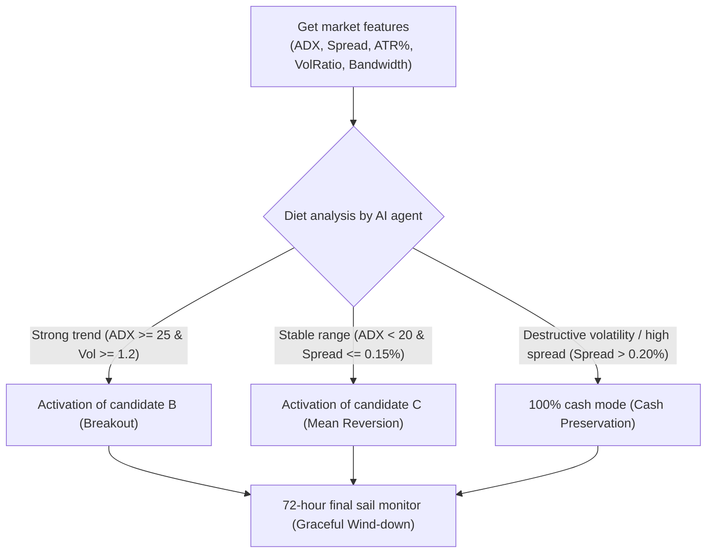

# Technical specifications and formulation of competitive strategy candidates (Phase 22)
## Strategy Candidates Specification, Hypotheses, and Architecture

> **Research branch:** `research/phase22-discovery`  
> **Repository:** [`wallex`](file:///root/starcoach-hack/wallex)  
> **Base commit:** [`b494d60e211497f47ef3b79d6ae79a0726471172`](file:///root/starcoach-hack/wallex)

---

## 1. Strategy Candidates Overview

In this phase, 5 distinct candidates are designed based on the quantitative research of phase 22 to be independently implemented and evaluated against the frozen baseline of phase 21:

1. **Candidate A (Adaptive Horizon & Graceful Wind-Down):** Modification of the current trend strategy by adding a no-entry zone (60 hours onwards), tighter targets and passive refinement.
2. **Candidate B (Short-Horizon Volatility Breakout):** Danchian channel breakout strategy and ATR volatility with exit time limit (Time Stop).
3. **Candidate C (Range-Bound Mean Reversion):** Mean reversion strategy based on Bollinger Bands and RSI for trendless windows.
4. **Candidate D (Agentic Meta-Strategy / Regime Router):** An intelligent agent that chooses a strategy suitable for the volatility and spread regime of the market.
5. **Candidate E (Multi-Asset Cross-Sectional Momentum):** Dynamic diversification between Bitcoin, Ethereum and Solana based on price momentum and liquidity.

---

## 2. Detailed specifications of candidate A: matching process with final sail (Candidate A)

### 2.1. Research hypothesis:
"Eliminating the entry in the last 12 hours of the competition and converting forced liquidation from order taker to passive order maker, eliminates the loss of 11,075 tomans of emergency liquidation and makes the performance of the trend strategy positive in 72-hour windows."

### 2.2. Entry conditions and filters:
- **Contest time condition:** The elapsed time of the window should be less than 60 hours ($t < 60\text{hours}$).
- **Technical trend condition:** $\text{EMA}_{20} > \text{EMA}_{50}$ and $50 \le \text{RSI}_{14} \le 68$ and $\text{VolRatio} \ge 1.10$.
- **Artificial intelligence regime filter:** `BULLISH_TREND' regime with confidence factor $\ge 0.70$.
- **Spread ceiling:** $\text{Spread} \le 0.20\%$.

### 2.3. Exit management and targets:
- **Dynamic profit limit (Take Profit):** $P_{\text{entry}} \times (1 + 2.0 \times \frac{\text{ATR}_{14}}{P_{\text{entry}}})$, with a ceiling of 2.5% and a floor of 1.5%.
- **Dynamic loss limit (Stop Loss):** $P_{\text{entry}} \times (1 - 1.2 \times \frac{\text{ATR}_{14}}{P_{\text{entry}}})$, with a floor of 1.0%.
- **Risk-free loss limit (Break-Even Trailing):** When the price reaches $+1.0 \times \text{ATR}$, the loss limit is moved to the entry point $+ 0.70\%$ to cover commission costs.
- **Final sail of the competition (Graceful Wind-down):** In the period of 64-71.5 hours, open position is registered with a limit order (Maker) at the Mid-Price rate. If it is not filled, it will be sent only in the last 15 minutes of the market order.

---

## 3. Detailed characteristics of Candidate B: short-horizon swing failure (Candidate B)

### 3.1. Research hypothesis:
"Entering the break of the ceiling of 20 Danchian candlesticks with double volume and high ADX will create a quick 4-8 hour bounce movement, which will quickly realize the target profit and prevent the position from lingering until the end of the race."

### 3.2. Entry conditions:
- **Breaking Danchian ceiling:** $P_{\text{close}} > \max(P_{\text{high}, t-20 \dots t-1})$.
- **trend strength indicator:** $\text{ADX}_{14} \ge 25.0$.
- **Transaction volume jump:** $\text{Volume} \ge 1.50 \times \text{MA}(\text{Volume}, 20)$.
- **Spread filter:** $\text{Spread} \le 0.18\%$.
- **Allowed entry hour:** $t \le 56\text{ hours}$.

### 3.3. Exit management:
- **Profit limit:** $+2.20\%$ (passive maker limit order with 0.25% fee).
- **Loss limit:** $-1.30\%$ (stop ticker order).
- **Mandatory time stop (Time Stop):** If after 16 candles (4 hours) the transaction does not reach a profit of at least 1.0%, the position will be closed to release the capital.

---

## 4. Detailed characteristics of Candidate C: Reversion to the mean in the range (Candidate C)

### 3.1. Research hypothesis:
"In the 34.5% of windows where the market is bearish and trendless and the trend strategy remains inactive, a mean reversion trade at the bottom of the Bollinger Bands can generate positive returns with controlled risk."

### 4.2. Entry conditions:
- **Range Regime Filter:** $\text{ADX}_{14} < 20.0$ and Bollinger Bandwidth Compression ($\text{BandWidth} < 2.5\%$).
- **Oversold condition:** $P_{\text{low}} < \text{LowerBand}(20, 2.0)$ and $\text{RSI}_{14} \le 30.0$.
- **Hurdle Rate: The distance between the price and the middle line of Bollinger ($\text{SMA}_{20}$) must be at least **1.30%** so that after deducting 0.70% commission and slippage, net profit remains.
- **Allowed entry hour:** $t \le 60\text{ hours}$.

### 4.3. Exit management:
- **First profit limit:** Bollinger middle line ($\text{SMA}_{20}$) as order limit maker.
- **Loss Limit:** Price break below $\text{LowerBand} - 1.0 \times \text{ATR}$.
- **Timed exit:** Mandatory exit if 12 candles (3 hours) have passed.

---

## 5. Candidate D - Agentic Meta-Router detailed specifications

### 5.1. Agent Architecture:
In every 15-minute candle, the intelligent agent analyzes the matrix of market characteristics and assigns the market situation to three modes:

### 5.2. Technical advantage for competition evaluation:
This candidate realistically uses artificial intelligence for strategy routing and capital allocation, and simultaneously solves the problem of passivity in the suffering regime and the problem of forced liquidation losses.

---

## 6. Candidate E - Multi-Asset Momentum details

### 6.1. Research hypothesis:
"Expanding the trading range from single token BTC to the liquid portfolio of Wallex (BTC, ETH, SOL) and exclusive entry into the asset with the strongest momentum and lowest spread reduces correlation and minimizes the rate of no-trade windows."

### 6.2. Cross-Sectional Scoring mechanism:
In each 15-minute step, for each of the symbols `BTCTMN`, `ETHTMN` and `SOLTMN`:
$$\text{Score} = \frac{\text{Momentum}_{24h}}{\text{ATR}_{24h}} \times (1 - \frac{\text{Spread}}{0.35\%})$$
- Only the symbol that has the highest positive score and meets the technical conditions of candidate A or B will receive permission to register an order.
- **Capital limit:** A maximum of 1 open position with a value of 500,000 Tomans is always allowed in the entire portfolio so that the risk is not concentrated.

---

## 7. Evaluation criteria and rejection criteria for candidates

A candidate is eliminated if:
1. Its average efficiency in 29 racing windows should be negative ($\bar{R}_{72h} < 0$).
2. In the slippage stress test, 0.30% of the total capital should face a drawdown above 5.0%.
3. The number of windows without trading should be more than 40%.
4. Dependence on historically unavailable data.

The results of the implementation and simulation of these candidates will be recorded in the next document.