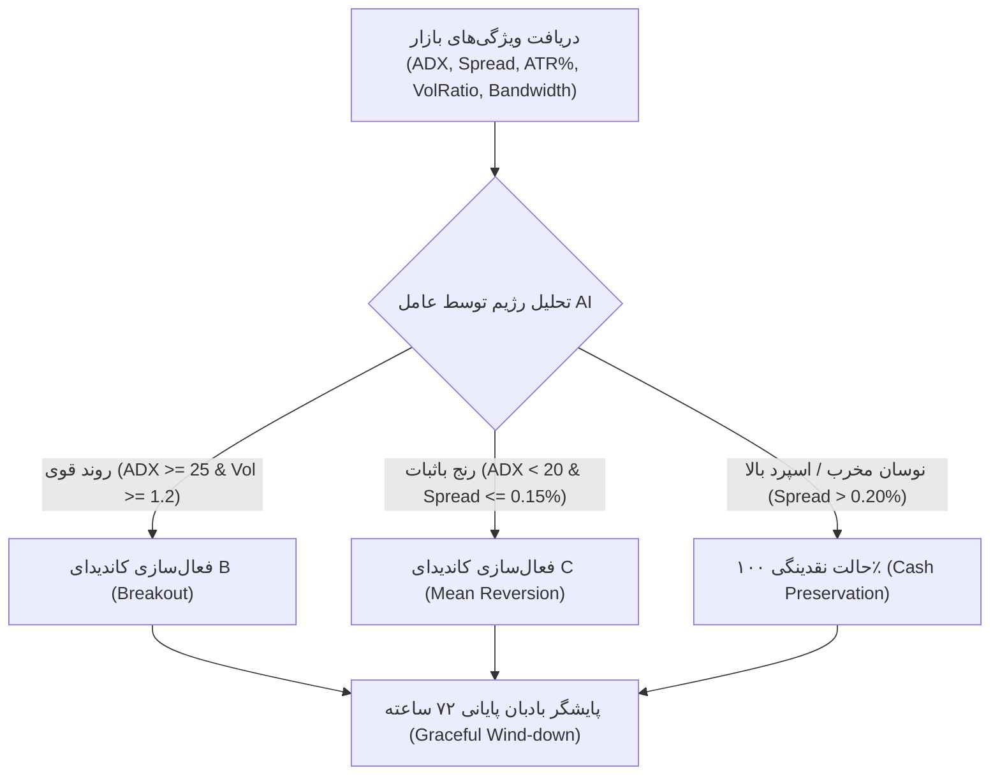

# مشخصات فنی و فرمولاسیون کاندیداهای استراتژی مسابقه‌ای (Phase 22)
## Strategy Candidates Specification, Hypotheses, and Architecture

> **شاخه پژوهشی:** `research/phase22-discovery`  
> **مخزن:** [`wallex`](file:///root/starcoach-hack/wallex)  
> **کامیت مبنا:** [`b494d60e211497f47ef3b79d6ae79a0726471172`](file:///root/starcoach-hack/wallex)

---

## ۱. مرور کاندیداهای استراتژی (Strategy Candidates Overview)

در این فاز، ۵ کاندیدای متمایز با پشتوانه پژوهش‌های کمی فاز ۲۲ طراحی شده‌اند تا به صورت مستقل پیاده‌سازی و در برابر خط مبنای منجمد فاز ۲۱ ارزیابی شوند:

1. **کاندیدای A (Adaptive Horizon & Graceful Wind-Down):** اصلاح استراتژی روندی فعلی با اضافه کردن ناحیه ممنوعه ورود (ساعت ۶۰ به بعد)، تارگت‌های فشرده‌تر و تصفیه پسیو.
2. **کاندیدای B (Short-Horizon Volatility Breakout):** استراتژی بریک‌اوت کانال دانچیان و نوسان ATR با حد زمانی خروج (Time Stop).
3. **کاندیدای C (Range-Bound Mean Reversion):** استراتژی بازگشت به میانگین بر مبنای باندهای بولینگر و RSI برای پنجره‌های بدون روند.
4. **کاندیدای D (Agentic Meta-Strategy / Regime Router):** عامل هوشمند انتخاب‌گر استراتژی متناسب با رژیم نوسان و اسپرد بازار.
5. **کاندیدای E (Multi-Asset Cross-Sectional Momentum):** تنوع‌بخشی پویا بین بیت‌کوین، اتریوم و سولانا بر مبنای شتاب قیمتی و نقدشوندگی.

---

## ۲. مشخصات تفصیلی کاندیدای A: روند تطبیقی با بادبان پایانی (Candidate A)

### ۲.۱. فرضیه پژوهشی (Hypothesis):
«حذف ورود در ۱۲ ساعت پایانی مسابقه و تبدیل تصفیه اجباری از اردر تیکر به اردر پسیو میکر، زیان ۱۱،۰۷۵ تومانی تصفیه اضطراری را حذف کرده و عملکرد استراتژی روندی را در پنجره‌های ۷۲ ساعته مثبت می‌سازد.»

### ۲.۲. شروط ورود و فیلترها:
- **شرط زمانی مسابقه:** زمان سپری‌شده از پنجره کمتر از ۶۰ ساعت باشد ($t < 60\text{ hours}$).
- **شرط روند تکنیکال:** $\text{EMA}_{20} > \text{EMA}_{50}$ و $50 \le \text{RSI}_{14} \le 68$ و $\text{VolRatio} \ge 1.10$.
- **فیلتر رژیم هوش مصنوعی:** رژیم `BULLISH_TREND` با ضریب اطمینان $\ge 0.70$.
- **سقف اسپرد:** $\text{Spread} \le 0.20\%$.

### ۲.۳. مدیریت خروج و تارگت‌ها:
- **حد سود پویا (Take Profit):** $P_{\text{entry}} \times (1 + 2.0 \times \frac{\text{ATR}_{14}}{P_{\text{entry}}})$, با سقف ۲.۵٪ و کف ۱.۵٪.
- **حد ضرر پویا (Stop Loss):** $P_{\text{entry}} \times (1 - 1.2 \times \frac{\text{ATR}_{14}}{P_{\text{entry}}})$, با کف ۱.۰٪.
- **حد ضرر بدون ریسک (Break-Even Trailing):** با رسیدن قیمت به $+1.0 \times \text{ATR}$، حد ضرر به نقطه ورود $+ 0.70\%$ منتقل می‌شود تا هزینه‌های کارمزد پوشش یابد.
- **بادبان پایانی مسابقه (Graceful Wind-down):** در بازه زمانی ساعت ۶۴ الی ۷۱.۵، پوزیشن باز با اردر لیمیت (Maker) به نرخ Mid-Price ثبت می‌شود. در صورت پر نشدن، تنها در ۱۵ دقیقه پایانی اردر مارکت ارسال می‌شود.

---

## ۳. مشخصات تفصیلی کاندیدای B: شکست نوسان افق کوتاه (Candidate B)

### ۳.۱. فرضیه پژوهشی (Hypothesis):
«ورود در شکست سقف ۲۰ کندلی دانچیان با حجم مضاعف و شاخص ADX بالا، حرکات جهشی سریع ۴ الی ۸ ساعته ایجاد می‌کند که به سرعت سود هدف را محقق می‌سازد و از معطل ماندن پوزیشن تا پایان مسابقه جلوگیری می‌کند.»

### ۳.۲. شروط ورود:
- **شکست سقف دانچیان:** $P_{\text{close}} > \max(P_{\text{high}, t-20 \dots t-1})$.
- **شاخص قدرت روند:** $\text{ADX}_{14} \ge 25.0$.
- **جهش حجم معاملات:** $\text{Volume} \ge 1.50 \times \text{MA}(\text{Volume}, 20)$.
- **فیلتر اسپرد:** $\text{Spread} \le 0.18\%$.
- **ساعت مجاز ورود:** $t \le 56\text{ hours}$.

### ۳.۳. مدیریت خروج:
- **حد سود:** $+2.20\%$ (اردر لیمیت پسیو میکر با کارمزد ۰.۲۵٪).
- **حد ضرر:** $-1.30\%$ (اردر استاپ تیکر).
- **خروج زمانی اجباری (Time Stop):** اگر پس از ۱۶ کندل (۴ ساعت) معامله به سود حداقل ۱.۰٪ نرسید، پوزیشن بسته می‌شود تا سرمایه آزاد گردد.

---

## ۴. مشخصات تفصیلی کاندیدای C: بازگشت به میانگین در رنج (Candidate C)

### ۳.۱. فرضیه پژوهشی (Hypothesis):
«در ۳۴.۵٪ پنجره‌هایی که بازار رنج و بدون روند است و استراتژی روندی غیرفعال می‌ماند، معامله بازگشت به میانگین در کف باندهای بولینگر می‌تواند بازدهی مثبت با ریسک کنترل‌شده تولید کند.»

### ۴.۲. شروط ورود:
- **فیلتر رژیم رنج:** $\text{ADX}_{14} < 20.0$ و فشرده شدن پهنای باند بولینگر ($\text{BandWidth} < 2.5\%$).
- **شرط اشباع فروش:** $P_{\text{low}} < \text{LowerBand}(20, 2.0)$ و $\text{RSI}_{14} \le 30.0$.
- **سد سودآوری نسبت به کارمزد (Hurdle Rate):** فاصله قیمت تا خط میانی بولینگر ($\text{SMA}_{20}$) باید حداقل **۱.۳۰٪** باشد تا پس از کسر ۰.۷۰٪ کارمزد و اسلیپیج، سود خالص باقی بماند.
- **ساعت مجاز ورود:** $t \le 60\text{ hours}$.

### ۴.۳. مدیریت خروج:
- **حد سود اول:** خط میانی بولینگر ($\text{SMA}_{20}$) به عنوان اردر لیمیت میکر.
- **حد ضرر:** شکست قیمت به زیر $\text{LowerBand} - 1.0 \times \text{ATR}$.
- **خروج زمانی:** خروج اجباری در صورت سپری شدن ۱۲ کندل (۳ ساعت).

---

## ۵. مشخصات تفصیلی کاندیدای D: عامل هوشمند انتخاب‌گر استراتژی (Candidate D - Agentic Meta-Router)

### ۵.۱. معماری عامل هوشمند (Agent Architecture):
عامل هوشمند در هر کندل ۱۵ دقیقه‌ای ماتریس ویژگی‌های بازار را تحلیل کرده و وضعیت بازار را به سه حالت تخصیص می‌دهد:

### ۵.۲. مزیت فنی برای ارزیابی مسابقه:
این کاندیدا به طور واقعی از هوش مصنوعی برای مسیریابی استراتژی و تخصیص سرمایه استفاده می‌کند و همزمان معضل انفعال در رژیم رنج و معضل زیان تصفیه اجباری را حل می‌نماید.

---

## ۶. مشخصات تفصیلی کاندیدای E: مومنتوم مقطعی سه‌گانه (Candidate E - Multi-Asset Momentum)

### ۶.۱. فرضیه پژوهشی (Hypothesis):
«گسترش دامنه معاملاتی از تک‌نماد BTC به سبد نقدشونده والکس (BTC, ETH, SOL) و ورود انحصاری به دارایی با قوی‌ترین ممنتوم و کمترین اسپرد، همبستگی را کاهش داده و نرخ پنجره‌های بدون معامله را به حداقل می‌رساند.»

### ۶.۲. سازوکار رتبه‌بندی مقطعی (Cross-Sectional Scoring):
در هر گام ۱۵ دقیقه‌ای، برای هر یک از نمادهای `BTCTMN`، `ETHTMN` و `SOLTMN`:
$$\text{Score} = \frac{\text{Momentum}_{24h}}{\text{ATR}_{24h}} \times (1 - \frac{\text{Spread}}{0.35\%})$$
- تنها نمادی که بالاترین امتیاز مثبت را داشته باشد و شرایط تکنیکال کاندیدای A یا B را احراز کند، مجوز ثبت سفارش دریافت می‌کند.
- **محدودیت سرمایه:** همواره حداکثر ۱ موقعیت باز به ارزش ۵۰۰،۰۰۰ تومان در کل پورتفولیو مجاز است تا ریسک متمرکز نشود.

---

## ۷. معیارهای ارزیابی و شرایط رد کاندیداها (Rejection Criteria)

یک کاندیدا در صورتی از دور خارج می‌شود که:
1. میانگین بازدهی آن در ۲۹ پنجره مسابقه‌ای منفی باشد ($\bar{R}_{72h} < 0$).
2. در آزمون استرس اسلیپیج ۰.۳۰٪ کل سرمایه را با دراوداون بالای ۵.۰٪ مواجه کند.
3. تعداد پنجره‌های بدون معامله آن بیش از ۴۰٪ باشد.
4. وابستگی به داده‌های غیرقابل دسترس تاریخی داشته باشد.

نتایج پیاده‌سازی و شبیه‌سازی این کاندیداها در سند بعدی ثبت خواهد شد.
