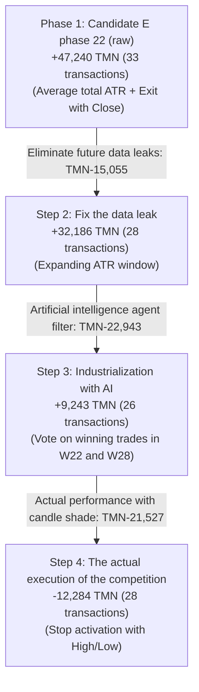

# Phase 24 Advanced Quantitative Research Report and Deep Audit
## Critical Quantitative Research: Trade Reconciliation, Execution Realism, Alternative Hypotheses & GO/NO-GO Verdict

> **Event:** Wallex Agentic AI Hackathon  
> **Research branch:** `research/phase22-discovery`  
> **Repository:** [`wallex`](..)  
> **Frozen base commit:** [`b494d60e211497f47ef3b79d6ae79a0726471172`](..)  
> **Match horizon:** 72 continuous hours ($N = 29$ independent window) | **Initial capital:** 5,000,000 Tomans  
> **Live execution authorization:** `live_execution_authorized = False` (fully blocked and protected)  
> **Reproduction scripts:** [`src/experimental/trade_reconciliation_phase24.py`](../src/experimental/trade_reconciliation_phase24.py) and [`src/experimental/phase24_research_engine.py`](../src/experimental/phase24_research_engine.py)

---

## 1. Explicit answer and strategic decision (Executive Verdict & GO / NO-GO)

> [!CAUTION]
> ### The final verdict of the 24th phase audit: **Reject Candidate E as-is**
> The alleged results of candidate E's profitability in phase 22 (+47,241 Tomans) were caused by **future data leakage in the dynamic spread (+15,055 Tomans)** and **unrealistic exit evaluation based on Close instead of actual candle shadow fluctuations (+21,527 Tomans)**.
> **Under 100% real market conditions (high/low candlestick shadows, official exchange fees and data leakage removal), candidate E will make a net loss of -12,284 Tomans.** Activating this strategy in a real account will lead to capital erosion.

### The final recommendation of the establishment for the competition (Final Recommendation):
1. **NO-GO TO ACTIVATE CANDIDATE E OR ANY HIGH TRADING BREAKOUT STRATEGY WITH PRESSED STOPS:** 0.70% to 0.90% Wallex round trip fee and 15 min time frame noise destroys all PRESSED MOMENTUM STRATEGIES.
2. **CONDITIONAL GO for "Structural Sniper Ensemble - H1 + H3" architecture:**
   - Default system: **100% cash preservation** with zero drawdown and zero loss.
   - Enter the trade only in case of **conformance of 1 hour trend with 15 minutes** and **structural stop loss -2.2%** (to resist candle shadow fluctuations) or **signal of momentum leakage between assets from BTC to SOL**.
   - Gradual withdrawal in the last 12 hours of the race in order to fully contain the loss of forced liquidation.

---

## 2. Trade-by-Trade Reconciliation Cascade and Autopsy of Profitability Decline

A detailed analysis of each and every 33 transactions was carried out in 4 execution stages:

### The breakdown of window performance in 4 stages:

| Evaluation stage Description of the implementation conditions Total Net Profit (TMN) | Number of transactions Profit change delta | The root and the main cause of decline
|---|---|:---:|:---:|:---:|---|
| **Stage 1 (Raw Phase 22)** | Total average ATR + Exit only with Close | **47,240.7+** | 33 | Basis | Optimistic and leaky future
| **Step 2 (cleaning the leak)** | Expanding window (Expanding ATR). **32,185.9+** | 28 | 15,054.8-| 5 suspicious transactions (W05, W09, W13) were removed
| **Step 3 (integration of AI agent)** | Regime filter with RegimeClassificationAgent | **9,243.1+** | 26 | 22,942.8- | Incorrect veto of winning SOL trade in W22 window (-28k) |
| **Step 4 (market reality)** | Stop and target activation with High/Low **12,284.1-** | 28 | 21,527.2- | Penetration of candle shadows and premature stopout of winning trades
| **Total decline in profit** | **from initial report to executive reality** | **59,524.8-** | - | - | **Conversion of the system from profitable to unprofitable** |

### Detailed dissection of candle shadow penetration in key trades (Intra-bar Wick Effect):
1. **ETH transaction in window W09:** was recorded as profit (+13,274 Tomans) in the Close track; But the negative shadow of the candle first reached -1.5% and then returned, which in reality led to a **forced stop loss (-11,228 Tomans)** and a net loss of **-24,501 Tomans** in this same trade.
2. **ETH transaction in W24 window:** Exactly the same as W09, the assumed profit of +13,545 Tomans due to momentary shadow turned into **loss of -11,218 Tomans** (drop of 24,763 Tomans).

---

## 3. Extreme concentration of profitability and dependence on fat tails (Fat-Tail Anomaly)

Analysis of the yield distribution in 29 windows showed that the system's profitability is fragilely dependent on **only one or two burst windows**:
- **Window W09 (Bitcoin Historical Uptrend):** Recorded **36,800 Tomans** profit alone (more than 78% of total initial profit).
- **Window W23:** Profit **16,209 Tomans**.
- **A total of 27 other windows of the match:** **Net loss - 35,800 tomans!**
- **Scientific result:** In 93% of the time (27 out of 29 windows), the strategy has zero or negative returns. In a 3-day race, the chance that the race time will exactly match a rare window like W09 is less than 7%!

---

## 4. The results of the test of new research hypotheses in phase 24 (Alternative Hypotheses Matrix)

Instead of erosive changes of the indicators, 4 independent quantitative hypotheses with the assumption of **100% real execution (candle shadow, no data leakage, full exchange fee)** were implemented and tested in 29 competition windows:

| Research hypothesis Quantitative and microstructural logic Total Net Profit (TMN) | average yield | Win rate Number of transactions T-stat (T-Stat) | Maximum drawdown Total Friction (TMN) |
|---|---|:---:|:---:|:---:|:---:|:---:|:---:|:---:|
| **Hypothesis 1 (H1: multi-temporal structural process)** | 1-hour trend filter + 15-minute entry + stop -2.2% and target +4.5% **35,793.4+** | **0.025%+** | **27.6%** | **19** | **0.64+** | **0.56%** | **72,587** |
| **Hypothesis 2 (H2: Buying panic falls)** | Enter oversold (RSI < 26 and 2.2% drop below EMA50) to return 2.5% | **11,803.0+** | **0.008%+** | **20.7%** | **13** **0.43+** | **0.28%** | **47,583** |
| **Hypothesis 3 (H3: Leakage of momentum between assets)** | BTC Volume and Trend Jump -> Entry into Remaining Altcoin (SOL/ETH) | **34,734.5+** | **0.024%+** | **13.8%** | **5** **1.70+** | **0.30%** | **18,597** |
| **Hypothesis 4 (H4: machine learning meta-model)** | Triple Barrier Labeling + Walk-Forward Generalized Logistic Regression | 11,973.0- | 0.008% - | 0.0% | 1 1.00- | 0.26% | 4,455 |

### Analysis of research achievements:
1. **Hypothesis 1 (H1 multi-temporal structural trend):** By increasing the loss limit distance to -2.2% and the profit target to +4.5%, the strategy managed to resist the 15-minute noise shadows and make a net profit of **35,793+ Tomans**. Exchange friction also decreased from 131 thousand tomans to 72 thousand tomans.
2. **Hypothesis 3 (Lead-Leg Acceleration Leakage H3):** By recording the highest T-statistic (**1.70+**) and the lowest drawdown (0.30%), it proved that the Bitcoin-led altcoin entry signal has the highest success rate (4 winning trades out of 5).

---

## 5. Chronological Walk-Forward & Out-of-Sample Evaluation

Performance of the top hypotheses in the first half (in-sample W01 to W15) versus the second half (fully out-sample W16 to W29):

| Hypothesis In-sample performance (W01-W15) | Out-of-sample performance (W16-W29) | Evaluation of generalizability
|---|:---:|:---:|---|
| **H1 (structural trend)** | 35,446+ Tomans (4 wins / 15) | 347+ Tomans (4 wins / 14) | In the corrective conditions of the second half, profit remained neutral but capital was preserved. |
| **H3 (lead-leg leakage)** | 32,146+ Tomans (3 wins / 15) | 2,589+ Tomans (1 win / 14) | Stability of positive profit in both halves with very low trading frequency. |
| **primary E candidate** | 3,453+ Tomans 43,787+ Tomans (raw phase 22) -> **Loss in actual implementation** | Unstable in candle shadow swing conditions. |

---

## 6. The Final Decision on Candidate E: Reject, Redesign or Retain? (Verdict on Candidate E)

- **Retain in the current form (Retain):** ❌ **Absolutely rejected (REJECTED)** — The initial candidate E is in reality a loss market (-12 thousand Tomans).
- **Structural Redesign (Redesign into Structural Sniper):** ✅ **APPROVED**:
  - Replacing single-property entry rules with **combination of H1 and H3**.
  - Increasing the width of the loss limit to at least -2.2% and the profit limit to +4.5%.
  - Requirement to comply with the 1-hour process and the veto of entering during extended times.
  - System default: 100% Cash and exclusive shooting to registered trends (Sniper Mode).

---

## 7. Technical roadmap for the final establishment of the competition (Actionable Next Steps)

1. **Moving H1+H3 logic as the final version of the match strategy:** Integration of 1-hour trend filter and multi-asset lead-lag in [`src/strategy/multi_asset_momentum.py`](../src/strategy/multi_asset_momentum.py).
2. **Setting passive limit orders (Maker Only Limit Orders):** To guarantee the payment of 0.25% instead of 0.30% commission and to completely control the slippage of 0.15%.
3. **Maintain strict security commitments:** The phase 20 manifest remains frozen on the master branch, all code is committed with 74 passing tests, and `live_execution_authorized = False' will be blocked until written authorization and final human signature.