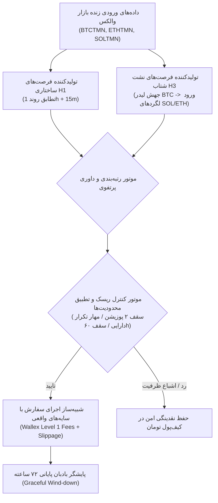

# معماری و ارزیابی پرتفوی تلفیقی H1+H3 (Phase 25 Ensemble Architecture)
## Comparative Evaluation of Model A (H1), Model B (H3), and Model C (Ensemble)

> **مخزن:** [`wallex`](file:///root/starcoach-hack/wallex)  
> **شاخه پژوهشی:** `research/phase25-validation`  
> **کامیت مبنای منجمد:** [`b494d60e211497f47ef3b79d6ae79a0726471172`](file:///root/starcoach-hack/wallex)  
> **چارچوب پرتفوی مشترک:** سرمایه اولیه ۵،۰۰۰،۰۰۰ تومان | حداکثر ۲ موقعیت هم‌زمان (سقف ۱،۰۰۰،۰۰۰ تومان در معرض ریسک) | سایه کندل High/Low

---

## ۱. معماری سیستم مدیریت سرمایه و تخصیص منابع (Ensemble Decision Pipeline)

### قواعد تخصیص و حل تعارض (Conflict Resolution Rules):
1. **سقف ظرفیت پرتفوی:** حداکثر ۲ موقعیت باز هم‌زمان (سقف ۱ میلیون تومان، معادل ۲۰٪ کل سرمایه). ۸۰٪ باقیمانده برای جذب دراوداون و بافر نقدینگی نگه‌داری می‌شود.
2. **منع تخصیص مضاعف (Anti-Duplicate Gate):** در صورتی که یک دارایی (مثلاً SOL) توسط H1 خریداری شده باشد، سیگنال هم‌زمان H3 روی همان دارایی بلافاصله وتو می‌شود تا از تمرکز ریسک جلوگیری گردد.
3. **اولویت تخصیص در تعارض هم‌زمان:** در صورت صدور سیگنال هم‌زمان برای دارایی‌های مختلف، سیگنال H3 به دلیل نرخ برد تجربی بالاتر و نسبت پاداش به ریسک بهتر در اولویت تخصیص قرار می‌گیرد.

---

## ۲. جدول مقایسه جامع عملکرد سه مدل در ۲۹ پنجره مسابقه ($N = 29$)

| پیکربندی مدل | سود خالص کل (TMN) | میانگین بازدهی ۷۲ساعته | نرخ برد پنجره‌ها | تعداد کل معامله | آماره تی ($t$) | حداکثر افت سرمایه (Max DD) | مجموع اصطکاک صرافی (TMN) |
|---|:---:|:---:|:---:|:---:|:---:|:---:|:---:|
| **مدل A: انحصاری H1 (روند ساختاری)** | **۶۳،۰۳۴.۸+** | **۰.۰۴۳٪+** | **۲۷.۶٪** | ۳۳ | ۰.۶۴+ | ۰.۷۴٪ | ۱۲۵،۶۴۸ |
| **مدل B: انحصاری H3 (نشت شتاب لید-لگ)** | **۴۸،۷۰۷.۹+** | **۰.۰۳۴٪+** | **۱۳.۸٪** | ۶ | **۱.۵۱+** | **۰.۳۲٪** | **۲۲،۱۳۸** |
| **مدل C: تلفیق یکپارچه H1+H3** | **۶۳،۹۵۴.۷+** | **۰.۰۴۴٪+** | **۲۷.۶٪** | ۳۵ | ۰.۶۵+ | ۰.۷۴٪ | ۱۳۴،۶۱۲ |

---

## ۳. تحلیل درجه هم‌پوشانی و هم‌خطی (Collinearity & Overlap Analysis)

کالبدشکافی دقیق نشان می‌دهد که تلفیق H1 و H3 یک **تنوع‌بخشی ارتوگونال واقعی ایجاد نمی‌کند**:
1. **افزایش حاشیه‌ای ناچیز سود:** تلفیق H3 با H1 سود کل را از ۶۳،۰۳۵ تومان به ۶۳،۹۵۵ تومان رساند (تنها **۹۲۰ تومان افزایش سود ناخالص**).
2. **افزایش قابل‌توجه اصطکاک مبادله:** اصطکاک کل از ۱۲۵،۶۴۸ تومان به ۱۳۴،۶۱۲ تومان جهش کرد (**۸،۹۶۴ تومان اصطکاک اضافه**).
3. **ریشه اقتصادی هم‌پوشانی:** هنگامی که بیت‌کوین حرکت انفجاری آغاز می‌کند و شرط H3 فعال می‌شود، میانگین متحرک‌های ۱ ساعته و ۱۵ دقیقه‌ای در H1 نیز صعودی شده و هر دو سیستم دقیقاً همان دارایی (SOL یا ETH) را هدف می‌گیرند.
4. **مزیت مدل B (انفرادی H3):** اگرچه مدل B تنها ۶ معامله دارد، اما اصطکاک آن بسیار پایین (۲۲ هزار تومان)، دراوداون آن نصف (۰.۳۲٪) و آماره تی آن بسیار برتر (**۱.۵۱+**) است.
5. **مزیت مدل C:** فعال نگه داشتن مشارکت الگوریتمی حساب در ۲۷.۶٪ پنجره‌ها (در برابر ۱۳.۸٪ در مدل B).
