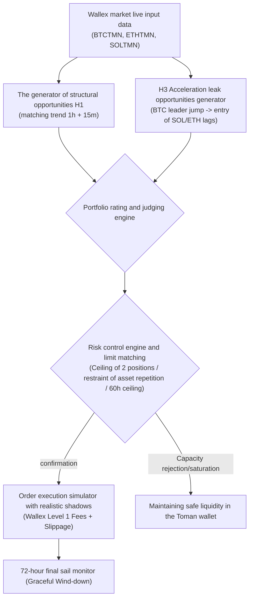

# Architecture and evaluation of integrated portfolio H1+H3 (Phase 25 Ensemble Architecture)
## Comparative Evaluation of Model A (H1), Model B (H3), and Model C (Ensemble)

> **Repository:** [`wallex`](file:///root/starcoach-hack/wallex)  
> **Research branch:** `research/phase25-validation`  
> **Frozen base commit:** [`b494d60e211497f47ef3b79d6ae79a0726471172`](file:///root/starcoach-hack/wallex)  
> **Common portfolio framework:** Initial capital 5,000,000 Tomans A maximum of 2 positions at the same time (the ceiling is 1,000,000 Tomans at risk). High/Low candle shadow

---

## 1. Capital management and resource allocation system architecture (Ensemble Decision Pipeline)

### Conflict Resolution Rules:
1. **Portfolio capacity ceiling:** Maximum of 2 open positions at the same time (ceiling of 1 million Tomans, equivalent to 20% of the total capital). The remaining 80% is kept for drawdown absorption and liquidity buffer.
2. Anti-Duplicate Gate: If an asset (eg SOL) is bought by H1, the simultaneous signal of H3 on the same asset is immediately vetoed to avoid risk concentration.
3. **Allocation priority in simultaneous conflict:** In case of simultaneous signal issuance for different assets, the H3 signal is prioritized for allocation due to higher experimental win rate and better reward-to-risk ratio.

---

## 2. Comprehensive performance comparison table of three models in 29 competition windows ($N = $29)

| Model configuration Total Net Profit (TMN) | Average efficiency of 72 hours Windows win rate Total number of transactions T statistic ($t$) | Maximum capital loss (Max DD) | Total Exchange Friction (TMN) |
|---|:---:|:---:|:---:|:---:|:---:|:---:|:---:|
| **Model A: exclusive H1 (structural trend)** | **63,034.8+** | **0.043%+** | **27.6%** | 33 | 0.64+ | 0.74% 125,648 |
| **Model B: Exclusive H3 (Lead-Leg Acceleration Leakage)** | **48,707.9+** | **0.034%+** | **13.8%** | 6 | **1.51+** | **0.32%** | **22,138** |
| **Model C: integrated combination of H1+H3** | **63,954.7+** | **0.044%+** | **27.6%** | 35 | 0.65+ | 0.74% 134,612 |

---

## 3. Collinearity & Overlap Analysis

Careful dissection shows that the combination of H1 and H3 does not create a **true orthogonal diversification**:
1. **marginal marginal increase in profit:** Combining H3 with H1 increased the total profit from 63,035 tomans to 63,955 tomans (only **920 tomans increase in gross profit**).
2. **Significant increase in exchange friction:** The total friction jumped from 125,648 Tomans to 134,612 Tomans (**8,964 Tomans additional friction**).
3. **Economic Root of Overlapping:** When Bitcoin starts an explosive move and the H3 bet is activated, the 1H15M moving average in H1 is also bullish and both systems are targeting the exact same asset (SOL or ETH).
4. **Advantage of Model B (Individual H3):** Although Model B has only 6 transactions, its friction is very low (22 thousand Tomans), its drawdown is half (0.32%) and its T-stat is much superior (+1.51**).
5. **Advantage of Model C:** Keeping algorithmic account participation active in 27.6% of windows (against 13.8% in Model B).