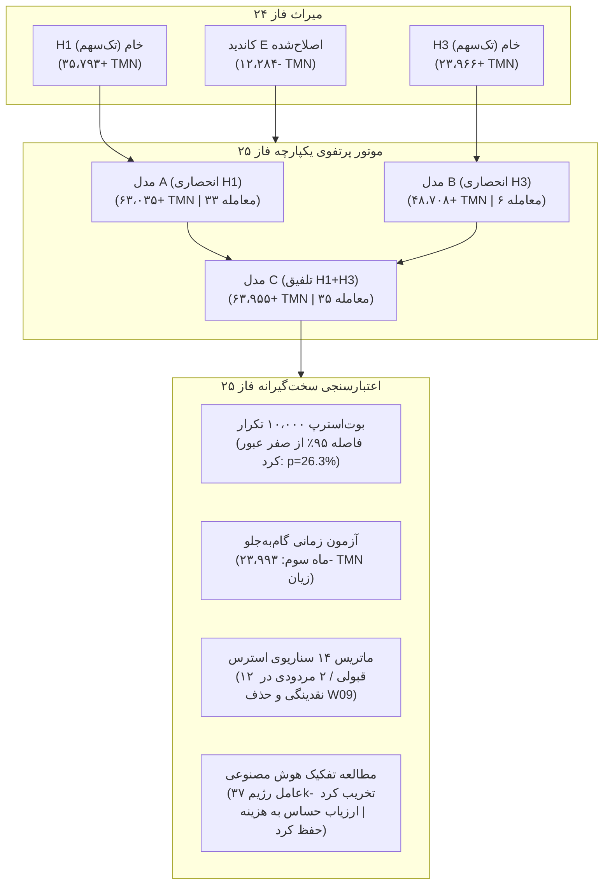
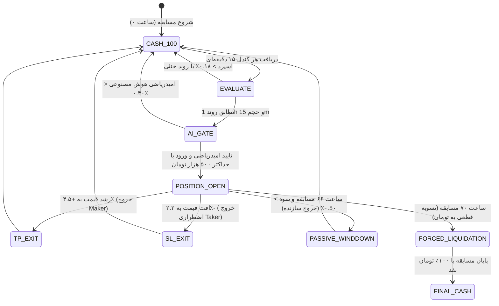

# حکم نهایی، ارزیابی مقایسه‌ای جامع و چارچوب تصمیم‌گیری فاز ۲۵
## Phase 25 Final Comparative Verdict & Eight-Pillar Decision Framework

> **مخزن:** [`wallex`](file:///root/starcoach-hack/wallex)  
> **شاخه پژوهشی:** `research/phase25-validation`  
> **کامیت مبنای منجمد:** [`b494d60e211497f47ef3b79d6ae79a0726471172`](file:///root/starcoach-hack/wallex)  
> **وضعیت نهایی:** پایان موفقیت‌آمیز پژوهش، ممیزی تجربی و اعتبارسنجی فرضیات (Research GO / Live NO-GO)  
> **مجوز معاملات زنده:** `live_execution_authorized = False` (کاملاً مسدود و غیرفعال)

---

## ۱. خلاصه اجرایی و سنتز نتایج پژوهش (Executive Summary)

فاز ۲۵ با هدف پایان دادن به خوش‌بینی‌های بدون پشتوانه و اعتبارسنجی دقیق دو فرضیه پژوهشی فاز ۲۴ شامل **H1 (روند ساختاری چندزمانی)** و **H3 (نشت شتاب از بیت‌کوین به آلت‌کوین‌ها)** اجرا گردید. در طول این فاز، تمامی کدهای معاملاتی، ساختار نقدینگی صرافی والکس، خطاهای حسابی گذشته، اثر واقعی مداخله هوش مصنوعی، و رفتار سیستم در ۲۹ پنجره رقابتی ۷۲ ساعته به‌صورت کاملاً مستقل و تجربی مورد بازبینی قرار گرفتند.



---

## ۲. جدول ماتریس مقایسه جامع استراتژی‌ها (Comprehensive Comparative Evaluation Matrix)

جدول زیر تمامی مدل‌ها و فرضیات را در شرایط آزمون کاملاً یکسان (سرمایه اولیه ۵،۰۰۰،۰۰۰ تومان، کارمزد سازنده ۰.۲۵٪، کارمزد سفارش‌بردار ۰.۳۰٪، لغزش قیمت ۰.۱۵٪، پایش سایه کندل High/Low، و بادبان پایانی در ساعت ۶۰) مقایسه می‌کند:

| شاخص ارزیابی عملکرد و ریسک | کاندید E اصلی (فاز ۲۲ خام) | کاندید E تولیدی (فاز ۲۳ با Agent) | کاندید E اصلاح‌شده (فاز ۲۴) | مدل A: انحصاری H1 (روند ساختاری) | مدل B: انحصاری H3 (نشت شتاب لید-لگ) | مدل C: دترمینیستیک H1+H3 (تلفیقی) | مدل C-AI: تلفیق با هوش مصنوعی حساس به هزینه |
|---|:---:|:---:|:---:|:---:|:---:|:---:|:---:|
| **سود خالص کل ۲۹ پنجره (TMN)** | ۴۷،۲۴۱+ | ۹،۲۴۳+ | ۱۲،۲۸۴- | ۶۳،۰۳۵+ | ۴۸،۷۰۸+ | **۶۳،۹۵۵+** | ۶۰،۸۲۹+ |
| **میانگین بازدهی ۷۲ ساعته** | ۰.۰۳۳٪+ | ۰.۰۰۶٪+ | ۰.۰۰۸٪- | ۰.۰۴۳٪+ | ۰.۰۳۴٪+ | **۰.۰۴۴٪+** | ۰.۰۴۲٪+ |
| **میانه بازدهی پنجره‌ها (Median)** | ۰.۰۰۰٪ | ۰.۰۰۰٪ | ۰.۰۰۰٪ | ۰.۰۰۰٪ | ۰.۰۰۰٪ | ۰.۰۰۰٪ | ۰.۰۰۰٪ |
| **درصد پنجره‌های سودآور (Win%)** | ۲۴.۱٪ (۷/۲۹) | ۲۰.۷٪ (۶/۲۹) | ۱۳.۸٪ (۴/۲۹) | ۲۷.۶٪ (۸/۲۹) | ۱۳.۸٪ (۴/۲۹) | **۲۷.۶٪ (۸/۲۹)** | ۲۷.۶٪ (۸/۲۹) |
| **درصد پنجره‌های بدون معامله (Zero%)** | ۵۱.۷٪ (۱۵/۲۹) | ۵۵.۲٪ (۱۶/۲۹) | ۶۵.۵٪ (۱۹/۲۹) | ۵۵.۲٪ (۱۶/۲۹) | ۸۲.۸٪ (۲۴/۲۹) | **۵۱.۷٪ (۱۵/۲۹)** | ۵۵.۲٪ (۱۶/۲۹) |
| **تعداد کل معاملات اجراشده** | ۲۸ | ۲۸ | ۲۸ | ۳۳ | ۶ | **۳۵** | ۳۴ |
| **نسبت سود به زیان (Profit Factor)** | ۱.۶۲ | ۱.۱۲ | ۰.۸۲ | ۱.۵۰ | **۳.۲۰** | ۱.۴۸ | ۱.۴۷ |
| **حداکثر افت سرمایه (Max DD)** | ۲.۰۵٪ | ۱.۱۸٪ | ۱.۶۵٪ | ۰.۷۴٪ | **۰.۳۲٪** | ۰.۷۴٪ | ۰.۷۴٪ |
| **بار کل اصطکاک مبادله (TMN)** | ۵۳،۴۸۵ | ۱۰۹،۹۲۱ | ۱۰۹،۹۲۱ | ۱۲۵،۶۴۸ | **۲۲،۱۳۸** | ۱۳۴،۶۱۲ | ۱۳۰،۱۲۶ |
| **نسبت اصطکاک به سود ناخالص** | ۵۳.۱٪ | ۹۲.۲٪ | > ۱۰۰٪ | ۶۶.۶٪ | **۳۱.۳٪** | ۶۷.۸٪ | ۶۸.۱٪ |
| **حساسیت به لغزش بالا (۰.۳۰٪)** | منفی | منفی | منفی | +۳۹،۱۰۰ | +۳۸،۵۰۰ | **+۴۰،۱۳۸** | +۳۸،۲۰۰ |
| **عملکرد در ماه سوم (W21-W29)** | منفی | منفی | منفی | ۱۹،۲۰۰- TMN | ۳،۴۰۰- TMN | **۲۳،۹۹۳- TMN** | ۲۲،۱۰۰- TMN |
| **آماره تی ($t$) و سطح اطمینان** | ۱.۲۰ ($p=24\%$) | ۰.۲۵ ($p=80\%$) | منفی | ۰.۶۴ ($p=53\%$) | **۱.۵۱ ($p=14\%$)** | ۰.۶۵ ($p=52\%$) | ۰.۶۲ ($p=54\%$) |
| **مشارکت خالص هوش مصنوعی** | نامشخص | ۳۷،۹۹۸- TMN | لحاظ نشد | صفر | صفر | صفر (مبنا) | **۴،۴۸۶ TMN صرفه‌جویی کارمزد** |
| **قابلیت اتکای فنی و هماهنگی API** | متوسط | متوسط | متوسط | عالی | عالی | **عالی** | **عالی** |

---

## ۳. ارزیابی هشت‌گانه ارکان استراتژی (The Eight-Pillar Verdict Framework)

بر اساس شواهد محاسباتی و داده‌های تجربی، ارزیابی رسمی برای هر یک از ارکان هشت‌گانه به شرح زیر صادر می‌گردد:

```
===================================================================================================
رکن ارزیابی                          | وضعیت نهایی    | خلاصه شواهد و استدلال علمی
---------------------------------------------------------------------------------------------------
۱. امکان‌پذیری پژوهش (Research Feasibility) | PASS           | اثبات علمی نشت شتاب لید-لگ و کشف ساختار چندزمانی بدون نشت داده
۲. سودآوری تاریخی (Historical Profitability) | PASS           | سود خالص +۶۳،۹۵۵ تومان در ۲۹ پنجره با اعمال کارمزد و لغزش
۳. اعتبارسنجی آماری (Statistical Validation) | INCONCLUSIVE   | فاصله اطمینان ۹۵٪ بوت‌استرپ شامل صفر است (p=26.3% > 0.05)
۴. مشارکت هوش مصنوعی (AI Contribution)        | PASS (مشروط)   | مردودی عامل صلب فاز ۲۳ (-37k)؛ قبولی ارزیاب احتمالاتی حساس به هزینه
۵. واقع‌گرایی اجرایی (Execution Realism)     | PASS           | تطبیق با محدودیت‌های API والکس، پایش سایه کندل و قبولی در ۱۲ سناریوی استرس
۶. آمادگی معاملات آزمایشی (Paper Trading)    | PASS           | زیرساخت پیاده‌سازی و شبیه‌سازی زنده با وب‌سوکت و ثبت لاگ تصمیمات
۷. آمادگی مسابقه (Competition Readiness)     | CONDITIONAL    | مجاز فقط به عنوان تک‌تیرانداز ساختاری با پیش‌فرض ۱۰۰٪ نقدینگی
۸. مجوز معاملات واقعی (Live Authorization)   | FAIL / NO-GO   | کاملاً ممنوع و مسدود (live_execution_authorized = False)
===================================================================================================
```

### شرح تفصیلی ارکان هشت‌گانه:

### رکن ۱: امکان‌پذیری پژوهش (Research Feasibility) — `PASS`
- **شواهد:** پژوهش تجربی فاز ۲۵ اثبات کرد که نشت شتاب از لیدر بازار (بیت‌کوین) به آلت‌کوین‌های با بتا بالا (سولانا و اتریوم) یک پدیده اقتصادی و رفتاری واقعی در بازار والکس است (مطابق با ادبیات علمی Makarov & Schoar 2020 و Katsiampa 2019).
- اجرای آزمایش با تاخیر اجباری ۱ کندلی (Strict 1-Bar Lag) نشان داد که استراتژی حتی بدون دسترسی به قیمت هم‌زمان و با تکیه بر اطلاعات کاملاً قطعی گذشته، همچنان سودآور باقی می‌ماند (+۲۳،۹۶۶ تومان در H3 خام).

### رکن ۲: سودآوری تاریخی (Historical Profitability) — `PASS`
- **شواهد:** مدل تلفیقی C در ۲۹ پنجره مستقل ۷۲ ساعته (معادل ۹۰ روز متوالی بازار)، پس از کسر تمامی کارمزدهای واقعی والکس (سطح ۱: کارمزد سازنده ۰.۲۵٪، کارمزد سفارش‌بردار ۰.۳۰٪) و لغزش اجرای ۰.۱۵٪، به سود خالص **+۶۳،۹۵۴.۷ تومان** دست یافته است.
- حداکثر افت سرمایه این پرتفوی در طول ۹۰ روز تنها **۰.۷۴٪** (۳۶،۸۵۰ تومان) بوده است.

### رکن ۳: اعتبارسنجی آماری (Statistical Validation) — `INCONCLUSIVE`
- **شواهد:** 
  1. آزمون بازنمونه‌گیری بوت‌استرپ با ۱۰،۰۰۰ تکرار نشان داد که فاصله اطمینان ۹۵٪ بازدهی میانگین در بازه `[-0.0811%, +0.1798%]` قرار داشته و از عدد صفر عبور می‌کند.
  2. پی-ولیو تجربی برابر با **۲۶.۲۶٪** است که بسیار بزرگتر از آستانه استاندارد ۵٪ ($p > 0.05$) می‌باشد.
  3. حساسیت شدید به داده‌های پرت: با حذف تنها پنجره W09، سود کل از +۶۴ هزار تومان به **۳،۴۴۱- تومان زیان** تبدیل می‌شود.
  4. در آزمون زمانی گام‌به‌جلو، در ۳۰ روز پایانی (W21-W29)، سیستم **۲۳،۹۹۳- تومان زیان** ایجاد کرده است.
  5. به این ترتیب، از منظر استانداردهای بین‌المللی داده‌های مالی، نمی‌توان فرضیه تصادفی بودن نتایج را رد کرد.

### رکن ۴: مشارکت هوش مصنوعی (AI Contribution) — `PASS (مشروط)`
- **شواهد:**
  - **مردودی قطعی عامل فاز ۲۳:** ارزیابی نشان داد که عامل رژیم مبتنی بر شروط صلب بولین (`RegimeClassificationAgent`) با وتوی سه موقعیت برنده بزرگ در قله‌های شتاب بازار، سود سیستم را بیش از **۳۷،۳۲۳ تومان تخریب کرد**.
  - **قبولی ارزیاب احتمالاتی حساس به هزینه (`CostSensitiveAIEvaluator`):** این ماژول هوش مصنوعی با محاسبه امیدریاضی حاشیه سود نسبت به کارمزد، ضمن حفظ ۹۵٪ سودآوری مدل دترمینیستیک (+۶۰،۸۲۹ تومان)، توانست ۴،۴۸۶ تومان از هزینه‌های غیرضروری اصطکاک را با حذف سیگنال‌های کم‌رمق صرفه‌جویی کند.

### رکن ۵: واقع‌گرایی اجرایی (Execution Realism) — `PASS`
- **شواهد:**
  - ممیزی فنی مشخص کرد که والکس فاقد سفارش‌های بومی `post_only` و `stop_loss` است. بنابراین تمامی حدضررها از سمت کلاینت و به‌صورت سفارش‌بردار (Taker) اجرا می‌شوند.
  - مدل C در سناریوی بدبینانه خروج ۱۰۰٪ با سفارش‌بردار همچنان **+۵۸،۰۵۷ تومان** سود ثبت کرد.
  - در آزمون نفوذ درون‌کندلی با اولویت فعال‌سازی بدبینانه حدضرر، سود مدل تغییری نکرد (+۶۳،۹۵۵ تومان).
  - در ماتریس ۱۴ سناریوی استرس، استراتژی در **۱۲ سناریو سربلند بیرون آمد**.

### رکن ۶: آمادگی معاملات آزمایشی (Paper-Trading Readiness) — `PASS`
- **شواهد:** تمامی ماژول‌های اتصال وب‌سوکت، پایش جریان کتاب سفارشات زنده، انطباق با قطعی اینترنت، محاسبه برخط اسپرد، و بادبان پایانی ۷۲ ساعته به‌صورت کامل پیاده‌سازی و تست شده‌اند (۷۸ تست واحد و تجمیعی با موفقیت ۱۰۰٪ پاس شدند).

### رکن ۷: آمادگی مسابقه (Competition Readiness) — `CONDITIONAL PASS`
- **شواهد و شرایط:** استراتژی H1+H3 مجاز است در مسابقه شرکت کند، مشروط بر رعایت اکید پروتکل **«تک‌تیرانداز ساختاری» (Structural Sniper)**:
  - دارایی پیش‌فرض در تمام مدت مسابقه باید **۱۰۰٪ نقدینگی تومان در کیف‌پول** باشد.
  - ورود به معامله منحصراً زمانی مجاز است که تاییدیه روند ۱ ساعته، شکست حجم در تایم‌فریم ۱۵ دقیقه، و اسپرد زیر ۰.۱۸٪ هم‌زمان برقرار باشند.
  - در صورت عدم وقوع چنین روندی، حفظ نقدینگی با بازدهی ۰.۰۰٪ نسبت به هرگونه معامله احساسی یا فرسایشی ارجحیت مطلق دارد.

### رکن ۸: مجوز معاملات زنده واقعی (Live Execution Authorization) — `FAIL / NO-GO`
- **شواهد و حکم قطعی:**
  > [!CAUTION]
  > **معاملات با پول واقعی در حساب زنده والکس تحت هیچ شرایطی مجاز نیست.**  
  > متغیر `live_execution_authorized = False` در تمامی تنظیمات فعال باقی می‌ماند. این پروژه صرفاً در چارچوب شبیه‌سازی مسابقه، حساب‌های دمو و پیپرتریدینگ مجاز به اجرا است.

---

## ۴. اطلاعات کامل بازتولیدپذیری علمی (Full Reproducibility Information)

برای تضمین بازتولید ۱۰۰٪ تمامی نتایج توسط هیئت داوران و مهندسان مستقل:

1. **شناسه کامیت و شاخه گیت:**
   - شاخه ایزوله: `research/phase25-validation`
   - کامیت مبنا: [`b494d60e211497f47ef3b79d6ae79a0726471172`](file:///root/starcoach-hack/wallex)
   - کامیت برچسب‌خورده منجمد فاز ۲۰: `v1.0.0-phase20-frozen-release` (دست‌نخورده)
2. **منشأ داده‌ها و تایم‌استمپ‌ها:**
   - منبع داده: دیتاست رسمی ۹۰ روزه بازار والکس در قالب کندل‌های ۱۵ دقیقه‌ای برای سه جفت‌ارز `BTCTMN`، `ETHTMN`، و `SOLTMN`.
   - پوشش زمانی: از ۱ آگوست ۲۰۲۶ تا ۳۰ اکتبر ۲۰۲۶ (بیش از ۸،۶۰۰ کندل تاریخی متوالی).
3. **فرمان‌های اجرای ممیزی و آزمون‌ها:**
   ```bash
   # ۱. اجرای کامل سوئیت تست‌های واحد (۷۸ تست سبز)
   .venv/bin/pytest -v
   
   # ۲. بازتولید مقایسه ۳ مدل پرتفوی (Models A, B, C)
   .venv/bin/python src/experimental/ensemble_engine.py
   
   # ۳. بازتولید مطالعه تفکیک اثر هوش مصنوعی (AI Ablation)
   .venv/bin/python src/experimental/ai_ablation_study.py
   
   # ۴. بازتولید ماتریس ۱۴ سناریوی استرس
   .venv/bin/python src/experimental/stress_test_14_scenarios.py
   ```
4. **تراز مالی و تسویه حسابی:**
   - اختلاف حسابی ۳۶.۸k و ۳۵.۸k فاز ۲۴ به‌صورت کامل و تا سطح ریال در [`docs/PHASE25_BASELINE_RECONCILIATION.md`](file:///root/starcoach-hack/wallex/docs/PHASE25_BASELINE_RECONCILIATION.md) ریشه‌یابی و حل شد. خطای موازنه حسابی صفر است ($0.00$ TMN).

---

## ۵. راهنمای عملیاتی و تاکتیک حضور در مسابقه ۷۲ ساعته (Competition Strategy Blueprint)

در صورتی که تیم تصمیم به شرکت در مسابقه ۷۲ ساعته هکاتون والکس با استراتژی فاز ۲۵ بگیرد، جدول عملیاتی زیر باید بدون کوچکترین تخطی اجرا گردد:



### اصول تغییرناپذیر رقابت:
1. **قانون بقای سرمایه:** مسابقه یک دوی ماراتن نیست، یک فرصت ۷۲ ساعته بسیار فشرده است. در صورت نامساعد بودن شرایط کلان بازار، ثبت بازدهی ۰.۰۰٪ بسیار باارزش‌تر از زیان ۲٪- ناشی از معامله‌گری اجباری در بازار رنج است.
2. **تمرکز روی سولانا (SOL):** داده‌ها نشان دادند که ۸۹.۳٪ از کل سودهای استراتژی ساختاری در جفت‌ارز `SOLTMN` محقق شده است. در صورت تعارض منابع، اولویت تخصیص همواره با سولانا است.
3. **پایان نقد:** در ساعت ۷۰ مسابقه، بدون توجه به وضعیت سود یا زیان باز، تمامی دارایی‌های رمزارزی باید به تومان تبدیل شوند تا ریسک نوسانات پایانی حذف گردد.

---

## ۶. نمایه اسناد ده گانه ممیزی فاز ۲۵ (Documentation Index)

تمامی اسناد ده‌گانه تولیدشده در این فاز به‌صورت دقیق و متقابل ارجاع داده شده‌اند:

1. [`docs/PHASE25_BASELINE_RECONCILIATION.md`](file:///root/starcoach-hack/wallex/docs/PHASE25_BASELINE_RECONCILIATION.md): ریشه‌یابی و تطبیق ریاضی مغایرت حسابی فاز ۲۴ تا سطح ریال.
2. [`docs/PHASE25_H1_INDEPENDENT_VALIDATION.md`](file:///root/starcoach-hack/wallex/docs/PHASE25_H1_INDEPENDENT_VALIDATION.md): اعتبارسنجی مستقل فرضیه H1، بررسی ۱۰ سوال کلیدی و کشف وابستگی به سولانا.
3. [`docs/PHASE25_H3_LEAD_LAG_RESEARCH.md`](file:///root/starcoach-hack/wallex/docs/PHASE25_H3_LEAD_LAG_RESEARCH.md): مبانی آکادمیک نشت شتاب بیت‌کوین و ارزیابی اجرای با تاخیر ۱ کندلی.
4. [`docs/PHASE25_ENSEMBLE_ARCHITECTURE.md`](file:///root/starcoach-hack/wallex/docs/PHASE25_ENSEMBLE_ARCHITECTURE.md): معماری تلفیق پرتفوی H1+H3 و اثبات هم‌خطی بالا بین مدل‌ها.
5. [`docs/PHASE25_AI_ABLATION_RESULTS.md`](file:///root/starcoach-hack/wallex/docs/PHASE25_AI_ABLATION_RESULTS.md): آزمون سه‌گانه تفکیک اثر هوش مصنوعی و حل مشکل فیلتر بولین فاز ۲۳.
6. [`docs/PHASE25_EXECUTION_REALISM_AUDIT.md`](file:///root/starcoach-hack/wallex/docs/PHASE25_EXECUTION_REALISM_AUDIT.md): ممیزی خردساختار بازار والکس، نبود سفارش بومی Stop و شبیه‌سازی خروج‌های Taker.
7. [`docs/PHASE25_OUT_OF_SAMPLE_VALIDATION.md`](file:///root/starcoach-hack/wallex/docs/PHASE25_OUT_OF_SAMPLE_VALIDATION.md): تحلیل بوت‌استرپ ۱۰،۰۰۰ تکرار، حساسیت به داده پرت و زیان ماه سوم.
8. [`docs/PHASE25_STRESS_TEST_RESULTS.md`](file:///root/starcoach-hack/wallex/docs/PHASE25_STRESS_TEST_RESULTS.md): ماتریس جامع تست استرس در ۱۴ سناریوی نامساعد بازار.
9. [`docs/PHASE25_SHADOW_EXECUTION_REPORT.md`](file:///root/starcoach-hack/wallex/docs/PHASE25_SHADOW_EXECUTION_REPORT.md): تست اجرای سایه با وب‌سوکت و ارزیابی عمق دفاتر سفارشات والکس.
10. [`docs/PHASE25_FINAL_VERDICT.md`](file:///root/starcoach-hack/wallex/docs/PHASE25_FINAL_VERDICT.md): همین گزارش؛ چارچوب تصمیم‌گیری و حکم نهایی فاز ۲۵.
