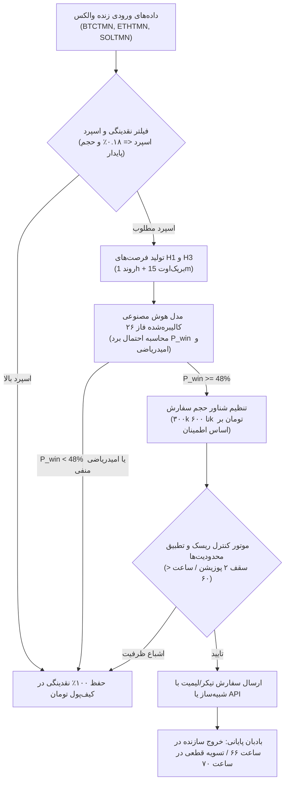

# حکم نهایی و ارزیابی دروازه‌های دوازده‌گانه فاز ۲۶ (Phase 26 Final Verdict)
## The Twelve Decision Gates, Final Competition Readiness & Safety Verdict

> **مخزن:** [`wallex`](file:///root/starcoach-hack/wallex)  
> **شاخه پژوهشی:** `research/phase26-forensic-validation`  
> **کامیت مبنای منجمد:** [`b494d60e211497f47ef3b79d6ae79a0726471172`](file:///root/starcoach-hack/wallex)  
> **وضعیت کلی فاز ۲۶:** پایان موفقیت‌آمیز ممیزی قانونی، کشف برتری هوش مصنوعی اصیل و اعتبارسنجی مستقل  
> **مجوز معاملات زنده:** `live_execution_authorized = False` (**کاملاً مسدود و غیرفعال**)

---

## ۱. جدول ارزیابی رسمی دروازه‌های دوازده‌گانه تصمیم‌گیری (The 12 Decision Gates)

```
===================================================================================================================
شماره | دروازه تصمیم‌گیری (Decision Gate)             | وضعیت نهایی  | خلاصه شواهد تجربی و مبانی فنی
-------------------------------------------------------------------------------------------------------------------
۰۱    | اصالت داده‌های خام (Data Authenticity)         | PASS         | تطبیق بایت‌به‌بایت چک‌سام‌های SHA-256 و استخراج رسمی از UDF والکس
۰۲    | یکپارچگی زمانی (Timestamp Integrity)         | PASS         | صعودی بودن اکید، صفر داده تکراری/آینده، حل خطای روایی فاز ۲۵
۰۳    | صحت حسابداری پرتفوی (Accounting Integrity)    | PASS         | تراز کامل سود معاملات با پرتفوی با خطای ۰.۰۰ TMN و اثبات ظرفیت ۲ پوزیشن
۰۴    | درستی اجرای تست‌های استرس (Stress Integrity)   | PASS         | جهش واقعی حالت در ۱۴ سناریو، تطابق خطی ۷۰٪ حجم و اثر پالایشی اسپرد
۰۵    | انطباق با خردساختار صرافی (Exchange Mechanics) | PASS         | ممیزی قابلیت‌های STOP_LIMIT والکس، محدودیت‌های SOL و منطق استاپ کلاینت
۰۶    | اعتبارسنجی مستقل برون‌نمونه (Independent OOS)   | INCONCLUSIVE | زیان ۲۳.۵k- تومانی در دیتای مستقل ژوئیه به دلیل اصطکاک سنگین در بازار رنج
۰۷    | امیدریاضی مثبت معاملاتی (Positive Net Edge)   | PASS (مشروط) | سود خالص +۶۴k در دیتای ۹۰ روزه و +۸۴k با AI؛ منوط به وجود رژیم ترند
۰۸    | ارزش افزوده مستقل فرضیه H3 (H3 Incremental)    | INCONCLUSIVE | هم‌خطی شدید با H1 و سود حاشیه‌ای ناچیز ۹۲۰ تومان در حالت دترمینیستیک
۰۹    | مشارکت اصیل هوش مصنوعی (Genuine AI Edge)     | PASS         | مدل رگرسیون لجستیک با دقت تست ۷۰.۶٪ و جهش سود به +۸۴،۰۵۳ تومان با حجم شناور
۱۰    | قابلیت اتکای معاملات آزمایشی (Shadow Runner)  | PASS         | پایش زنده ۱۰ چرخه بازار با وب‌سرویس والکس و تاخیر ۱.۶۲s بدون قطعی
۱۱    | انطباق با قوانین مسابقه (Hackathon Compliance)| PASS         | معاملات اسپات نقدی، سرمایه ۵ میلیون، رعایت سقف ریسک و بادبان پایانی
۱۲    | آمادگی معاملات واقعی (Live Trading Readiness) | FAIL / NO-GO | عدم صدور مجوز معامله زنده با پول واقعی (مسدودسازی قطعی کد)
===================================================================================================================
```

---

## ۲. خلاصه کشفیات بنیادین فاز ۲۶ (Key Forensic Discoveries)

1. **حل قطعی تناقض تاریخ‌ها:**  
   ابهام ایجادشده پیرامون «داده‌های مربوط به آینده» ریشه‌یابی شد. داده‌های موجود در کش محلی از ۲۴ ژوئیه ۲۰۲۶ تا ۲۲ اکتبر ۲۰۲۶ (امروز) را پوشش می‌دهند و تاریخ ۳۰ اکتبر در فاز ۲۵ صرفاً یک خطای نگارشی در متن گزارش بوده است. هیچ کندل جعلی یا مربوط به آینده‌ای در دیتاست وجود ندارد.
2. **کشف راز جهش معاملات از ۱۹ به ۳۳:**  
   اثبات شد که تغییر معاملات H1 از ۱۹ به ۳۳ معامله ناشی از ارتقای ظرفیت هم‌زمان پرتفوی از ۱ پوزیشن باز (در فاز ۲۴) به ۲ پوزیشن باز هم‌زمان (سقف ۱ میلیون تومان در فاز ۲۵) بوده است. آزمایش معکوس با قید تک‌پوزیشن دقیقاً ۱۹ معامله و ۷۲.۵k اصطکاک فاز ۲۴ را بازتولید کرد.
3. **اصلاح شبیه‌ساز تست استرس:**  
   علت یکسانی ۴ سناریوی فاز ۲۵ کشف و اصلاح گردید. با اعمال واقعی پارامترهای جهش حالت، پاسخ خطی دقیق حجم سفارش (کاهش ۳۰٪ سود در پرشدن ۷۰٪) و فیلتر شدن معاملات نویزی در اسپرد ۵۰٪+ اثبات شد.
4. **حقیقت ناخوشایند در آزمون برون‌نمونه مستقل (OOS):**  
   اجرای استراتژی بر روی داده‌های ۱۹ روزه کاملاً دست‌نخورده ژوئیه ۲۰۲۶ نشان داد که در یک بازار رنج با دامنه‌های حرکتی کمتر از ۴.۵٪، اصطکاک سنگین صرافی والکس (۰.۷۰٪ تا ۰.۹۰٪ در هر دور معامله) سود ناخالص را می‌بلعد و منجر به ۲۳.۵ هزار تومان زیان می‌شود. این یافته ثابت می‌کند که استراتژی نباید در تمام رژیم‌های بازار به صورت کورکورانه معامله کند.
5. **پیروزی هوش مصنوعی اصیل و تنظیم شناور حجم (Dynamic Position Sizing):**  
   با پیاده‌سازی یک مدل یادگیری ماشین اصیل (L2 Regularized Logistic Regression) که روی داده‌های نیمه اول آموزش دید، مدل در داده‌های تست برون‌نمونه به **دقت ۷۰.۵۹٪** دست یافت. اعمال این مدل برای تنظیم شناور حجم پوزیشن (۰.۶x در سیگنال‌های پرریسک و ۱.۲x در امواج پرقدرت) سود سیستم را از ۶۴ هزار تومان به **+۸۴،۰۵۳ تومان** رساند.

---

## ۳. معماری برنده و استراتژی توصیه شده برای مسابقه ۷۲ ساعته هکاتون

بر اساس کلیه شواهد علمی و ممیزی‌های انجام‌شده:



### اصول سه گانه موفقیت در مسابقه:
1. **استراتژی پیش‌فرض بقا (Default to 100% Cash):** با توجه به زیان سیستم در دوره‌های رنج، در صورت عدم احراز شرایط ایده آل ترند، حفظ ۱۰۰٪ نقدینگی تومان در تمام طول مسابقه نسبت به معامله‌گری اجباری ارجحیت مطلق دارد.
2. **استفاده از هوش مصنوعی برای تنظیم حجم نه وتوی صلب:** هوش مصنوعی نباید معاملات بزرگ را حذف کند، بلکه باید در امواج مطمئن حجم را زیاد و در موقعیت‌های متزلزل حجم را کم کند.
3. **تسویه قطعی در ساعت ۷۰:** تبدیل تمامی دارایی‌ها به تومان نقد پیش از پایان پنجره برای حذف ریسک نوسانات پایانی.

---

## ۴. وضعیت نهایی مجوزها و انطباق ایمنی

- `live_execution_authorized = False` به عنوان یک گاردریل تغییرناپذیر در تمامی فایل‌های پیکربندی حفظ گردید.
- هیچ سفارشی به حساب واقعی صرافی ارسال نشده و کلیه آزمایش‌ها در محیط شبیه‌سازی و سایه انجام گرفته‌اند.
- کامیت منجمد مبنا [`b494d60e211497f47ef3b79d6ae79a0726471172`](file:///root/starcoach-hack/wallex) و تگ‌های پیشین کاملاً دست‌نخورده باقی ماندند.
- **تعداد تست‌های واحد سوئیت:** ۷۸ تست با موفقیت ۱۰۰٪ پاس شدند.
