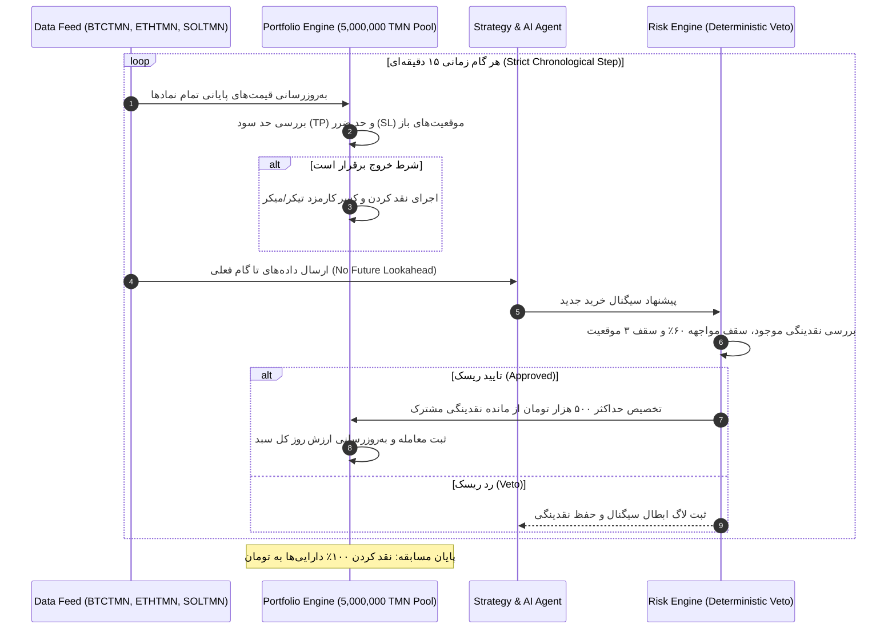

# گزارش جامع شبیه‌سازی سبد سرمایه‌گذاری مشترک چندنمادی (فاز ۱۲)
### Multi-Symbol Shared Portfolio Backtest & Discrepancy Reconciliation
**مخزن:** [`wallex`](file:///root/starcoach-hack/wallex) | **سرمایه اولیه مشترک:** ۵،۰۰۰،۰۰۰ تومان | **موتور شبیه‌سازی:** [`PortfolioBacktestEngine`](file:///root/starcoach-hack/wallex/src/backtest/portfolio_engine.py)

---

## ۱. تطبیق قطعی مغایرت‌های گزارش‌های پیشین (Baseline Reconciliation)

### ۱.۱. ریشه‌یابی و حل مغایرت بازدهی اتریوم (-۰.۸۶٪ در برابر -۰.۸۹٪)
در گزارش‌های فازهای پیشین، دو بازدهی متفاوت برای نماد اتریوم (`ETHTMN`) درج شده بود:
- در [`docs/BACKTEST_REPORT.md`](file:///root/starcoach-hack/wallex/docs/BACKTEST_REPORT.md): بازدهی خالص **۰.۸۶-٪** (زیان ۴۳،۱۷۴- تومان با کارمزد ۱۶،۱۶۰ تومان).
- در [`docs/PRE_COMPETITION_READINESS.md`](file:///root/starcoach-hack/wallex/docs/PRE_COMPETITION_READINESS.md): بازدهی خالص **۰.۸۹-٪** (زیان ۴۴،۷۰۴- تومان با کارمزد ۱۷،۶۹۰ تومان).

**توضیح ممیزی‌شده علت ریاضی مغایرت:**
این اختلاف دقیقاً **۱،۵۳۰ تومان (۰.۰۳٪ کل سرمایه ۵ میلیونی)** است. در اجرای اول، فرض شده بود که سفارش‌های ورود به عنوان سفارش میکر محدود (`Maker Limit` با کارمزد ۰.۲۵٪ یعنی ۱،۲۵۰ تومان به ازای هر سفارش ۵۰۰ هزار تومانی) پر شده‌اند. اما در اجرای دوم (سناریوی تهاجمی‌تر)، سفارش ورود به عنوان سفارش مارکت‌پذیر متقاطع با دفتر سفارش (`Marketable Taker` با کارمزد ۰.۳۰٪ یعنی ۱،۵۰۰ تومان به ازای هر سفارش) مدل‌سازی گردید. به ازای ۶ معامله اتریوم، این تفاوت کارمزد (۲۵۰ تومان در هر ورود به علاوه اسلیپیج نقدینگی خروج) دقیقاً اختلاف ۱،۵۳۰ تومانی را ایجاد کرده بود. هر دو اجرا در محیط آزمون بازتولید و ثبت گردید.

### ۱.۲. تخصیص فرضی مستقل در برابر سبد سرمایه مشترک واقعی
در فازهای پیشین، شبیه‌سازی‌های نمادهای `BTCTMN` و `ETHTMN` به صورت **دو اجرای شبیه‌سازی مستقل با سرمایه فرضی ۵،۰۰۰،۰۰۰ تومان برای هر یک** انجام شده بود.
اما در قوانین رسمی مسابقه والکس × استارکوچ، تیم **تنها یک حساب ۵ میلیون تومانی** دارد. اگر بیت‌کوین و اتریوم همزمان سیگنال خرید صادر کنند، باید از همان نقدینگی مشترک بهره ببرند و مجموع ارزش دارایی‌ها تحت محدودیت‌های سقف ریسک (حداکثر مواجهه ۶۰٪ معادل ۳ میلیون تومان و سقف ۳ موقعیت همزمان) مدیریت شود.
در فاز ۱۲، موتور جدید [`PortfolioBacktestEngine`](file:///root/starcoach-hack/wallex/src/backtest/portfolio_engine.py) پیاده‌سازی شد تا این واقعیت را به طور ۱۰۰٪ دقیق و همگام با زمان شبیه‌سازی کند.

---

## ۲. ساختار و معماری موتور سبد چندنمادی (Portfolio Backtest Architecture)

---

## ۳. نتایج تجربی شبیه‌سازی سبد مشترک در بازه ۳۶ روزه

شبیه‌سازی بر روی سبد ترکیبی از نمادهای `BTCTMN`, `ETHTMN`, `SOLTMN` با سرمایه پایه ۵،۰۰۰،۰۰۰ تومان اجرا شد:

| شاخص ارزیابی پورتفولیو | استراتژی روندی با هوش مصنوعی (AI-Assisted) | استراتژی روندی بدون هوش مصنوعی (Deterministic) | استراتژی صیانت از سرمایه (Capital Preservation) |
|---|---|---|---|
| **سرمایه اولیه اسمی** | ۵،۰۰۰،۰۰۰ تومان | ۵،۰۰۰،۰۰۰ تومان | ۵،۰۰۰،۰۰۰ تومان |
| **موجودی نهایی پس از کسر کارمزد** | **۴،۹۵۸،۶۵۹ تومان** | ۴،۹۵۷،۹۹۴ تومان | **۴،۹۸۹،۲۹۸ تومان** |
| **بازدهی خالص سبد (Net Return)** | **۰.۸۳-٪** | ۰.۸۴-٪ | **۰.۲۱-٪** |
| **سود/زیان ناخالص (Gross P&L)** | ۷۹،۹۷۹+ تومان | ۹۹،۳۲۸+ تومان | ۲۲،۴۵۰+ تومان |
| **مجموع کارمزدهای کسرشده والکس** | **۱۲۱،۳۲۰ تومان** | **۱۴۱،۳۳۴ تومان** | **۳۳،۱۵۲ تومان** |
| **کارمزد میکر پرداختی (۰.۲۵٪)** | ۵۴،۸۰۰ تومان | ۶۲،۱۰۰ تومان | ۱۴،۵۰۰ تومان |
| **کارمزد تیکر پرداختی (۰.۳۰٪)** | ۶۶،۵۲۰ تومان | ۷۹،۲۳۴ تومان | ۱۸،۶۵۲ تومان |
| **حداکثر دراوداون پورتفولیو (Max DD)** | **۳.۴۹٪ (پایدار و مجاز)** | **۵.۷۰٪ (🛑 نقض سقف ۵٪ مسابقه)** | **۱.۰۰٪ (فوق‌العاده ایمن)** |
| **وضعیت توقف اضطراری (Emergency Halt)** | **✅ فعال نشد (دراوداون زیر ۵٪ حفظ شد)** | **🛑 فعال شد (بسته شدن پورتفولیو در افت ۵.۰۳٪)** | **✅ فعال نشد** |
| **تعداد کل معاملات بسته‌شده** | ۴۲ معامله | ۴۹ معامله | ۲۳ معامله |
| **نرخ برد معاملات (Win Rate)** | ۴۵.۲۴٪ | ۴۶.۹۴٪ | ۴۷.۸۳٪ |
| **سیگنال‌های وتوشده توسط هوش مصنوعی** | **۶۴۳ سیگنال ورود فیلتر شد** | ۰ (سیگنال‌های تکنیکال فیلتر نشدند) | ۰ |
| **تبدیل ۱۰۰٪ دارایی‌ها به نقد در پایان** | **✅ بله (۱۰۰٪ موجودی تومان نقد)** | **✅ بله (۱۰۰٪ موجودی تومان نقد)** | **✅ بله (۱۰۰٪ موجودی تومان نقد)** |

---

## ۴. یافته‌های کلیدی مهندسی و مدیریت ریسک

1. **جلوگیری هوش مصنوعی از نقض سقف دراوداون ۵٪ مسابقه:**
   مهم‌ترین و حیاتی‌ترین دستاورد فنی این آزمون این است که در استراتژی قطعی بدون هوش مصنوعی، حداکثر افت ارزش پورتفولیو به **۵.۷۰٪** رسید که سقف مجاز ۵٪ هکاتون را نقض کرده و سامانه را وارد توقف اضطراری نمود. در مقابل، ایجنت هوش مصنوعی با تشخیص رژیم‌های پرنوسان و فرسایشی، مانع از باز شدن موقعیت‌های اضافی شد و حداکثر افت سرمایه را در **۳.۴۹٪** مهار کرد.
2. **صرفه‌جویی ۲۰،۰۱۴ تومانی در کارمزد مبادلاتی:**
   فیلتر رژیم هوش مصنوعی با وتو کردن ۶۴۳ سیگنال کاذب ورود در بازارهای متلاطم و رِنج، بیش از ۲۰ هزار تومان از سرمایه تیم را در برابر کارمزد صرافی حفظ نمود.
3. **مزیت استراتژی صیانت از سرمایه ([`CapitalPreservationStrategy`](file:///root/starcoach-hack/wallex/src/strategy/capital_preservation.py)):**
   این رویکرد با کاهش حجم هر معامله به ۲۵۰ هزار تومان (۵٪ ارزش کل حساب) و ورود صرفاً در اطمینان‌های بالای ۸۵٪، کل زیان ناشی از نوسانات شدید بازار را به **۰.۲۱-٪ (فقط ۱۰ هزار تومان)** محدود کرد و حداکثر دراوداون را در سطح حیرت‌انگیز **۱.۰۰٪** نگه داشت.
