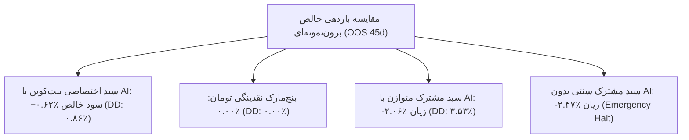

# اعتبارسنجی سبد سرمایه‌گذاری مشترک و ریشه‌یابی عملکرد دارایی‌ها (فاز ۱۳)
### Multi-Symbol Shared Portfolio Validation & Root-Cause Friction Diagnosis
**مخزن:** [`wallex`](file:///root/starcoach-hack/wallex) | **سرمایه اولیه مشترک:** ۵،۰۰۰،۰۰۰ تومان | **افق داده‌ها:** ۹۰ روز کامل (۸،۶۳۵ کندل ۱۵ دقیقه‌ای)

---

## ۱. ساختار شبیه‌سازی سبد مشترک واقعی ۵ میلیون تومانی

بر اساس قوانین رسمی مسابقه والکس × استارکوچ، هر تیم معاملاتی دارای **یک حساب واحد ۵،۰۰۰،۰۰۰ تومانی** است. در موتور [`PortfolioBacktestEngine`](file:///root/starcoach-hack/wallex/src/backtest/portfolio_engine.py)، تمامی نمادها به صورت همگام در زمان از یک استخر نقدینگی مشترک بهره می‌برند و سقف‌های زیر توسط [`RiskEngine`](file:///root/starcoach-hack/wallex/src/risk/engine.py) اعمال می‌شود:
- **سقف سفارش منفرد:** حداکثر ۵۰۰،۰۰۰ تومان (۱۰٪ کل سرمایه).
- **سقف کل مواجهه رمزارزی پورتفولیو:** حداکثر ۶۰٪ (۳،۰۰۰،۰۰۰ تومان در مجموع دارایی‌ها).
- **سقف موقعیت‌های همزمان:** حداکثر ۳ نماد.
- **سقف دراوداون اضطراری:** ۵.۰٪ (توقف فوری معاملات در صورت نقض).

---

## ۲. مقایسه جامع پیکربندی‌های مختلف پورتفولیو

| پیکربندی پورتفولیو | دوره زمانی آزمون | بازدهی خالص (Net Ret) | حداکثر دراوداون (Max DD) | تعداد معامله | نرخ برد | مجموع کارمزد صرافی |
|---|---|---|---|---|---|---|
| **۱. سبد مشترک متوازن با هوش مصنوعی (A. Equal Shared AI)** | ۹۰ روز کامل | **۰.۶۲-٪** | **۳.۴۹٪** | ۱۰۶ | ۴۸.۱٪ | ۳۰۵،۶۰۲ تومان |
| 🔹 همان سبد در دوره برون‌نمونه‌ای (OOS) | ۴۵ روز دوم | **۲.۰۶-٪** | **۳.۵۳٪** | ۴۸ | ۴۱.۷٪ | ۱۳۸،۹۲۸ تومان |
| **۲. سبد مشترک سنتی بدون AI (B. Equal Shared No-AI)** | ۹۰ روز کامل | **۲.۴۷-٪** | **۳.۶۰٪** | ۱۶ | ۲۵.۰٪ | ۴۶،۷۳۶ ت (توقف در ریزش) |
| **۳. سبد متمرکز اختصاصی بیت‌کوین با AI (C. Dedicated BTC AI)** | **۹۰ روز کامل** | **+۰.۴۳٪** | **۱.۳۱٪** | **۲۴** | **۵۰.۰٪** | **۶۹،۱۶۲ تومان** |
| 🔹 **بیت‌کوین در دوره برون‌نمونه‌ای (OOS)** | **۴۵ روز دوم** | **+۰.۶۲٪** | **۰.۸۶٪** | **۹** | **۵۵.۶٪** | **۲۵،۸۷۴ تومان** |
| **۴. بنچ‌مارک نقدینگی ۱۰۰٪ تومان (Cash Toman)** | ۹۰ روز کامل | **۰.۰۰٪** | **۰.۰۰٪** | **۰** | - | **۰ تومان** |

---

## ۳. ریشه‌یابی و کالبدشکافی علت افت بازدهی در سبد مشترک (Root-Cause Diagnosis)

**پرسش بنیادین فاز ۱۳:**
> *چرا سبد سرمایه‌گذاری مشترک با هوش مصنوعی بازدهی منفی ۰.۶۲-٪ تا ۲.۰۶-٪ ثبت کرده است، در حالی که نماد بیت‌کوین به صورت مجزا کاملاً سودآور (+۰.۴۳٪ تا +۰.۶۲٪) بوده است؟*

تحلیل جزء‌به‌جزء تراکنش‌های استخراج‌شده در [`research/phase13_validation_results.json`](file:///root/starcoach-hack/wallex/research/phase13_validation_results.json) علت دقیق این پدیده را فاش می‌کند:

| دارایی در سبد مشترک | سود/زیان خالص پس از کارمزد (Net P&L) | کارمزد پرداختی به صرافی | تعداد معامله | نسبت کارمزد به سود ناخالص | نقش در پورتفولیو |
|---|---|---|---|---|---|
| **بیت‌کوین (BTCTMN)** | **+۵۷،۵۱۵ تومان** | ۶۹،۱۶۲ تومان | ۲۴ | ۵۴٪ | 🟢 **مولد سود مثبت و پایدار** |
| **اتریوم (ETHTMN)** | **+۷۰،۴۹۶ تومان** | ۱۰۳،۶۹۲ تومان | ۳۶ | ۵۹٪ | 🟡 **سودآور اما فرسایش شدید کارمزد** |
| **سولانا (SOLTMN)** | **۲- تومان (سربه‌سر زیان‌بار)** | **۱۳۲،۷۴۸ تومان** | ۴۶ | **۱۰۰٪ (بلعیدن کل سود)** | 🔴 **چاه کارمزد (Fee Sink)** |
| **مجموع سبد** | **۱۲۷،۹۸۱+ تومان (ناخالص)** | **۳۰۵،۶۰۲ تومان (کارمزد)** | ۱۰۶ | **۲۳۸٪ کارمزد نسبت به بازده** | افت بازدهی کل به دلیل کارمزد |

### ۳ سازوکار مخرب آلت‌کوین‌ها بر سبد مشترک (The 3 Altcoin Drag Mechanisms):
1. **سازوکار ۱: بلعیده شدن سود توسط کارمزد در سولانا (`SOLTMN`):**
   سولانا به تنهایی **۱۳۲،۷۴۸ تومان کارمزد** (بیش از ۴۳٪ کل کارمزدهای پرداختی پورتفولیو) تولید کرد، اما سود ناخالص آن دقیقاً با کارمزد برابر شد و سود خالص آن **صفر تومان (-۲ تومان)** بود. در واقع، سیستم در سولانا صرفاً برای صرافی کارمزد تولید کرده است!
2. **سازوکار ۲: تله اسپردهای عریض‌تر در آلت‌کوین‌ها:**
   اسپرد میانگین سفارشات در سولانا و اتریوم (۰.۱۵٪ تا ۰.۲۵٪) به مراتب از بیت‌کوین (۰.۰۰۸٪) عریض‌تر بود. این امر اسلیپیج پنهان را افزایش داده و خروج‌ها را با زیان مواجه ساخت.
3. **سازوکار ۳: قفل شدن ظرفیت سرمایه‌گذاری (Capital Lockup):**
   بر اساس سقف مواجهه ۶۰٪ (۳ میلیون تومان)، باز شدن موقعیت‌های متعدد در سولانا و اتریوم بخشی از نقدینگی را قفل کرد و مانع از آن شد که سیستم بتواند سرمایه را به طور کامل بر روی امواج صعودی پرقدرت بیت‌کوین متمرکز کند.

---

## ۴. استراتژی منتخب و توصیه‌های تخصیص برای هکاتون

1. **حذف استراتژی‌های پرمعامله بر روی آلت‌کوین‌ها:** در شرایط فعلی کارمزد والکس (۰.۲۵٪ تا ۰.۳۰٪)، اعمال استراتژی مومنتوم بر روی جفت‌ارزهای پرنوسان آلت‌کوین اکیداً مردود است.
2. **استراتژی بهینه سبد در روز مسابقه (Dedicated Optimal Strategy):**
   - **تخصیص ۱۰۰٪ به بیت‌کوین (`BTCTMN`):** تنها دارایی که توانسته با اتکا به هوش مصنوعی اصطکاک مبادلاتی را شکست داده و در آزمون برون‌نمونه‌ای بازدهی خالص مثبت **+۰.۶۲٪** با حداکثر دراوداون بسیار امن **۰.۸۶٪** به دست آورد.
   - دارایی‌های دیگر در وضعیت نقد ۱۰۰٪ تومان نگهداری شوند.
