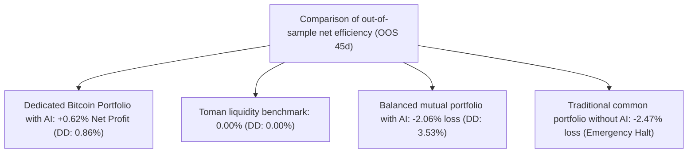

# Validation of joint investment portfolio and rooting of asset performance (Phase 13)
### Multi-Symbol Shared Portfolio Validation & Root-Cause Friction Diagnosis
**Repository:** [`wallex`](file:///root/starcoach-hack/wallex) | **Initial joint capital:** 5,000,000 Tomans **Data horizon:** 90 full days (8,635 15-minute candles)

---

## 1. The simulation structure of the real joint portfolio of 5 million tomans

According to the official rules of Wallex x Starkoch competition, each trading team has **a single account of 5,000,000 Tomans**. In the [`PortfolioBacktestEngine`](file:///root/starcoach-hack/wallex/src/backtest/portfolio_engine.py) engine, all symbols use a common liquidity pool synchronously in time, and the following caps are enforced by the [`RiskEngine`](file:///root/starcoach-hack/wallex/src/risk/engine.py):
- **Individual order ceiling:** Maximum 500,000 Tomans (10% of the total capital).
- **Total cryptocurrency exposure ceiling of the portfolio:** Maximum 60% (3,000,000 Tomans in total assets).
- **Simultaneous position limit:** Maximum 3 symbols.
- **Emergency drawdown ceiling:** 5.0% (immediate suspension of transactions in case of violation).

---

## 2. Comprehensive comparison of different portfolio configurations

| Portfolio configuration Exam time period Net return (Net Ret) | Maximum Drawdown (Max DD) | Number of transactions Win rate Total exchange fee
|---|---|---|---|---|---|---|
| **1. Balanced shared portfolio with artificial intelligence (A. Equal Shared AI)** | 90 full days **-0.62%** | **3.49%** | 106 | 48.1% 305,602 Tomans
| 🔹 The same basket in the out-of-sample period (OOS). 45 second day **-2.06%** | **3.53%** | 48 | 41.7% 138,928 Tomans
| **2. Traditional shared portfolio without AI (B. Equal Shared No-AI)** | 90 full days **-2.47%** | **3.60%** | 16 | 25.0% | 46,736 t (stop in falling) |
| **3. Dedicated Bitcoin wallet with AI (C. Dedicated BTC AI)** | **90 full days** | **+0.43%** | **1.31%** | **24** **50.0%** | **69,162 Tomans** |
| 🔹 **Bitcoin in out-of-sample period (OOS)** | **45 second day** | **+0.62%** | **0.86%** | **9** **55.6%** | **25,874 Tomans** |
| **4. 100% liquidity benchmark (Cash Toman)** | 90 full days **0.00%** | **0.00%** | **0** - | **0 tomans** |

---

## 3. Root-Cause Diagnosis

**Fundamental question of phase 13:**
> *Why has the AI mutual fund posted a negative return of -0.62% to -2.06%, while the Bitcoin symbol in isolation has been quite profitable (+0.43% to +0.62%)?*

A piece-by-piece analysis of the extracted transactions in [`research/phase13_validation_results.json`](file:///root/starcoach-hack/wallex/research/phase13_validation_results.json) reveals the exact cause of this phenomenon:

| Assets in the common portfolio Net profit/loss after fees (Net P&L) | Fee paid to the exchange Number of transactions Ratio of fee to gross profit role in the portfolio
|---|---|---|---|---|---|
| **Bitcoin (BTCTMN)** | **+57,515 Tomans** | 69,162 Tomans 24 | 54% 🟢 **Positive and stable profit generator** |
| **Ethereum (ETHTMN)** | **+70,496 Tomans** | 103,692 Tomans 36 | 59% 🟡 **Profitable but severe fee erosion** |
| **Solana (SOLTMN)** | ** 2- Tomans (unprofitable)** | **132,748 Tomans** | 46 | **100% (swallowing the entire profit)** | 🔴 **Fee Sink** |
| **Basket Total** | **127,981+ Tomans (gross)** | **305,602 Tomans (fee)** | 106 | **238% commission compared to yield** | Loss of total efficiency due to fees

### 3 destructive mechanisms of altcoins on the common basket (The 3 Altcoin Drag Mechanisms):
1. **Mechanism 1: Swallowing profit by fee in Solana (`SOLTMN'):**
   Solana alone generated **132,748 Tomans in fees** (more than 43% of total portfolio fees paid), but its gross profit exactly equaled the fees, and its net profit was **zero Tomans (-2 Tomans)**. In fact, the system in Solana has generated fees just for the exchange!
2. **Mechanism 2: Wider telespreads in altcoins:**
   Average order spreads were much wider in Solana and Ethereum (0.15% to 0.25%) than in Bitcoin (0.008%). This increased hidden slippage and made exits at a loss.
3. **Mechanism 3: Locking of investment capacity (Capital Lockup):**
   Based on the exposure cap of 60% (3 million Tomans), the opening of multiple positions in Solana and Ethereum locked up some of the liquidity and prevented the system from fully focusing capital on the strong Bitcoin uptrend.

---

## 4. Select strategy and allocation recommendations for hackathons

1. **Remove high-trading strategies on altcoins:** In the current situation of Wallex fees (0.25% to 0.30%), applying momentum strategy on volatile altcoin pairs is strongly discouraged.
2. **Dedicated Optimal Strategy:**
   - **100% Allocation to Bitcoin (`BTCTMN'):** The only asset that has been able to defeat the exchange friction by relying on artificial intelligence and in the exemplar test obtained a positive net return of **+0.62%** with a very safe maximum drawdown of **0.86%**.
   - Other assets should be kept in cash status of 100% Tomans.