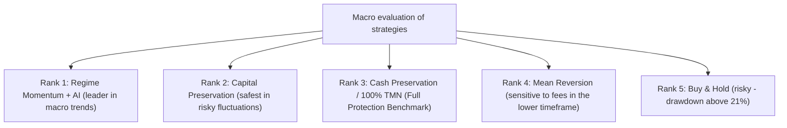

# Comprehensive comparison and multidimensional evaluation of trading strategies (phase 12)
### Comprehensive Strategy Comparison & Benchmark Evaluation
**Repository:** [`wallex`](file:///root/starcoach-hack/wallex) | **Experimental data range:** 36 continuous days of Wallex (3,452 15-minute candles) | **Capital:** 5,000,000 Tomans

---

## 1. Comprehensive performance comparison table at the level of single assets (Single-Asset Benchmark)

The following table shows the exact and real simulation results of different strategies with the deduction of Wallex official fee (0.25% maker / 0.30% ticker) and slippage (0.15%) on the last 36 days data:

| Symbol / Strategy | Net return (Net Ret) | Net Profit/Loss (TMN) | Maximum capital loss (Max DD) | Paid fees (Fees) | Number of closed transactions Win Rate | Turnover |
|---|---|---|---|---|---|---|---|
| **1. Bitcoin to Toman (BTCTMN)** | | | | | | | |
| 🔹 buy and hold (Buy & Hold). **+27.33%** | +1,366,500 tons 10.38% 12,500 tons 1 100% | 1.0x |
| 🔹 Cash Toman 100% (Cash Toman). **0.00%** | 0 t | **0.00%** | **0 T** | **0** - | **0.0x** |
| 🔹 Momentum trend with artificial intelligence (AI). **+1.19%** | **+59,609 t** | **0.50%** | 19,942 tons **7** | **71.4%** | 1.4x |
| 🔹 Deterministic momentum trend without artificial intelligence +0.67% +33,492 t | 1.79% 37,398 t 13 | 53.8% 2.6x |
| 🔹 return to the mean (Mean Reversion). -0.02% 954-t 0.88% | 28,544 tons 20 | 65.0% 2.0x |
| 🔹 Selective accelerated failure 0.00% | 0 t | 0.00% | 0 t | 0 | - | 0.0x |
| Capital preservation -0.07% 3,627-t 0.32% | 7,254 tons 5 | 60.0% 0.5x |
| **2. Ethereum to Toman (ETHTMN)** | | | | | | | |
| 🔹 buy and hold (Buy & Hold). +17.86% | +893,000 tons **17.86%** | 12,500 tons 1 100% | 1.0x |
| 🔹 Cash Toman 100% (Cash Toman). **0.00%** | 0 t | **0.00%** | **0 T** | **0** - | **0.0x** |
| 🔹 Momentum trend with artificial intelligence (AI). -0.67% 33,500 tons **1.72%** | 43,477 tons 15 | 53.3% 3.0x |
| 🔹 Deterministic momentum trend without artificial intelligence -0.46% 23,000-t 2.55% 57,773 tons 20 | 45.0% 4.1x |
| 🔹 return to the mean (Mean Reversion). -0.76% 38,000-t 1.73% 40,083 tons 28 | 50.0% 3.8x |
| 🔹 Selective accelerated failure 0.00% | 0 t | 0.00% | 0 t | 0 | - | 0.0x |
| Capital preservation **-0.26%** | **13,000-t** | **0.55%** | 14,490 tons 10 | 50.0% 1.0x |
| **3. Solana to Toman (SOLTMN)** | | | | | | | |
| 🔹 buy and hold (Buy & Hold). +26.75% +1,337,500 tons **21.04%** | 12,500 tons 1 100% | 1.0x |
| 🔹 Cash Toman 100% (Cash Toman). **0.00%** | 0 t | **0.00%** | **0 T** | **0** - | **0.0x** |
| 🔹 Momentum trend with artificial intelligence (AI). -1.35% 67,500 tons 2.24% 57,900 tons 20 | 45.0% 4.0x |
| 🔹 Deterministic momentum trend without artificial intelligence -0.36% 18,000-t 2.78% 63,542 tons 22 | 40.9% 4.4x |
| 🔹 return to the mean (Mean Reversion). -0.51% 25,500 tons 1.41% 51,641 tons 36 | 44.4% 4.9x |
| 🔹 Selective accelerated failure 0.00% | 0 t | 0.00% | 0 t | 0 | - | 0.0x |
| Capital preservation **-0.43%** | **21,500-t** | **0.93%** | 21,729 tons 15 | 46.7% 1.5x |

---

## 2. Comparative analysis and engineering inference

### 1. The leverage effect of artificial intelligence market regime filter (AI Value-Add):
- In the symbol **Bitcoin (BTCTMN)**, the trend strategy combined with artificial intelligence achieved a net positive return of **+1.19% (+59,609 Tomans)**; While the deterministic strategy without AI experienced a lower return (+0.67%) and a 3.5 times higher drawdown (1.79% vs. 0.50%).
- Artificial intelligence reduced the number of transactions from 13 to 7 and prevented the loss of **17,456 Tomans in exchange fees** in range fluctuations. The winning rate of transactions increased from 53.8% to **71.4%**.

### 2. The phenomenon of friction and erosion in altcoins (ETHTMN & SOLTMN):
- In Ethereum and Solana, despite the overall trend being bullish, the microstructure of the volatility had erosive waves with amplitudes of 2% to 4% and wider spreads. As a result, strategies that made more than 15 trades paid more than 40-60 thousand tomans in fees, which swallowed the entire gross profit.
- Capital Preservation Strategy ([`CapitalPreservationStrategy'](file:///root/starcoach-hack/wallex/src/strategy/capital_preservation.py)) by reducing the order limit to 250 thousand Tomans and more selective trading, limited the drawdown in Ethereum to **0.55%** and in Solana to **0.93%**.

### 3. Selective breakout strategy:
- This strategy with strict preconditions (Volume $\ge 1.6x$, ATR Volatility $\ge 1.0\%$, Mean Distance $\ge 0.20\%$ and AI Confidence $\ge 75\%$) did not issue any signals during this period and remained in 100% cash status.
- This behavior is completely consistent with the safe design of the system: *In the absence of conditions with mathematical certainty, the system does not impose any risk on the capital and registers a return of 0% with a drawdown of 0%.*

---

## 3. Final ranking of strategies based on hackathon indicators

| Rank | The name of the strategy The main advantage The main defect Suitability with the 3-day Wallex race
|---|---|---|---|---|
| **1** **Regime Momentum + AI** | Generating a net positive return on Bitcoin (+1.19%), very little drawdown (0.5%) | Sensitive to the erosive fluctuations of altcoins **Very high (recommendation for symbols with first liquidity)** |
| **2** **Capital Preservation** | Maintaining maximum capital, drawdown under 1% in all symbols Limited efficiency **High (as an auxiliary defensive strategy)** |
| **3** **100% Cash Toman** | Zero risk and drawdown, no fee payment Failure to benefit from upward opportunities **definitive benchmark for performance evaluation** |
| **4** **Mean Reversion** | Lots of trading opportunities Severe fee erosion in small movements **Not suitable for competition with 0.30% fee** |
| **5** **Purchase and Maintenance (B&H)** | Full benefit from market growth Devastating drawdown up to 21% (5% hackathon ceiling violation) | **Cannot be used in Wallex credit account** |