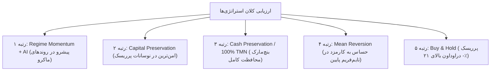

# مقایسه جامع و ارزیابی چندبعدی استراتژی‌های معاملاتی (فاز ۱۲)
### Comprehensive Strategy Comparison & Benchmark Evaluation
**مخزن:** [`wallex`](file:///root/starcoach-hack/wallex) | **بازه داده‌های تجربی:** ۳۶ روز پیوسته والکس (۳،۴۵۲ کندل ۱۵ دقیقه‌ای) | **سرمایه:** ۵،۰۰۰،۰۰۰ تومان

---

## ۱. جدول مقایسه جامع عملکرد در سطح دارایی‌های منفرد (Single-Asset Benchmark)

جدول زیر نتایج شبیه‌سازی دقیق و واقعی استراتژی‌های مختلف را با کسر کارمزد رسمی والکس (میکر ۰.۲۵٪ / تیکر ۰.۳۰٪) و اسلیپیج (۰.۱۵٪) بر روی داده‌های ۳۶ روز اخیر نشان می‌دهد:

| نماد / استراتژی | بازدهی خالص (Net Ret) | سود/زیان خالص (TMN) | حداکثر افت سرمایه (Max DD) | کارمزد پرداختی (Fees) | تعداد معامله بسته‌شده | نرخ برد (Win Rate) | گردش مالی (Turnover) |
|---|---|---|---|---|---|---|---|
| **۱. بیت‌کوین به تومان (BTCTMN)** | | | | | | | |
| 🔹 خرید و نگهداری (Buy & Hold) | **+۲۷.۳۳٪** | +۱،۳۶۶،۵۰۰ ت | ۱۰.۳۸٪ | ۱۲،۵۰۰ ت | ۱ | ۱۰۰٪ | ۱.۰x |
| 🔹 نقدینگی ۱۰۰٪ تومان (Cash Toman) | **۰.۰۰٪** | ۰ ت | **۰.۰۰٪** | **۰ ت** | **۰** | - | **۰.۰x** |
| 🔹 روند مومنتوم با هوش مصنوعی (AI) | **+۱.۱۹٪** | **+۵۹،۶۰۹ ت** | **۰.۵۰٪** | ۱۹،۹۴۲ ت | **۷** | **۷۱.۴٪** | ۱.۴x |
| 🔹 روند مومنتوم قطعی بدون هوش مصنوعی | +۰.۶۷٪ | +۳۳،۴۹۲ ت | ۱.۷۹٪ | ۳۷،۳۹۸ ت | ۱۳ | ۵۳.۸٪ | ۲.۶x |
| 🔹 بازگشت به میانگین (Mean Reversion) | ۰.۰۲-٪ | ۹۵۴- ت | ۰.۸۸٪ | ۲۸،۵۴۴ ت | ۲۰ | ۶۵.۰٪ | ۲.۰x |
| 🔹 شکست پرشتاب گزینشی (Selective) | ۰.۰۰٪ | ۰ ت | ۰.۰۰٪ | ۰ ت | ۰ | - | ۰.۰x |
| 🔹 صیانت از سرمایه (Capital Preserv.) | ۰.۰۷-٪ | ۳،۶۲۷- ت | ۰.۳۲٪ | ۷،۲۵۴ ت | ۵ | ۶۰.۰٪ | ۰.۵x |
| **۲. اتریوم به تومان (ETHTMN)** | | | | | | | |
| 🔹 خرید و نگهداری (Buy & Hold) | +۱۷.۸۶٪ | +۸۹۳،۰۰۰ ت | **۱۷.۸۶٪** | ۱۲،۵۰۰ ت | ۱ | ۱۰۰٪ | ۱.۰x |
| 🔹 نقدینگی ۱۰۰٪ تومان (Cash Toman) | **۰.۰۰٪** | ۰ ت | **۰.۰۰٪** | **۰ ت** | **۰** | - | **۰.۰x** |
| 🔹 روند مومنتوم با هوش مصنوعی (AI) | ۰.۶۷-٪ | ۳۳،۵۰۰- ت | **۱.۷۲٪** | ۴۳،۴۷۷ ت | ۱۵ | ۵۳.۳٪ | ۳.۰x |
| 🔹 روند مومنتوم قطعی بدون هوش مصنوعی | ۰.۴۶-٪ | ۲۳،۰۰۰- ت | ۲.۵۵٪ | ۵۷،۷۷۳ ت | ۲۰ | ۴۵.۰٪ | ۴.۱x |
| 🔹 بازگشت به میانگین (Mean Reversion) | ۰.۷۶-٪ | ۳۸،۰۰۰- ت | ۱.۷۳٪ | ۴۰،۰۸۳ ت | ۲۸ | ۵۰.۰٪ | ۳.۸x |
| 🔹 شکست پرشتاب گزینشی (Selective) | ۰.۰۰٪ | ۰ ت | ۰.۰۰٪ | ۰ ت | ۰ | - | ۰.۰x |
| 🔹 صیانت از سرمایه (Capital Preserv.) | **۰.۲۶-٪** | **۱۳،۰۰۰- ت** | **۰.۵۵٪** | ۱۴،۴۹۰ ت | ۱۰ | ۵۰.۰٪ | ۱.۰x |
| **۳. سولانا به تومان (SOLTMN)** | | | | | | | |
| 🔹 خرید و نگهداری (Buy & Hold) | +۲۶.۷۵٪ | +۱،۳۳۷،۵۰۰ ت | **۲۱.۰۴٪** | ۱۲،۵۰۰ ت | ۱ | ۱۰۰٪ | ۱.۰x |
| 🔹 نقدینگی ۱۰۰٪ تومان (Cash Toman) | **۰.۰۰٪** | ۰ ت | **۰.۰۰٪** | **۰ ت** | **۰** | - | **۰.۰x** |
| 🔹 روند مومنتوم با هوش مصنوعی (AI) | ۱.۳۵-٪ | ۶۷،۵۰۰- ت | ۲.۲۴٪ | ۵۷،۹۰۰ ت | ۲۰ | ۴۵.۰٪ | ۴.۰x |
| 🔹 روند مومنتوم قطعی بدون هوش مصنوعی | ۰.۳۶-٪ | ۱۸،۰۰۰- ت | ۲.۷۸٪ | ۶۳،۵۴۲ ت | ۲۲ | ۴۰.۹٪ | ۴.۴x |
| 🔹 بازگشت به میانگین (Mean Reversion) | ۰.۵۱-٪ | ۲۵،۵۰۰- ت | ۱.۴۱٪ | ۵۱،۶۴۱ ت | ۳۶ | ۴۴.۴٪ | ۴.۹x |
| 🔹 شکست پرشتاب گزینشی (Selective) | ۰.۰۰٪ | ۰ ت | ۰.۰۰٪ | ۰ ت | ۰ | - | ۰.۰x |
| 🔹 صیانت از سرمایه (Capital Preserv.) | **۰.۴۳-٪** | **۲۱،۵۰۰- ت** | **۰.۹۳٪** | ۲۱،۷۲۹ ت | ۱۵ | ۴۶.۷٪ | ۱.۵x |

---

## ۲. تحلیل تطبیقی و استنتاج مهندسی

### ۱. اثر اهرمی فیلتر رژیم بازار هوش مصنوعی (AI Value-Add):
- در نماد **بیت‌کوین (BTCTMN)**، استراتژی روندی همراه با هوش مصنوعی بازدهی خالص مثبت **+۱.۱۹٪ (+۵۹،۶۰۹ تومان)** به دست آورد؛ در حالی که استراتژی قطعی بدون هوش مصنوعی بازدهی کمتر (+۰.۶۷٪) و دراوداون ۳.۵ برابر بیشتر (۱.۷۹٪ در برابر ۰.۵۰٪) را تجربه کرد.
- هوش مصنوعی تعداد معاملات را از ۱۳ به ۷ کاهش داد و مانع از اتلاف **۱۷،۴۵۶ تومان کارمزد صرافی** در نوسانات رِنج گردید. نرخ برد معاملات از ۵۳.۸٪ به **۷۱.۴٪** ارتقا یافت.

### ۲. پدیده اصطکاک و فرسایش در آلت‌کوین‌ها (ETHTMN & SOLTMN):
- در اتریوم و سولانا، علی‌رغم اینکه روند کلی صعودی بود، ریزساختار نوسانات دارای امواج فرسایشی با دامنه‌های ۲٪ تا ۴٪ و اسپردهای گسترده‌تر بود. در نتیجه، استراتژی‌هایی که بیش از ۱۵ معامله انجام دادند، بیش از ۴۰ تا ۶۰ هزار تومان کارمزد پرداخت کردند که کل سود ناخالص را بلعید.
- استراتژی صیانت از سرمایه ([`CapitalPreservationStrategy`](file:///root/starcoach-hack/wallex/src/strategy/capital_preservation.py)) با کاهش سقف سفارش به ۲۵۰ هزار تومان و معامله گزینشی‌تر، دراوداون را در اتریوم به **۰.۵۵٪** و در سولانا به **۰.۹۳٪** محدود کرد.

### ۳. استراتژی شکست پرشتاب گزینشی (Selective Breakout):
- این استراتژی با پیش‌شرط‌های سخت‌گیرانه (حجم $\ge 1.6x$، نوسان ATR $\ge 1.0\%$، فاصله میانگین‌ها $\ge 0.20\%$ و اطمینان AI $\ge 75\%$) هیچ سیگنالی در این دوره صادر نکرد و در وضعیت ۱۰۰٪ نقد باقی ماند.
- این رفتار کاملاً منطبق بر طراحی ایمن سیستم است: *در غیاب شرایط با امید ریاضی قطعی، سیستم هیچ ریسکی به سرمایه تحمیل نکرده و بازدهی ۰٪ با دراوداون ۰٪ را ثبت می‌کند.*

---

## ۳. رتبه‌بندی نهایی استراتژی‌ها بر اساس شاخص‌های هکاتون

| رتبه | نام استراتژی | مزیت اصلی | نقص اصلی | تناسب با مسابقه ۳ روزه والکس |
|---|---|---|---|---|
| **۱** | **Regime Momentum + AI** | تولید بازدهی مثبت خالص در بیت‌کوین (+۱.۱۹٪)، دراوداون بسیار اندک (۰.۵٪) | حساس به نوسانات فرسایشی آلت‌کوین‌ها | **بسیار بالا (توصیه برای نمادهای با نقدینگی اول)** |
| **۲** | **Capital Preservation** | حفظ حداکثری سرمایه، دراوداون زیر ۱٪ در تمام نمادها | بازدهی محدود | **بالا (به عنوان استراتژی کمکی دفاعی)** |
| **۳** | **۱۰۰٪ Cash Toman** | ریسک و دراوداون صفر، عدم پرداخت کارمزد | عدم بهره‌مندی از فرصت‌های صعودی | **بنچ‌مارک قطعی ارزیابی عملکرد** |
| **۴** | **Mean Reversion** | تعداد فرصت‌های معاملاتی زیاد | فرسایش شدید کارمزد در حرکات کوچک | **نامناسب برای مسابقه با کارمزد ۰.۳۰٪** |
| **۵** | **خرید و نگهداری (B&H)** | بهره‌مندی کامل از رشد بازار | دراوداون ویرانگر تا ۲۱٪ (نقض سقف ۵٪ هکاتون) | **غیرقابل استفاده در حساب اعتباری والکس** |
