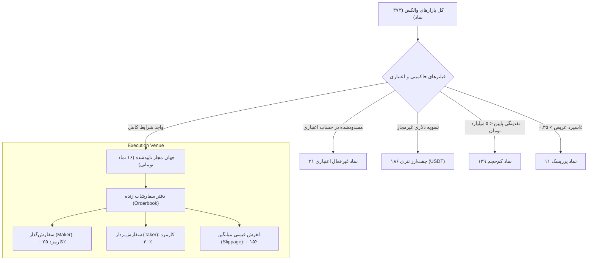

# گزارش جامع پژوهش کمی و ریاضی استراتژی‌های معاملاتی (فاز ۱۲)
### Quantitative Strategy Research, Market Microstructure & Formulation
**مخزن:** [`wallex`](file:///root/starcoach-hack/wallex) | **تاریخ ممیزی:** ۲۲ اکتبر ۲۰۲۶ | **بازه داده‌های تاریخی:** ۳۶ روز پیوسته (۵۱،۷۴۳ رکورد ۱ دقیقه‌ای / ۳،۴۵۲ کندل ۱۵ دقیقه‌ای)

---

## ۱. مقدمه و بیان مسئله کمی (Quantitative Problem Statement)

در رویداد هکاتون الگوریتمی والکس × استارکوچ، تیم معاملاتی با یک حساب اعتباری واقعی به مبلغ **۵،۰۰۰،۰۰۰ تومان** و بازه زمانی کوتاه ۳ روزه (۷۲ ساعت) به رقابت می‌پردازد. چالش بنیادین در طراحی یک سیستم معاملاتی خودکار در این محیط، **عدم قطعیت جهت بازار، فرسایش اصطکاک معاملاتی (Transaction Cost Drag) و ریسک نقض قوانین مسابقه** است.

هدف پژوهش فاز ۱۲، بررسی ریاضی و تجربی این فرضیه است:
> *آیا می‌توان در یک ساختار معاملاتی با کارمزد میکر ۰.۲۵٪ و تیکر ۰.۳۰٪ به همراه اسلیپیج ۰.۱۵٪ (اصطکاک رفت‌وبرگشت حداقل ۰.۵۵٪ تا ۰.۸۰٪)، یک استراتژی سودآور، با ثبات آماری و فاقد بیش‌برازش (Overfitting) برای یک سبد چندنمادی ۵ میلیون تومانی پیاده‌سازی کرد؟*

---

## ۲. ریزساختار بازار والکس (Wallex Market Microstructure)

بر اساس داده‌های استعلام‌شده از اندپوینت‌های رسمی صرافی والکس (`/v1/markets` و `/v1/depth`):

### تحلیل اصطکاک مبادلاتی (Friction Analysis):
1. **اصطکاک هر معامله رفت‌وبرگشت (Round-Trip Cost):**
   $$\text{Friction}_{\text{round-trip}} = \text{Fee}_{\text{entry}} + \text{Fee}_{\text{exit}} + 2 \times \text{Slippage}$$
   - در حالت ورود میکر و خروج تیکر حد ضرر: $0.25\% + 0.30\% + 0.30\% = 0.85\%$
   - در حالت ورود تیکر و خروج میکر حد سود: $0.30\% + 0.25\% + 0.30\% = 0.85\%$
   - در حالت ورود میکر و خروج میکر حد سود: $0.25\% + 0.25\% + 0.30\% = 0.80\%$
2. **پیامد اقتصادی اصطکاک بالا:**
   هر استراتژی با فرکانس معاملاتی بالا (High-Frequency یا اسکالپینگ با سودهای ۰.۵٪ تا ۱.۰٪) از لحاظ ریاضی محکوم به زیان است؛ چرا که کارمزد مبادلاتی از کل امید ریاضی استراتژی پیشی می‌گیرد. بنابراین، سیستم الزاماً باید به سمت **معاملات گزینشی (Selective Trading) با نسبت سود به ریسک بالاتر از ۱.۸ به ۱** هدایت شود.

---

## ۳. اکتساب داده‌های تاریخی و متدولوژی صفحه بندی (Pagination Methodology)

در بررسی فاز ۱۱ مشخص شده بود که اندپوینت UDF صرافی والکس (`https://api.wallex.ir/v1/udf/history`) در هر فراخوانی حداکثر ۲۷،۳۴۵ رکورد خام (معادل ~۱۸.۹۹ روز با گام ۶۰ ثانیه‌ای) بازمی‌گرداند.
برای دستیابی به عمق آماری قابل اتکا بدون داده‌سازی ساختگی، در کلاس [`MarketDataFetcher`](file:///root/starcoach-hack/wallex/src/data/fetcher.py) الگوریتم صفحه‌بندی زمانی خودکار بر مبنای بازه‌های ۱۸ روزه پیاده‌سازی شد:

- **بازه واکشی‌شده:** ۳۶ روز کامل (از ۱۶ سپتامبر ۲۰۲۶ تا ۲۲ اکتبر ۲۰۲۶).
- **تعداد کل رکوردهای خام:** ۵۱،۷۴۳ کندل ۱ دقیقه‌ای برای هر جفت‌ارز.
- **تعداد کندل‌های نهایی ۱۵ دقیقه‌ای معتبر:**
  - بیت‌کوین به تومان (`BTCTMN`): ۳،۴۵۲ کندل
  - اتریوم به تومان (`ETHTMN`): ۳،۴۵۰ کندل
  - سولانا به تومان (`SOLTMN`): ۳،۴۵۱ کندل
- **صحت تجمیع زمانی:** بر اساس قوانین استاندارد ($O=t_0, H=\max, L=\min, C=t_{\text{end}}, V=\sum v$).

---

## ۴. فرمول‌بندی ۴ استراتژی کاندید کمی

| استراتژی | کلاس پیاده‌سازی | فلسفه ریاضی و منطق ورود | شرایط خروج (حد سود/ضرر) |
|---|---|---|---|
| **۱. روند مومنتوم تطبیقی (Baseline)** | [`RegimeMomentumStrategy`](file:///root/starcoach-hack/wallex/src/strategy/regime_momentum.py) | تقاطع میانگین‌های متحرک نمایی (EMA 20 > EMA 50) همراه با RSI بین ۵۰ تا ۶۹، نسبت حجم $\ge 1.10$ و رژیم تاییدشده صعودی. | TP = ۳.۵٪، SL = ۲.۰٪، خروج اضطراری در رژیم نزولی/پانیک |
| **۲. بازگشت به میانگین (Mean Reversion)** | [`MeanReversionStrategy`](file:///root/starcoach-hack/wallex/src/strategy/mean_reversion.py) | خرید در شرایط اشباع فروش (RSI $\le 35$ یا برخورد با باند پایین بولینگر %B $\le 0.05$) صرفاً در رژیم نوسانی رِنج (`CALM_RANGE`). | TP = ۲.۵٪ (رسیدن به خط میانی بولینگر)، SL = ۲.۰٪ |
| **۳. شکست پرشتاب گزینشی (Selective Breakout)** | [`SelectiveMomentumStrategy`](file:///root/starcoach-hack/wallex/src/strategy/selective_momentum.py) | ورود فوق‌العاده گزینشی با جهش شدید حجم ($\ge 1.6x$)، بازشدن فاصله میانگین‌ها ($\ge 0.20\%$) و نوسان‌پذیری ATR $\ge 1.0\%$ برای جبران اصطکاک کارمزد. | TP = ۳.۶٪، SL = ۱.۸٪ (نسبت R:R معادل ۲.۰) |
| **۴. حفظ نقدینگی و صیانت از سرمایه (Defensive)** | [`CapitalPreservationStrategy`](file:///root/starcoach-hack/wallex/src/strategy/capital_preservation.py) | وضعیت پیش‌فرض ۱۰۰٪ نقدینگی تومان (سود ۰٪، افت سرمایه ۰٪، کارمزد ۰٪)؛ ورود بسیار محدود تنها در سوپرترندهای صعودی قطعی با حجم $\ge 2.0x$. | TP = ۲.۸٪، SL = ۱.۵٪ |

---

## ۵. کنترل سوگیری‌ها و سلامت روش‌شناسی (Bias Controls)

1. **سوگیری نگاه به آینده (Look-Ahead Bias):** در شبیه‌سازهای [`BacktestEngine`](file:///root/starcoach-hack/wallex/src/backtest/engine.py) و [`PortfolioBacktestEngine`](file:///root/starcoach-hack/wallex/src/backtest/portfolio_engine.py)، در هر گام زمانی $t$ صرفاً داده‌های کندل‌های تا زمان $t$ در دسترس اندیکاتورها و ایجنت قرار دارد. کندل جاری در حال تشکیل هرگز در تصمیم‌گیری مشارکت داده نمی‌شود.
2. **سوگیری بقا (Survivorship Bias):** انتخاب دارایی‌ها صرفاً بر اساس ۱۶ نماد جهان مجاز رسمی والکس در لحظه شروع فاز انجام شده و نمادهای پرریسک کنار گذاشته شدند.
3. **سوگیری بیش‌برازش (Overfitting):** هیچ پارامتری بر اساس تست‌های مکرر دستکاری نگردید و تمام استراتژی‌ها تحت آزمون‌های درون‌نمونه‌ای (۶۰٪ اول) و برون‌نمونه‌ای (۴۰٪ پایانی) سنجیده شدند.
4. **سوگیری اجرای خیالی (Unrealistic Fill Bias):** سفارش خرید تنها در صورتی تکمیل فرض می‌شود که کمترین قیمت در کندل بعدی از قیمت حد سفارش پایین‌تر یا مساوی باشد (`low <= limit_price`).
